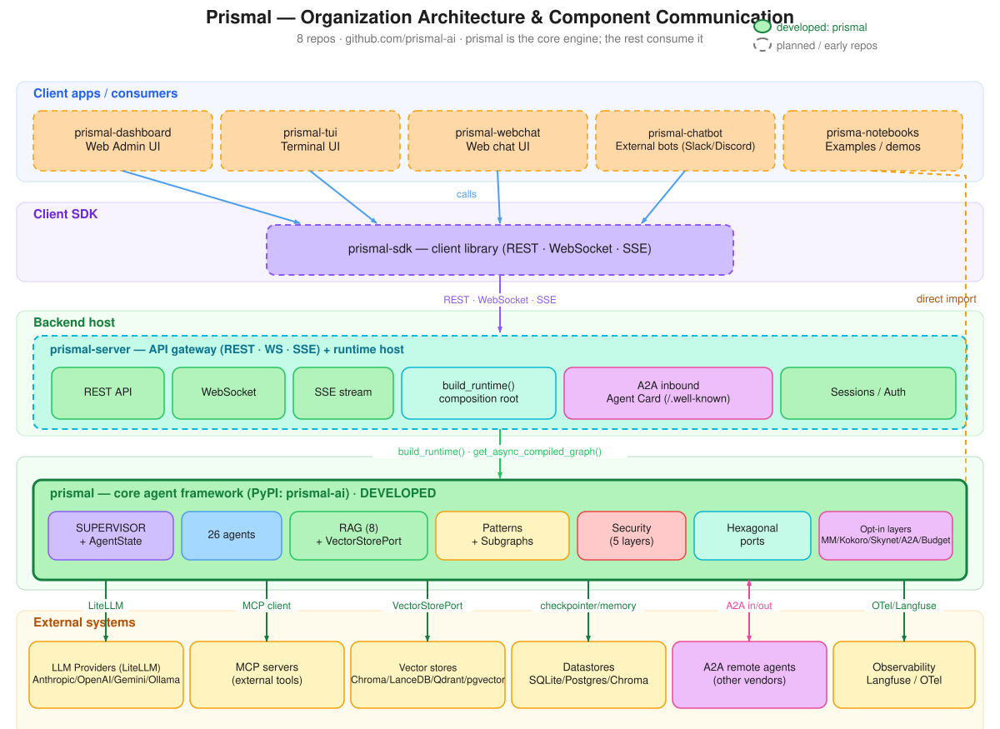
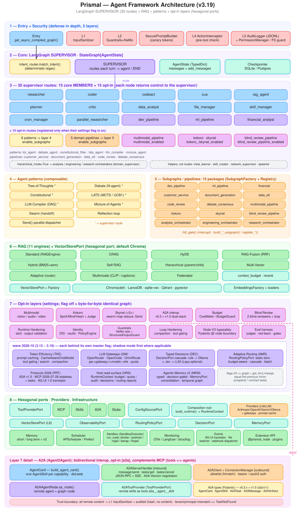

# prismal-ai

[](https://pypi.org/project/prismal-ai/)
[](https://www.python.org/downloads/)
[](https://opensource.org/licenses/MIT)

**Prismal AI Agent Framework** — the core engine powering multi-agent orchestration, security guardrails, RAG, MCP integration, and observability.

This package is the **agent framework layer** extracted from the larger monorepo as a standalone, publishable PyPI package. It provides everything needed to build and run AI agents without the web server, dashboard, or CLI. It was published as `lightagent-agents` through v2.x and **rebranded in v3.0.0**: the distribution is published on PyPI as `prismal-ai` while the import namespace is `prismal` (`lightagent.*` → `prismal.*`). End-user backward compatibility is provided by the deprecated `lightagent-agents` distribution, which now depends on `prismal-ai`. The sibling `lightagent` app package historically shared this import namespace and is rebranded/coordinated in tandem.

---

## Project architecture (organization)

Prismal is split across **eight repositories** in the [`prismal-ai`](https://github.com/orgs/prismal-ai/repositories) organization. `prismal` (this repo) is the **core engine** and the only one currently developed; everything else is a consumer or host that builds on top of it.



The macro architecture is a layered, client–server design where a single engine does the agent work and every other component talks to it through well-defined protocols:

- **`prismal`** — the core agent framework (published to PyPI as `prismal-ai`). It owns the LangGraph SUPERVISOR graph (30 supervisor routes: 15 core + 15 opt-in), the 11 RAG engines + `VectorStorePort`, the reasoning patterns and 15 subgraph packages, the 5-layer security stack, the hexagonal ports, and the opt-in layers (Multimodal, Kokoro, Skynet, A2A, Budget, Token Efficiency, Gateways, Decisions, Adaptive Routing, Protocols 2026, Memory v2). Its full internal architecture is in [Architecture](#architecture) below.
- **`prismal-server`** — the backend host. It composes the engine via `build_runtime()` / `get_async_compiled_graph()` and exposes it over **REST, WebSocket, and SSE**, plus inbound A2A (the Agent Card at `/.well-known/agent-card.json`) and session/auth handling. This is the one process that turns the library into a service.
- **`prismal-sdk`** — the client library that wraps the server's REST/WS/SSE endpoints so consumers don't hand-roll HTTP.
- **`prismal-dashboard`, `prismal-tui`, `prismal-webchat`, `prismal-chatbot`** — the consumer front-ends (web admin, terminal, web chat, and external bots such as Slack/Discord). They all reach the engine through the SDK → server path.
- **`prisma-notebooks`** — example and demo notebooks that import the `prismal` package directly rather than going through the server.

Communication flows top-to-bottom: front-ends call the **SDK**, the SDK speaks **REST/WebSocket/SSE** to **`prismal-server`**, and the server invokes the **`prismal`** engine in-process. The engine, in turn, reaches **external systems** — LLM providers through LiteLLM, MCP servers for tools, vector stores via `VectorStorePort`, datastores (SQLite/Postgres/Chroma) for checkpoints and memory, observability through OpenTelemetry/Langfuse, and other vendors' agents bidirectionally over A2A (outbound from the engine, inbound served by the server). In the diagram, the solid green block marks the developed core, while dashed outlines mark the planned/early-stage repositories.

---

## Features

- **30 supervisor routes** built on [LangGraph](https://langchain-ai.github.io/langgraph/) — 15 core routes (`researcher`, `coder`, `codeact`, `cua`, `rag_agent`, `planner`, `critic`, `data_analyst`, `file_manager`, `skill_manager`, `cron_manager`, `dev_pipeline`, `ml_pipeline`, `financial_analyst`, `parallel_researcher`) plus 15 opt-in routes (6 reasoning patterns, 5 domain pipelines, multimodal, Kokoro, Skynet, blind review) — see [`docs/agents.md`](./docs/agents.md)
- **SUPERVISOR state machine** — central supervisor routes each turn to the right specialist, then back to `END`
- **Security-first (5-layer defense)** — `InputSanitizer` → `GuardrailsEngine` (+ NeMo Guardrails L3) → `ActionInterceptor` → `AuditLogger` (hash-chained) + `SecurePromptBuilder` + `PermissionManager`
- **Provider-agnostic** — Anthropic Claude, OpenAI GPT, Google Gemini, Ollama via LiteLLM (isolated in `prismal/providers/`)
- **11 RAG engines** — standard, CRAG, HyDE, RAG-Fusion (RRF), Hybrid (BM25 + semantic), Self-RAG, Parent-Child hierarchical, Multi-Vector, Adaptive facade, Multimodal and Federated — see [`docs/rag.md`](./docs/rag.md)
- **7 agent reasoning patterns + 2 primitives** — Tree of Thoughts, Debate, Constitutional AI, LATS (MCTS), LLM-Compiler (parallel DAG), Mixture of Agents, Swarm/Handoff, plus `reflection_loop()` and `make_parallel_dispatcher()` — see [`docs/patterns.md`](./docs/patterns.md)
- **15 subgraph packages** — dev / ML / financial pipelines; Customer Service, Document Generation, Data ETL, Code Review, Debate/Consensus; multimodal, Kokoro, Skynet and blind-review pipelines; analysis / engineering / research orchestrators — see [`docs/subgraphs.md`](./docs/subgraphs.md)
- **Multimodal layer (implemented, opt-in)** — Vision / Audio / Video agents, modality router, multimodal fusion, multimodal subgraph, multimodal RAG engine with cross-modal embeddings, and `MediaValidator` security gate — gated by `settings.multimodal_enabled` (default `False`); see [`specs/multimodal-agents/`](./specs/multimodal-agents/)
- **Kokoro deliberation (implemented, opt-in)** — three Markdown-authored persona souls (spirit 魂 / mind 知 / heart 情) deliberate toward agreement and a `KokoroJudgeAgent` renders the final, accountable verdict (optionally executing one `ActionInterceptor`-gated action) — gated by `settings.kokoro_enabled` (default `False`); see [`docs/kokoro.md`](./docs/kokoro.md) and [`specs/kokoro-deliberation/`](./specs/kokoro-deliberation/)
- **Skynet swarm supervisor (implemented, opt-in)** — a meta-supervisor that decomposes one order into N sub-orders, dispatches a dynamically-sized worker swarm via LangGraph `Send` fan-out (supervisor-sized, hard-capped, overflow deferred), reduces the results, and re-plans unmet work in a bounded loop — gated by `settings.skynet_enabled` (default `False`); see [`docs/skynet.md`](./docs/skynet.md) and [`specs/skynet-swarm/`](./specs/skynet-swarm/). **Skynet S+** (opt-in) adds **heterogeneous specialist swarms** (a file-driven `RoleRegistry` binds each role to its own model / persona / tools), **truthfully-metered workers** (one shared `CostMeter` so `skynet_token_budget` bounds the whole swarm), and **remote workers** (a role bound to a remote A2A agent) — gated by `skynet_specialists_enabled` / `skynet_remote_workers_enabled`; see [`specs/skynet-swarm-plus/`](./specs/skynet-swarm-plus/)
- **Extension surface (implemented, opt-in)** — `prismal.langgraph` re-export, `@prismal_node` decorator (security/OTel/audit/retry middleware), `PrismalStateGraphBuilder` fluent API, plugin discovery via `importlib.metadata` entry points, `LangChainRunnableAdapter`, and formal `Protocol`s for ports (checkpoint/audit/embeddings/tools) — see [`docs/extension.md`](./docs/extension.md) and [`specs/extension-surface/`](./specs/extension-surface/)
- **MCP client with capability routing** — [Model Context Protocol](https://modelcontextprotocol.io) with auto-discovery and per-agent capability-based tool filtering (`config/mcp_servers.yaml`)
- **Sandboxed execution** — `SandboxExecutor` with docker/podman/nsjail/bwrap/firejail isolation backends for `run_code` (Python); shell commands (`run_command`) run as time-limited host subprocesses — see [`docs/sandbox.md`](./docs/sandbox.md)
- **Human-in-the-Loop** — `hitl_gate()` with LangGraph `interrupt()` support
- **Composable primitives** — `reflection_loop()` (generate → critique → refine) and `make_parallel_dispatcher()` (fan-out via `Send()`)
- **Cron engine** — APScheduler + timezone-aware `DateTimeService` (single time source of truth)
- **Long-term memory** — PII-sanitized cross-session store (SQLite + ChromaDB; optional MongoDB)
- **Observability** — Langfuse traces, OpenTelemetry spans, structlog
- **Deterministic intent routing** — regex-based `match_intent()` ahead of LLM supervision
- **Tool provider injection (implemented)** — `ToolProviderPort` hexagonal port: the host composes MCP/Skills/stub providers and injects them (`set_tool_provider` or per-session via graph config); the agent core no longer imports `prismal.mcp`/`prismal.skills` — see [`docs/tool-providers.md`](./docs/tool-providers.md) and [`specs/tool-provider-injection/`](./specs/tool-provider-injection/)
- **Runtime composition root (implemented)** — `build_runtime(settings, *, org_id=None)` composes every core port (tool provider, vector store, embeddings, checkpointer, audit) into a `RuntimeContext` in a single call, with `global`/`context` modes (`settings.runtime_mode`), per-`org_id` collection isolation, coordinated `aclose()`, and `build_test_runtime` fakes — the one composition contract `prismal-server`/`prismal-dashboard` build on; see [`docs/composition-root.md`](./docs/composition-root.md) and [`specs/composition-root/`](./specs/composition-root/)
- **Config source injection (implemented)** — `ConfigSourcePort` hexagonal port: the core stops reading `.env`/`os.environ` and consumes an injected source (`EnvConfigSource` default keeps byte-for-byte parity; `MappingConfigSource`/`ChainedConfigSource` compose secrets managers; per-tenant via `build_settings(source)`); `set_config_source` invalidates the `get_settings` cache, an AST guard forbids new config `os.getenv` in the core — see [`docs/configuration.md`](./docs/configuration.md) and [`specs/config-source-injection/`](./specs/config-source-injection/)
- **Cost & Budget Governance (implemented, opt-in)** — per-run/session/tenant token / cost(USD) / call / wall-clock budgets with **soft (degrade) / hard (abort)** circuit-breakers: a `CostMeter` accumulates real usage (priced via LiteLLM + a `budget_pricing` fallback table) and a `BudgetGuard` enforces it in `react_loop`, the expensive patterns (debate, ToT, LATS, MoA, reflection) and Skynet (unifying `skynet_token_budget`) — gated by `settings.budget_enabled` (default `False`); see [`docs/budget.md`](./docs/budget.md) and [`specs/cost-budget-governance/`](./specs/cost-budget-governance/)
- **Runtime Hardening (implemented, opt-in)** — defense-in-depth for the 2026 OWASP **LLM01/05/06/10** gaps: taint tracking of untrusted content, an `IndirectInjectionDetector` that scores tool/RAG/media results before re-injection, an `OutputValidator` (tool-arg schema + path/command/HTML escaping), an identity-agnostic `ToolPolicyEngine` (allow/deny/require-HITL/rate-limit via `config/tool_policies.yaml`), a `RunawayGuard` (step cap + stagnation), and PII-on-output — each with `off`/`warn`/`enforce` modes; gated by `settings.hardening_enabled` (default `False`, graph byte-for-byte unchanged when off); see [`docs/security/runtime-hardening.md`](./docs/security/runtime-hardening.md) and [`specs/runtime-hardening/`](./specs/runtime-hardening/)
- **Agent Evaluation & Reliability Harness (implemented)** — `prismal/eval/` runs eval-sets against the **real compiled graph** (closing the 2026 "scaffold gap"): `EvalRunner` over `astream` + `build_test_runtime` fakes, trajectory capture, composable assertions (exact/semantic/tool-usage/llm-judge/groundedness/security), LLM-as-judge, a regression gate, and an adversarial **red-team** suite proving security containment — the executable proof for Phase H. Fakes by default, `live_api` opt-in; `python -m prismal.eval` CLI. Imports only the public graph entry + ports (AST-guarded). See [`docs/eval.md`](./docs/eval.md) and [`specs/agent-eval-harness/`](./specs/agent-eval-harness/)
- **Agent Identity & Access Governance (implemented)** — `prismal/identity/` gives every agent a verifiable W3C **DID** (`did:key` offline + `did:web` for A2A), least-privilege **scoped credentials** from a pluggable vault (`EnvVault` via `ConfigSourcePort` / encrypted `FileVault` / `FakeVault`; secrets never reach state/logs), **OAuth on-behalf-of** delegation (scopes only narrow along the chain), and an identity-aware **`PolicyEngine`** that **delegates** `(agent, tool, args)` to the Phase H `ToolPolicyEngine`. Wired at the `ActionInterceptor` seam and composed per `org_id` in `build_runtime`. Opt-in: `identity_enabled` (graph byte-for-byte unchanged when off, snapshot-tested). See [`docs/identity.md`](./docs/identity.md) and [`specs/agent-identity-governance/`](./specs/agent-identity-governance/)
- **A2A (Agent2Agent) interop (implemented, opt-in)** — `prismal/a2a/` makes prismal a citizen of the multi-vendor agent ecosystem: **inbound**, an `A2AServerHandler` exposes the graph over JSON-RPC + SSE behind an Agent Card at `/.well-known/agent-card.json` (built from the capability registry, embeds the agent DID); **outbound**, `A2AClient`/`A2AAgentNode` delegate to remote agents as graph nodes and `A2AToolProvider` surfaces remote skills as tools (conforms to the Phase Y `ToolProviderPort`). Complements MCP (tools); every remote response is L1-sanitized + audited. Opt-in: `a2a_enabled` (default `False`, graph unchanged when off); `[a2a]` extra. See [`docs/a2a.md`](./docs/a2a.md) and [`specs/a2a-interop/`](./specs/a2a-interop/)
- **Guardrails Modernization (implemented, opt-in)** — closes the last gap in L3: `config/nemo_rails/` finally ships the config `NemoRailsLayer` always expected, plus a reasoning-capable safety-classifier custom action (`security/nemo_actions.py`, gated by `nemo_classifier_enabled`) with its own independent timeout budget, settings-driven main-LLM resolution via `providers/` (no hardcoded provider), and fail-open semantics. A new `StructuredOutputGuard` (`[guardrails-ai]` extra) adds bounded, Budget-metered automatic re-ask on schema violations and opt-in Guardrails Hub validators (PII/provenance/toxicity), composing with — never replacing — `OutputValidator`. Both flags default `False` (graph byte-for-byte unchanged when off). See [`docs/security/guardrails-modernization.md`](./docs/security/guardrails-modernization.md) and [`specs/guardrails-modernization/`](./specs/guardrails-modernization/)
- **Loop Hardening (implemented, opt-in)** — closes two agentic-loop mechanics gaps: `ContextCompactor` (`agents/context_compaction.py`, `context_compaction_enabled`) trims/summarizes `state["messages"]` via `RemoveMessage` once a message-count or Budget-token threshold is exceeded, keeping the most recent messages verbatim; seeded per-turn in `supervisor_node` and optionally in `react_loop(..., context_compactor=...)` for a single node's local tool loop. `resolve_phase()` (`agents/loop_phase.py`) derives a deterministic, LLM-free task phase from `task_plan`/`pending_tasks`/`completed_tasks`; `ToolProviderPort.get_tools()` gains an optional `phase` keyword and `CompositeToolProvider(phase_capability_map=...)` narrows the tool catalogue per phase (`tool_gating_enabled`), falling open on a non-conforming provider. Both flags default `False` (graph and tool-resolution output byte-for-byte unchanged when off). See [`docs/loop-hardening.md`](./docs/loop-hardening.md) and [`specs/loop-hardening/`](./specs/loop-hardening/)
- **Blind Review Pipeline (implemented, opt-in)** — a spec agent and an implementer produce an artifact that **two independent, blind reviewers** (no visibility into `state["messages"]`, only spec + artifact) assess before a **deterministic synthesis** (`synthesize_verdicts`: conservative `min` score + de-duplicated issue union + `agreement` flag) and a **bounded correction loop**, optionally HITL-gated. Blindness is enforced three ways — the narrow `(spec, artifact)` input contract, a CI-blocking AST guard, and the runtime `BlindnessGuard`. Each of the four roles gets its own LLM (`ProviderRegistry`) and tool scope (`ToolProviderPort`). Gated by `settings.blind_review_pipeline_enabled` (default `False`, graph byte-for-byte unchanged when off, snapshot-tested). See [`docs/blind-review-pipeline.md`](./docs/blind-review-pipeline.md) and [`specs/blind-review-pipeline/`](./specs/blind-review-pipeline/)
- **Token Efficiency (implemented, opt-in)** — measure first, then cut: cache-aware accounting (`Usage` cache/reasoning fields, cache-priced `compute_cost_usd`, `TokenReport` + `token-gate` in the eval harness), provider **prompt caching** (`CacheAwareChatModel`: Anthropic `cache_control` breakpoints / OpenAI `prompt_cache_key`) with a **cache-stable prompt layout** (HMAC prefix canary + tail `<turn_context>`, leak detection on both canaries), **cache-safe tool gating** (`mask` mode keeps the tool list stable, the phase allow-set is enforced at execution) and BM25 **deferred tool loading**, **observation masking** into an `ArtifactStore`, **tool-output budgets** + TOON, **effort per role**, **handoff envelopes** and a **RAG context budget** — all gated by `token_efficiency_enabled` (default `False`; graph and every disabled-path output unchanged, snapshot- and contract-tested). See [`docs/token-efficiency.md`](./docs/token-efficiency.md) and [`specs/token-efficiency/`](./specs/token-efficiency/)
- **LLM Gateway Providers (implemented, opt-in)** — route agents through **OpenRouter** (privacy defaults `data_collection:"deny"` + ZDR, sticky `session_id` for cache hits, gateway-owned model fallback, billed cost capture), **OpenCode Zen/Go** (per-model wire protocols, coding-agent ToS guard, flat-fee `QuotaLedger`), **OmniRoute** (fail-closed version/attestation gate) or any OpenAI-compatible endpoint with `gw:<gateway>/<model>` references; no double fallback, `subscription` cost mode, cost reconciliation, per-tenant keys via the vault — gated by `llm_gateways_enabled` (default `False`; graph and `get_llm()` kwargs unchanged, snapshot- and contract-tested). See [`docs/gateways.md`](./docs/gateways.md) and [`specs/llm-gateway-providers/`](./specs/llm-gateway-providers/)
- **Typed Decision Models (implemented, opt-in)** — closed questions (route choice, chunk relevance, judge scores, HITL bands) are answered by a **cascade** of a deterministic rule hook, **Laya** (local, Apache-2.0) and **Jev** (TypeSafe / OpenRouter / laya-serve) before today's LLM path; calibrated per decision and per language (EN/ES), shadow → enforce rollout with drift demotion, hash-only audit, an EN/ES injection corpus and forbidden-use tests — a decision *proposes*, deterministic code *authorizes*. Gated by `decisions_enabled` (default `False`; graph unchanged, snapshot-tested). See [`docs/decisions.md`](./docs/decisions.md) and [`specs/typed-decision-models/`](./specs/typed-decision-models/)
- **Adaptive Model Routing (implemented, opt-in)** — a `RoutingPolicyPort` picks the model per agent call: a **static tier map** (shipped as a parity map — every agent keeps its model until you fill in tiers), **budget-aware** one-tier downgrades on the soft cap, a cheapest-first **cascade** that escalates on structured-output failure, inadequate answers (DEC adequacy check) or tool errors with **cache affinity**, and an **OmniRouter-style batch assigner** (Lagrangian dual under an accuracy floor and concurrency caps) for Skynet / MoA fan-outs; plus an intent-keyed **plan cache**, an exact response cache and a provider **BatchExecutor** (Anthropic / OpenAI / OpenRouter `:batch`). Risk floors are fail-closed; prismal picks the model, gateways pick the provider. Gated by `adaptive_routing_enabled` (default `False`, shadow first; `get_llm()` kwargs and graph unchanged, contract- and snapshot-tested). See [`docs/routing.md`](./docs/routing.md) and [`specs/adaptive-model-routing/`](./specs/adaptive-model-routing/)
- **Protocol upgrades 2026 (implemented, opt-in)** — **A2A v0.3 + v1.0 dual-stack** on one endpoint (version negotiated per request, per-version Agent Cards, `ListTasks`, PKCE / device-code OAuth, cross-tenant task guard), **MCP 2026-07-28 stateless** client (`legacy` / `stateless` / `auto`) with a `ttlMs` tool-list cache and the **tasks extension**, and a pure **AG-UI 1.0** event translator for streaming front-ends, plus a shared 12-key usage wire and a read-only **host surface** on `RuntimeContext` (budget, quotas, audit chain, decision / routing reports, A2A routes). All switches default off — graph, v0.3 card and MCP request sequence unchanged (snapshot-tested). See [`docs/protocols-2026.md`](./docs/protocols-2026.md) and [`ADR-PRT-001`](./docs/adr/ADR-PRT-001-protocol-pins.md)
- **Agentic memory v2 (implemented, opt-in)** — typed (episodic / semantic / procedural / preference), **decision-gated** writes (worth + type + batched relation typing through the DEC cascade, exact-hash dedupe, `UPDATES` supersession), **budgeted multi-hop recall** with a sufficiency stop and a hard token cap rendered into the prompt tail, **sleep-time consolidation** (merge, newest-wins contradictions with provenance precedence, episodic → semantic summaries; supersedes, never deletes), ACE-style **playbooks** (deltas only, versioned), an optional temporal graph (SQLite, or Graphiti via `[graph-memory]`) — over the **same legacy stores** (`mv2_*` metadata, idempotent backfill, legacy-shaped facades). Fail-closed tenancy per `org_id`, sticky taint (tainted content is only ever an untrusted episode) and deletion reachable **only** from retention rules or an approved human. Gated by `memory_v2_enabled` (default `False`, shadow first; graph unchanged, snapshot-tested). See [`docs/memory.md`](./docs/memory.md) and [`specs/agentic-memory/`](./specs/agentic-memory/)
- **120-tool global cap** enforced by the official `CompositeToolProvider` (legacy constants kept in `tool_registry.py`)
- **Graph visualization** — `to_mermaid()` / `visualize()` / `save_graph_image()` (from `prismal.langgraph`) render any compiled graph or `SubgraphDefinition`; `SubgraphDefinition.to_mermaid()` and `visualize_supervisor_graph()` are one-line shortcuts (see `examples/visualize_graphs.py`)

---

## Installation

```bash
pip install prismal-ai
# or with uv:
uv pip install prismal-ai
```

The distribution is named `prismal-ai`, but the import namespace is `prismal` (e.g. `from prismal.agents.graph import get_async_compiled_graph`).

### Optional extras

```bash
pip install "prismal-ai[postgres]"          # PostgreSQL checkpointing
pip install "prismal-ai[mongodb]"           # MongoDB long-term memory
pip install "prismal-ai[ollama]"            # Local LLMs via Ollama
pip install "prismal-ai[local-embeddings]"  # HuggingFace embeddings
pip install "prismal-ai[ml]"                # ML/AutoML pipeline
pip install "prismal-ai[ml-dl]"             # ML + PyTorch Lightning
pip install "prismal-ai[finance]"           # yfinance + pandas-ta
pip install "prismal-ai[analytics]"         # matplotlib + plotly
pip install "prismal-ai[datetime]"          # tzdata + NTP
pip install "prismal-ai[maintenance]"       # pip-audit
pip install "prismal-ai[multimodal]"         # Pillow + ffmpeg-python + imagehash (Phase F)
pip install "prismal-ai[multimodal-local]"   # faster-whisper (local STT)
pip install "prismal-ai[multimodal-premium]" # elevenlabs TTS
pip install "prismal-ai[multimodal-embed]"   # open-clip-torch (CLIP cross-modal embeddings)
pip install "prismal-ai[lancedb]"            # LanceDB embedded vector store (Phase Z)
pip install "prismal-ai[sqlite-vec]"         # sqlite-vec embedded vector store (Phase Z)
pip install "prismal-ai[qdrant]"             # Qdrant vector store, embedded or server (Phase Z)
pip install "prismal-ai[pgvector]"           # PostgreSQL + pgvector vector store (Phase Z)
pip install "prismal-ai[rerank]"             # Cross-encoder RAG rerank (Phase TKE)
pip install "prismal-ai[compression]"        # LLMLingua-2 passage compression (Phase TKE)
pip install "prismal-ai[all]"                # Everything above
```

---

## Quick Start

```python
from prismal.agents.graph import get_async_compiled_graph
from prismal.agents.state import create_initial_state
from prismal.core.config import get_settings

async def main():
    settings = get_settings()
    graph = await get_async_compiled_graph()   # async contexts MUST use this

    state = create_initial_state(
        session_id="my-session",
        user_message="Analyse the sales data in data/sales.csv",
    )

    result = await graph.ainvoke(
        state,
        config={"configurable": {"thread_id": "my-session"}},
    )
    print(result["messages"][-1].content)
```

A synchronous `get_compiled_graph()` entry point is also available for non-async callers.

---

## Advanced architectures

The package ships 19 composable architectures under `specs/advanced-architectures/` (Phases A/B/C, ≥82% coverage per module, 0 bandit issues). Every component follows a **callable-injection pattern** — business logic accepts `generate_fn`, `evaluate_fn`, `reward_fn`, `plan_fn`, `tool_executor`, … so tests run without LLM backends. Defaults wire `ProviderRegistry().get_llm()` lazily.

### RAG engines (`prismal/rag/`)

| Engine | Module | Purpose |
|--------|--------|---------|
| **HyDE** | `hyde.py` | Generates a hypothetical answer and searches by its embedding (recall boost on abstract queries) |
| **RAG-Fusion** | `fusion.py` | N query variants + `reciprocal_rank_fusion()` (RRF, k=60) over parallel searches |
| **Hybrid Search** | `hybrid.py` | BM25 (`rank-bm25`) + semantic linear fusion with configurable `alpha` |
| **Self-RAG** | `self_rag.py` | LLM decides whether to retrieve (`RETRIEVE`/`NO_RETRIEVE`) and self-assesses support (`SUPPORTED`/`PARTIALLY_SUPPORTED`/`UNSUPPORTED`) + utility score |
| **Parent-Child** | `hierarchical.py` | Indexes small child chunks (~100 tok) for precision but returns parent context (~500 tok) to the LLM |
| **Multi-Vector** | `multi_vector.py` | Indexes each chunk plus a summary and N hypothetical questions per chunk |
| **Adaptive RAG** | `adaptive.py` | Facade that classifies queries (`FACTUAL_SIMPLE` / `ABSTRACT` / `AMBIGUOUS` / `MULTI_HOP` / `TECHNICAL` / `CONVERSATIONAL`) and routes to the engine above |

### Agent reasoning patterns (`prismal/agents/patterns/`)

| Pattern | Module | Purpose |
|---------|--------|---------|
| **Tree of Thoughts** | `tree_of_thoughts.py` | Explores a tree of candidate thoughts with BFS / DFS / beam search |
| **Debate** | `debate.py` | N-agent multi-round debate with moderator / majority-vote / weighted synthesis and Jaccard agreement score |
| **Constitutional AI** | `constitutional.py` | Principle-driven self-critique + revision loop with audit log (3 default principles: `no_harmful_content`, `factual_accuracy`, `no_pii_exposure`) |
| **LATS** | `lats.py` | Monte Carlo Tree Search (UCB1) over the action space — real backtracking when a branch fails |
| **LLM-Compiler** | `llm_compiler.py` | Compiles a DAG of tasks, validates with Kahn topological sort, executes independent tasks in parallel waves |
| **Mixture of Agents** | `mixture_of_agents.py` | Parallel proposers across multiple providers + aggregator synthesis layers |
| **Swarm/Handoff** | `swarm.py` | Decentralised agent-to-agent handoff with `HandoffRecord` audit trail and allow-list validation |

### Domain subgraph pipelines (`prismal/agents/subgraphs/`)

| Pipeline | Directory | Flow |
|----------|-----------|------|
| **Customer Service** | `customer_service/` | classifier → faq_retrieval → escalation_gate → response \| ticket_creator |
| **Document Generation** | `document_generation/` | planner → researcher → writer → editor → formatter (markdown/plain/html) |
| **Data ETL** | `data_etl/` | extractor → validator → (conditional gate) → transformer → loader → auditor |
| **Code Review** | `code_review/` | linter → security_scanner → logic_reviewer → suggester → report_generator |
| **Debate/Consensus** | `debate_consensus/` | proponent → opponent → moderator → consensus |

Each subgraph exports both `build_<name>_subgraph()` (returns a `SubgraphDefinition`) and an idempotent `register_<name>()` mirroring the existing `register_ml_pipeline`. Wiring into the top-level supervisor is opt-in operational work — the primitives are ready to register.

### MCP capability routing

`config/mcp_servers.yaml` declares each server's `capabilities: list[str]`. `MCPClientManager.get_all_langchain_tools(capabilities=…)` and `get_tools_for_agent(agent, required_capabilities=…)` filter the tool pool per agent. Servers tagged `general` are always included; omitting `capabilities` from a YAML entry defaults to `["general"]` for backward compatibility. The capability set is extended in Phase F to include `vision`, `audio`, and `video`.

See [`specs/advanced-architectures/SPEC.md`](./specs/advanced-architectures/SPEC.md) for the full interface contracts of Phases A/B/C/D/E.

### Multimodal layer (Phase F — implemented, opt-in)

The multimodal expansion described in [`specs/multimodal-agents/`](./specs/multimodal-agents/) adds voice, image, and video to the existing text-only stack without modifying any existing agent. It is **opt-in**: gated by `settings.multimodal_enabled` (default `False`) and registered via `register_multimodal_pipeline(registry)` when the operator is ready.

#### Provider wrappers (`prismal/providers/`)

| Wrapper | Module | Backends |
|---------|--------|----------|
| **STT** | `stt.py` | OpenAI Whisper API, local (`faster-whisper`) |
| **TTS** | `tts.py` | `pyttsx3` (offline default), OpenAI, ElevenLabs — automatic cascade fallback |
| **Vision LLM** | `vision.py` | Any LiteLLM model with vision (Claude, GPT-4o, Gemini) |
| **Multimodal LLM** | `multimodal.py` | Gemini 2.x, GPT-4o, Sonnet 4.6 (native multimodal) |
| **Cross-modal embeddings** | `cross_modal_embeddings.py` | CLIP / `open_clip_torch` (opt-in extra) |

#### Modal agents (`prismal/agents/multimodal/`)

| Agent | Module | Purpose |
|-------|--------|---------|
| **VisionAgent** | `vision_agent.py` | General-purpose image analysis: description, object detection, optional OCR |
| **AudioAgent** | `audio_agent.py` | Voice-to-voice pipeline: STT → LLM reasoning → optional TTS |
| **VideoAgent** | `video_agent.py` | FFmpeg frame extraction (via `SandboxExecutor`) + audio transcript + fusion summary |
| **ModalityRouter** | `modality_router.py` | Heuristic classifier (MIME + regex) with optional LLM fallback |
| **MultimodalFusion** | `multimodal_fusion.py` | Combines outputs from modal agents using `moa`, `moderator`, or `concat` strategies (reuses `mixture_of_agents.py`) |

#### Multimodal subgraph (`prismal/agents/subgraphs/multimodal_pipeline/`)

```
router_node → [vision_node | audio_node | video_node | text passthrough] → fusion_node → output_formatter_node
```

Exports `build_multimodal_subgraph()` (returns `SubgraphDefinition`) and an idempotent `register_multimodal_pipeline()` matching the existing `register_ml_pipeline` pattern.

#### Multimodal RAG (`prismal/rag/`)

`MultimodalRAGEngine` indexes text + image captions + audio/video transcripts and exposes `search(query, modalities=[...])` with metadata-based modality filtering. Without the `[multimodal-embed]` extra it falls back to textual captions; with it, vectors come from CLIP-style cross-modal embeddings. New loaders: `loaders/image_loader.py`, `loaders/audio_loader.py`, `loaders/video_loader.py`.

#### Security (`prismal/security/`)

`MediaValidator` enforces magic-byte verification + size/duration limits before any media reaches an agent. `InputSanitizer.sanitize_media()` strips EXIF; `AuditLogger.log_media()` records SHA-256 + modality (never content); `ActionInterceptor.check_media_op()` gates filesystem media operations; FFmpeg always runs through `SandboxExecutor.run_command` (out of process, time-limited — the container/namespace isolation backends apply only to `run_code`; see [`docs/sandbox.md`](./docs/sandbox.md)).

See [`specs/multimodal-agents/SPEC.md`](./specs/multimodal-agents/SPEC.md) for the full interface contracts of Phase F.

### Extension surface (Phase X — implemented, opt-in)

The extension surface (user guide: [`docs/extension.md`](./docs/extension.md); contracts: [`specs/extension-surface/`](./specs/extension-surface/)) exposes LangGraph as a first-class build target for users and third-party plugins, so you can write new patterns without forking prismal. All public symbols import from `prismal.agents.extension`. Five components:

#### `prismal.langgraph` — official re-export

```python
from prismal.langgraph import StateGraph, START, END, Send, interrupt, add_messages, AgentState, VERSION

graph = StateGraph(AgentState)
graph.add_node("my_node", my_node)
graph.add_edge(START, "my_node")
graph.add_edge("my_node", END)
compiled = graph.compile()
```

Importing from `prismal.langgraph` (rather than `langgraph.*` directly) guarantees the LangGraph version prismal was tested against, exposed as `VERSION`.

#### `@prismal_node` decorator

```python
from prismal.agents.extension import prismal_node

@prismal_node(name="my_classifier", capabilities=["general"], security="standard", audit=True)
async def my_classifier(state):
    last = state["messages"][-1].content
    label = await classify(last)
    return {"metadata": {"my_classifier": {"label": label}}}
```

Wraps any async `(state) → state_update` with a middleware chain: `InputSanitizer` + `SecurePromptBuilder` + `ActionInterceptor` → OTel span → structured logger bind → retry/backoff → timeout → user function → audit log → error mapping. Side effect: registers the node's capabilities in `tool_registry.DEFAULT_CAPABILITY_MAP`.

#### `PrismalStateGraphBuilder` — fluent API

```python
from prismal.agents.extension import PrismalStateGraphBuilder

builder = PrismalStateGraphBuilder("my_pipeline")
builder.add_node("classify", classify_fn)        # auto-wraps with @prismal_node if missing
builder.add_node("respond", respond_fn)
builder.add_edge("classify", "respond")
builder.set_entry_point("classify")
subgraph = builder.compile()                      # returns SubgraphDefinition
```

#### Plugin discovery via entry points

```toml
# prismal-x-healthcare/pyproject.toml
[project.entry-points."prismal.subgraphs"]
healthcare_triage = "prismal_x_healthcare:register_healthcare_pipeline"
```

After `pip install prismal-x-healthcare`, `discover_plugins()` auto-registers the subgraph. Allowlist/denylist via `settings.plugins_allowlist` / `plugins_denylist`. CLI: `python -m prismal.plugins list | info <name> | doctor`. Each plugin loads in isolation — individual failures do not abort startup.

#### `LangChainRunnableAdapter` — bridge for existing LangChain code

```python
from prismal.agents.extension import LangChainRunnableAdapter

adapter = LangChainRunnableAdapter(my_agent_executor)
node = adapter.as_node(name="legacy_research", capabilities=["research"])
```

Automatically maps `state["messages"]` ↔ the Runnable's input/output. Supports `Runnable`, `RunnableSequence`, `RunnableLambda`, `AgentExecutor`.

#### Formal ports (hexagonal)

`prismal/agents/extension/ports.py` declares `CheckpointPort`, `AuditPort`, `EmbeddingsPort`, `ToolPort`, `ToolProviderPort` as `Protocol`s. Existing implementations (`AsyncSqliteSaver`, `AuditLogger`, ChromaDB embeddings, `BaseTool`, the Phase Y tool providers) conform structurally; users substitute their own (Redis checkpointer, Splunk audit, custom tool source, etc.) without modifying the core.

See [`specs/extension-surface/SPEC.md`](./specs/extension-surface/SPEC.md) for the full interface contracts of Phase X.

### Tool provider injection (Phase Y — implemented)

Tool resolution is a hexagonal port (user guide: [`docs/tool-providers.md`](./docs/tool-providers.md); contracts: [`specs/tool-provider-injection/`](./specs/tool-provider-injection/)): the agent core asks an injected `ToolProviderPort` for tools and never imports `prismal.mcp` / `prismal.skills` (enforced by an architecture test). The host composes the providers and injects them at startup:

```python
from prismal.agents.extension import build_default_tool_provider
from prismal.agents.tool_registry import set_tool_provider

async def on_startup() -> None:                       # FastAPI lifespan or equivalent
    set_tool_provider(await build_default_tool_provider())   # MCP + Skills + stubs
```

- **Providers** (`prismal.agents.extension`): `McpToolProvider`, `SkillToolProvider`, `StubToolProvider`, `CompositeToolProvider` (merge with MCP→Skills→stubs priority, name dedupe, 60/120 tool caps, fixed-tool-agent exemption — exact parity with the historical registry) and `FakeToolProvider` for tests.
- **Variante A (global)** — `set_tool_provider()` once per process; nodes keep calling `get_tools_for_agent(name)` unchanged.
- **Variante B (multi-tenant)** — `get_async_compiled_graph(tool_provider=provider)` with `tool_provider_mode="context"` binds a per-session provider; nodes resolve via `get_tools_for_agent_ctx(name, config)`. No shared global state.
- **No provider?** The registry degrades to static stubs with a warning (`tool_provider_strict=True` raises `ToolProviderNotConfigured` instead).
- **Legacy shims** — `init_mcp()` / `get_mcp_tools()` / `get_skill_tools()` still work, emit `DeprecationWarning`, and will be removed in the next minor.

Runnable examples: [`examples/tool_provider_host.py`](./examples/tool_provider_host.py), [`examples/tool_provider_custom.py`](./examples/tool_provider_custom.py).

---

### Config source injection (Phase W — implemented)

Configuration is a hexagonal port (user guide: [`docs/configuration.md`](./docs/configuration.md); contracts: [`specs/config-source-injection/`](./specs/config-source-injection/)): the core stops *reading* `.env`/`os.environ` and instead *consumes* an injected `ConfigSourcePort` that *supplies* raw values. `Settings` keeps its schema and only validates. **Additive and opt-in** — with no source injected the default `EnvConfigSource` reproduces today's behaviour byte-for-byte, so the ~151 `get_settings()` call sites are untouched.

```python
from prismal.core.config_source import ChainedConfigSource, EnvConfigSource, set_config_source

# Front a secrets manager, fall back to the environment (first-wins).
set_config_source(ChainedConfigSource([VaultConfigSource(), EnvConfigSource()]))
```

- **Sources** (`prismal.core.config_source`): `EnvConfigSource` (the only core reader of `os.environ`/`.env`; folds the legacy `LIGHTAGENT_` mirror into its mapping, no global mutation), `MappingConfigSource`, `ChainedConfigSource` (first-wins, sub-error skipped), `FakeConfigSource` for tests.
- **Global** — `set_config_source(source)` once per process; invalidates the `get_settings` cache so the next read rebuilds `Settings`.
- **Per-tenant** — `build_settings(source)` is a pure constructor (no global state, `ContextVar`-isolated); composition-root threads it via `apply_org_overrides(*, source=...)`.
- **Strict** — `config_source_strict=True` makes `build_settings` raise `ConfigSourceError` when no source is available instead of falling back.
- **Guardrail** — an AST guard (`tests/unit/core/test_no_env_reads.py`) forbids new direct config `os.getenv`/`os.environ` reads in `prismal/**` (exempt: `EnvConfigSource`, the LiteLLM write-bridge).

Runnable examples: [`examples/config_source_env.py`](./examples/config_source_env.py), [`examples/config_source_custom.py`](./examples/config_source_custom.py).

---

### Cost & Budget Governance (Phase C — implemented, opt-in)

The **enforcement** layer atop the monitoring stack (user guide: [`docs/budget.md`](./docs/budget.md); contracts: [`specs/cost-budget-governance/`](./specs/cost-budget-governance/)): meter real per-run usage, compare it to a `Budget`, and cut off when exceeded. **Additive and opt-in** — gated by `settings.budget_enabled` (default `False`); with the flag off there is zero extra state and the compiled supervisor graph is byte-for-byte unchanged (snapshot-tested).

```python
# settings (env: PRISMAL_BUDGET_*)
budget_enabled       = True
budget_scope         = "turn"     # turn | session | tenant
budget_max_tokens    = 200_000    # 0 = unlimited on that dimension
budget_max_cost_usd  = 5.0
budget_soft_ratio    = 0.8        # warn/degrade at 80% of any cap
budget_hard_cap      = True       # raise BudgetExceeded on a hard breach
```

- **Value objects** (`prismal/budget/types.py`): `Budget` (per-dimension ceiling; `0` = unlimited), `BudgetScope` (`turn|session|tenant`), `Usage` (cumulative, summable), `BudgetStatus`, `Degradation`.
- **Meter** (`prismal/budget/meter.py`): `CostMeter` accumulates `Usage` per run (O(1), no hot-path I/O), prices each call via `providers/cost.py` (LiteLLM native map → `budget_pricing` table → zero-cost `none`), emits OTel counters tagged `agent`/`pattern`/`model`/`tenant`, and optionally persists to a `CostTracker` (FinOps history).
- **Guard** (`prismal/budget/guard.py`): `BudgetGuard.check()` is a pure within/soft/hard verdict; `enforce()` audits (hash-first) and raises `BudgetExceeded` on a hard cap; `make_budget_guard_fn()` adapts it to the `budget_guard_fn` the patterns consume.
- **Per-run wiring** (`prismal/budget/resolve.py`): `seed_budget_run` installs the `{meter, guard}` in an in-process registry keyed by `session_id` (never checkpointed — only a serializable marker lands in `state["metadata"]["budget"]`), idempotent per user-turn so usage resets between turns.
- **Enforcement sites**: `react_loop` (record after, check before, hard → partial answer + break) and the expensive patterns `debate` / `tree_of_thoughts` / `lats` / `mixture_of_agents` / `reflection_loop`; Skynet builds `Budget(max_tokens=skynet_token_budget)` over a shared meter and raises `SkynetBudgetExceeded(BudgetExceeded, SkynetError)`.

Runnable example: [`examples/budget_governance.py`](./examples/budget_governance.py).

---

## Roadmap — status

Already implemented: extension surface (Phase X), tool provider injection (Phase Y), advanced architectures (Phase A/B/C), multimodal (Phase F), Kokoro (Phase K), Skynet (Phase S) plus the **Skynet S+ heterogeneous/metered/remote swarms (Phase S+)**, the **vector store port (Phase Z)**, the **runtime composition root (Phase R)**, the **config source injection (Phase W)**, the **cost & budget governance (Phase C)**, the **runtime hardening (Phase H)**, the **agent evaluation & reliability harness (Phase V)**, the **agent identity & access governance (Phase IDN)**, the **A2A interop (Phase I)**, the **guardrails modernization (Phase GRD)**, the **loop hardening (Phase LH)**, the **node I/O type-safety (Phase NTS)**, the **observability integration (Phase OBS)**, the **blind review pipeline (Phase BRP)**, the **token efficiency layer (Phase TKE, v3.13.0)**, the **LLM gateway providers (Phase GW, v3.14.0)**, the **typed decision models (Phase DEC, v3.15.0)**, the **adaptive model routing (Phase AMR, v3.16.0)**, the **protocol upgrades + host read surface (Phase PRT + HRS, v3.17.0)**, the **agentic memory v2 (Phase MEM, v3.18.0)**, the **local Ollama decision backend + one-way human-review gate (DEC delta, v3.19.0)**, and the dependency remediation (18/18 alerts in a terminal state).

Wave 2026-10 (GW, DEC, AMR, PRT + HRS, MEM) is planned in [`specs/wave-2026-10-implementation-plan.md`](./specs/wave-2026-10-implementation-plan.md); TKE, GW, DEC, AMR, PRT + HRS and MEM have shipped; only the out-of-repo M7 remains. The `prismal-server` reference host is a **separate repository** and out of this repo's scope — it is not tracked in this roadmap.

Each shipped feature has its SDD contract in [`specs/`](./specs/).

1. **Tool Provider Injection (Phase Y)** — *fast · necessary · ✅ implemented* — [`specs/tool-provider-injection/`](./specs/tool-provider-injection/). The agent core resolves tools only through the injected `ToolProviderPort`; MCP/Skills/stub providers are composed by the host. See [`docs/tool-providers.md`](./docs/tool-providers.md).
2. **Vector Store Port (Phase Z)** — *moderate · necessary · ✅ implemented* — [`specs/vector-store-port/`](./specs/vector-store-port/). Removes the ChromaDB lock-in behind a `VectorStorePort` with adapters (Chroma default + LanceDB, sqlite-vec, Qdrant, pgvector), selectable via `settings.vector_store_backend`. Reduces the security surface and opens up embedded backends. See [`docs/vector-stores.md`](./docs/vector-stores.md).
3. **Runtime Composition Root (Phase R)** — *moderate · necessary · ✅ implemented* — [`specs/composition-root/`](./specs/composition-root/). `build_runtime()` composes and injects every port (tools, vector store, embeddings, checkpoint, audit) into a `RuntimeContext` in a single call, with `global`/`context` modes and per-`org_id` collection isolation; **unblocks `prismal-server` / `prismal-dashboard`**. See [`docs/composition-root.md`](./docs/composition-root.md).
4. **Cost & Budget Governance (Phase C)** — *fast-to-moderate · useful · ✅ implemented* — [`specs/cost-budget-governance/`](./specs/cost-budget-governance/). Per-run/session/tenant budgets + cost/token/call/wall-clock circuit-breakers (soft = degrade, hard = abort) in `react_loop`, the expensive patterns (debate, ToT, LATS, MoA, reflection) and Skynet. A cheap insurance policy against runaway spend. See [`docs/budget.md`](./docs/budget.md).
5. **A2A / Agent Cards interop (Phase I)** — *complex · necessary (ecosystem) · ✅ implemented (v3.5.0)* — [`specs/a2a-interop/`](./specs/a2a-interop/). Bidirectional agent-to-agent interop: expose prismal as an A2A agent (Agent Card at `/.well-known/agent-card.json`, JSON-RPC + SSE) and consume remote agents as nodes/tools. Complements MCP; closes the gap with MS Agent Framework / Google ADK. See [`docs/a2a.md`](./docs/a2a.md).
6. **Agent Identity & Access Governance (Phase IDN)** — *complex · necessary (enterprise) · ✅ implemented (v3.4.0)* — [`specs/agent-identity-governance/`](./specs/agent-identity-governance/). Per-agent identity (W3C DID), scoped credentials, OAuth-on-behalf, and an identity-aware `PolicyEngine` (delegates to the Phase H tool policy). The trust foundation that A2A consumes. See [`docs/identity.md`](./docs/identity.md). (ID6-02 PermissionManager-DID deferred.)
7. **Agent Evaluation & Reliability Harness (Phase V)** — *moderate-to-complex · useful (reliability) · ✅ implemented (v3.3.0)* — [`specs/agent-eval-harness/`](./specs/agent-eval-harness/). System-level evaluation of the graph (trajectories, tool usage, RAG groundedness), regression with a CI gate, and an adversarial red-team suite. Closes the "scaffold gap". See [`docs/eval.md`](./docs/eval.md).
8. **Polish** — *variable · less urgent* — **per-node type safety (Phase NTS) ✅ implemented (v3.8.0)** — [`specs/node-io-typesafety/`](./specs/node-io-typesafety/): an opt-in Pydantic `input_model`/`output_model` contract per `@prismal_node`, validated at the node boundary (`off | warn | enforce`), byte-for-byte unchanged when disabled ([`docs/node-typesafety.md`](./docs/node-typesafety.md)). **Observability integration (Phase OBS) ✅ implemented (v3.9.0)** — [`specs/observability-integration/`](./specs/observability-integration/): an opt-in `ObservabilityPort` (queryable `RunSummary`, LangSmith/Langfuse naming/scoring/dataset-export parity) wrapping the existing OTel/Langfuse emission, byte-for-byte unchanged when disabled ([`docs/observability-integration.md`](./docs/observability-integration.md)). The framework ships the port; a first-party observability **UI** remains the planned `prismal-dashboard`'s job.
9. **Guardrails Modernization (Phase GRD)** — *fast-to-moderate · necessary (security) · ✅ implemented (v3.6.0)* — [`specs/guardrails-modernization/`](./specs/guardrails-modernization/). Ships the NeMo config `NemoRailsLayer` always expected plus a reasoning-capable safety-classifier rail, and a new `StructuredOutputGuard` (bounded, Budget-metered re-ask + opt-in Hub validators) composing with `OutputValidator`. See [`docs/security/guardrails-modernization.md`](./docs/security/guardrails-modernization.md).
10. **Loop Hardening (Phase LH)** — *moderate · necessary (agentic-loop mechanics) · ✅ implemented* — [`specs/loop-hardening/`](./specs/loop-hardening/). Context compaction (`ContextCompactor`) and dynamic tool gating by task phase (`resolve_phase()` + `CompositeToolProvider(phase_capability_map=...)`). See [`docs/loop-hardening.md`](./docs/loop-hardening.md).
11. **Wave 2026-10** — *✅ implemented (v3.13.0–v3.19.0)* — token efficiency (TKE), LLM gateways (GW), typed decision models (DEC, + Ollama backend in v3.19.0), adaptive model routing (AMR), protocol upgrades + host read surface (PRT + HRS) and agentic memory v2 (MEM). Plan: [`specs/wave-2026-10-implementation-plan.md`](./specs/wave-2026-10-implementation-plan.md); guides: [`docs/token-efficiency.md`](./docs/token-efficiency.md), [`docs/gateways.md`](./docs/gateways.md), [`docs/decisions.md`](./docs/decisions.md), [`docs/routing.md`](./docs/routing.md), [`docs/protocols-2026.md`](./docs/protocols-2026.md), [`docs/memory.md`](./docs/memory.md). Only the out-of-repo M7 (host integration in `prismal-server`) remains.

### Framework or host? (where each feature lives)

Rule: **contract/logic → framework (`prismal/`); serving HTTP, authenticating, rendering, persisting config → host (`prismal-server` / `prismal-dashboard`).** That's why A2A and Identity are split across both.

| # | Feature | Framework (`prismal/`) | Host (`prismal-server` / `dashboard`) |
|---|---|---|---|
| 1 | Tool Provider (Phase Y) | ✅ ports/providers (`agents/extension`) | composes and injects at startup |
| 2 | Vector Store Port (Phase Z) | ✅ `rag/stores/` + `VectorStorePort` | picks the backend via config |
| 3 | Composition Root (Phase R) | ✅ `prismal/composition/` · `build_runtime()` / `RuntimeContext` | calls it in the lifespan |
| 3b | Config Source Injection (Phase W) | ✅ `core/config_source.py` · `ConfigSourcePort` / `build_settings(source)` | owns secrets/`.env`, injects per-tenant sources |
| 4 | Cost & Budget Governance (Phase C) | ✅ `prismal/budget/` · meter + guard in `react_loop`/patterns/Skynet | per-tenant quotas |
| 5 | A2A / Agent Cards (Phase I) | ✅ types · card · client · `A2AToolProvider` · handler | **HTTP endpoint (`/a2a`, `/.well-known/agent-card.json`) + auth** |
| 6 | Agent Identity & Governance | ✅ `PolicyEngine` + identity port (`security/`) | **IdP/OAuth + credential vault + DID issuance/rotation** |
| 7 | Agent Eval Harness (Phase V) | ✅ `prismal/eval/` (runner/assertions/judges/regression/redteam/report/CLI) | runs as a dev/CI tool |
| 8 | Polish | ✅ per-node type safety (`@prismal_node` I/O models) · ✅ `ObservabilityPort` (`prismal/monitoring/`) | observability **UI** (`prismal-dashboard`) consumes the port |
| 9 | Guardrails / Loop hardening | ✅ `security/` (NeMo rails, `StructuredOutputGuard`) · ✅ `agents/context_compaction.py`, `loop_phase.py` | — |
| 10 | Token efficiency · Gateways | ✅ `providers/prompt_cache.py`, `providers/gateways/` · `eval` token gate | per-tenant gateway keys (vault), quota dashboards |
| 11 | Decisions · Adaptive routing | ✅ `prismal/decisions/` · `prismal/routing/` | calibration stores, routing reports (read via host surface) |
| 12 | Protocols 2026 · Host surface | ✅ A2A v1.0 / MCP stateless / AG-UI translator · `composition/host_surface.py` | **HTTP/SSE endpoints**, AG-UI streaming transport |
| 13 | Agentic memory v2 | ✅ `memory/v2/` | storage backend choice, human approval UI for forgets |

The framework defines the ports and logic; the host composes and exposes them. Details in [`docs/competitive-analysis.md`](./docs/competitive-analysis.md).

A full analysis and comparison with 2026 frameworks is in [`docs/competitive-analysis.md`](./docs/competitive-analysis.md).

---

## Development

Python 3.13+ is required. `uv` is the recommended package manager.

```bash
# Install with dev tools
uv pip install -e ".[dev]"
# or with dev + extras:
uv pip install -e ".[dev,all]"

# Run the test suite (pytest-asyncio auto-mode, filterwarnings="error")
uv run pytest                                      # full suite
uv run pytest tests/unit                           # one tier
uv run pytest -m unit                              # by marker (unit|integration|security|slow|live_api)
uv run pytest tests/unit/security/test_sanitizer.py::test_strip_removes_null_byte  # single test
uv run pytest -n auto                              # parallel (pytest-xdist)
uv run pytest --cov=prismal --cov-report=term-missing   # coverage (fail_under = 80)

# Lint + format (ruff, line-length=100, target py313)
uv run ruff check .
uv run ruff check --fix .
uv run ruff format .

# Strict type-check (mypy strict mode, namespace_packages=true)
uv run mypy prismal

# Security linting
uv run bandit -r prismal -c pyproject.toml

# Build the distribution
uv run python -m build
```

`live_api` tests call real LLM APIs and require provider keys; skip them locally with `-m "not live_api"`. Integration tests under `tests/integration/` expect running services (sandbox backends, databases).

---

## Architecture

The core is a LangGraph `StateGraph[AgentState]` assembled in `prismal/agents/graph.py` following the **SUPERVISOR pattern**: a central `supervisor_node` routes each turn to one of 30 routes (15 core members always registered + 15 opt-in members gated by settings flags), each of which returns control to the supervisor; the supervisor routes to `END` when the task is complete. Checkpointing is handled by `AsyncSqliteSaver` (or PostgreSQL via the `[postgres]` extra).



### Diagram walkthrough

The diagram above reads top-to-bottom as a request flows through the framework, organized into eight layers plus a detail panel for A2A.

**1 — Entry + Security.** Every request enters through `get_async_compiled_graph()` and immediately crosses the five-layer defense-in-depth stack before it can touch any state: `InputSanitizer` (L1) strips control characters and normalizes unicode, `GuardrailsEngine` + NeMo Guardrails (L2/L3) apply regex and risk scoring, `SecurePromptBuilder` isolates user input with canary tokens, `ActionInterceptor` (L4) runs pre-tool permission checks, and `AuditLogger` (L5) writes a hash-chained JSONL trail alongside the `PermissionManager` and filesystem guard. No user text is ever f-stringed into a prompt — it always passes through `SecurePromptBuilder` first.

**2 — Core supervisor.** The heart of the framework is the LangGraph `StateGraph[AgentState]`. A deterministic regex `intent_router.match_intent()` runs ahead of LLM supervision; the `SUPERVISOR` node then routes each turn to the right specialist (or to `END`). All turn state lives in `AgentState`, a `TypedDict` whose `messages` field uses the `add_messages` reducer, and progress is persisted by the checkpointer (SQLite by default, PostgreSQL optional).

**3 — Specialist agents.** The supervisor dispatches to the 15 core routes — `researcher`, `coder`, `codeact`, `cua`, `rag_agent`, `planner`, `critic`, `data_analyst`, `file_manager`, `skill_manager`, `cron_manager`, `parallel_researcher` (map-reduce fan-out) and the `dev_pipeline` / `ml_pipeline` / `financial_analyst` subgraphs — plus up to 15 opt-in routes (patterns, domain pipelines, multimodal, Kokoro, Skynet, blind review). `codeact` and `cua` are downgraded at routing time when their flags are off. With `hierarchical_mode=True` the graph becomes a 3-level hierarchy (analysis / engineering / research orchestrators built on `domain_supervisor`). Modules such as `meta_learner`, `skill_creator`, `network_supervisor` and `spawner` are standalone helpers, not supervisor routes — the full inventory is in [`docs/agents.md`](./docs/agents.md).

**4 — Agent patterns.** Composable reasoning strategies live in `prismal/agents/patterns/`: Tree-of-Thoughts, N-agent Debate, Constitutional self-revision, LATS (MCTS with UCB1), LLM-Compiler (parallel task DAG), Mixture-of-Agents, Swarm handoff, the `reflection_loop` and the `Send()` parallel dispatcher. Six of them (ToT, Debate, Constitutional, LATS, LLM-Compiler, MoA) become supervisor routes when `enable_subgraphs` is on — see [`docs/patterns.md`](./docs/patterns.md).

**5 — Subgraphs / pipelines.** Multi-node pipelines assembled by `SubgraphFactory` and held in `SubgraphRegistry`: 15 packages — `dev_pipeline`, `ml_pipeline`, `financial`, `customer_service`, `document_generation`, `data_etl`, `code_review`, `debate_consensus`, `multimodal_pipeline`, `kokoro`, `skynet`, `blind_review_pipeline`, plus the analysis/engineering/research orchestrators — see [`docs/subgraphs.md`](./docs/subgraphs.md).

**6 — RAG + vector store.** Eleven retrieval engines (standard, CRAG, HyDE, RAG-Fusion, Hybrid BM25+semantic, Self-RAG, Hierarchical, Multi-Vector, the Adaptive router, Multimodal and Federated — see [`docs/rag.md`](./docs/rag.md)) sit on top of the hexagonal `VectorStorePort`. A factory selects the backend — Chroma is the default, with LanceDB, sqlite-vec, Qdrant, and pgvector available via extras — and embeddings plus federated search round out the layer.

**7 — Opt-in layers.** Capabilities gated by settings flags that, when off, leave the compiled graph byte-for-byte identical: Multimodal (vision/audio/video), Kokoro deliberation (Spirit/Mind/Heart souls + a Judge), Skynet swarm map-reduce (dynamic worker fan-out via `Send`), A2A interop, Cost/Budget governance (`CostMeter` + `BudgetGuard`), runtime hardening, identity, the blind review pipeline, and the wave 2026-10 layers — token efficiency, LLM gateways (`gw:` refs), typed decision cascades (`DecisionPort`), adaptive model routing (`RoutingPolicyPort`), protocol upgrades (A2A v1.0, MCP stateless, AG-UI) and agentic memory v2.

**8 — Hexagonal ports, providers & infrastructure.** Tool resolution is inverted behind `ToolProviderPort` (composing MCP, Skills, A2A and stub providers); configuration behind `ConfigSourcePort`; and `build_runtime()` is the single composition root that wires every port together. All LLM calls are isolated behind the LiteLLM-based providers layer (Anthropic, OpenAI, Gemini, Ollama). Supporting infrastructure includes short/long-term memory, the scheduler (APScheduler/Prefect), the sandbox (`SandboxExecutor`; docker/podman/nsjail/bwrap/firejail for Python code), monitoring (OpenTelemetry/Langfuse/structlog), and the public Extension API (`@prismal_node`, plugins).

**A2A detail panel.** Expanding layer 7's A2A box: `build_agent_card()` publishes an `AgentCard` (one `AgentSkill` per capability, identified by a `did:web`). Inbound traffic is served by `A2AServerHandler` over JSON-RPC + SSE (`message/send`, `tasks/get`, `tasks/cancel`); outbound, `A2AClient` + `A2AConnectionManager` reach remote agents behind an fnmatch allowlist with bearer/oauth2 auth. `A2AAgentNode.as_node()` turns a remote agent into a graph node, and `A2AToolProvider` (conforming to `ToolProviderPort`) surfaces remote skills as `a2a__agent__skill` tools. A2A complements MCP (tools vs. agents), and the trust boundary holds: every remote response is L1-sanitized and audited by hash, never by content.

```
prismal/                ← PEP 420 namespace package (NO __init__.py at root)
├── agents/                ← LangGraph state machine (30 supervisor routes) — docs/agents.md
│   ├── graph.py           ← get_compiled_graph() / get_async_compiled_graph()
│   ├── supervisor.py      ← Central router (MEMBERS + opt-in *_MEMBERS)
│   ├── state.py           ← AgentState (TypedDict; messages uses add_messages)
│   ├── intent_router.py   ← Deterministic regex routing
│   ├── tool_registry.py   ← stable facade over the injected ToolProviderPort (Phase Y)
│   ├── context_compaction.py · loop_phase.py · tool_gate.py · tool_search.py
│   ├── tool_output_budget.py · artifacts.py · handoff.py   ← loop hardening + TKE
│   ├── extension/         ← @prismal_node, builder, plugins, adapters, ports, providers
│   ├── patterns/          ← reflection, parallel, ToT, debate, constitutional, LATS,
│   │                         LLM-compiler, mixture of agents, swarm — docs/patterns.md
│   ├── multimodal/        ← (Phase F) vision / audio / video agents + router + fusion
│   ├── kokoro/            ← (Phase K) soul agents, deliberation, judge
│   ├── skynet/            ← (Phase S/S+) swarm supervisor, workers, reduce, roles
│   └── subgraphs/         ← 15 pipeline packages — docs/subgraphs.md
│       ├── factory.py · registry.py · gates.py (hitl_gate)
│       ├── dev_pipeline/ · ml_pipeline/ · financial/
│       ├── customer_service/ · document_generation/ · data_etl/ · code_review/
│       ├── debate_consensus/ · multimodal_pipeline/ · kokoro/ · skynet/
│       ├── blind_review_pipeline/
│       └── analysis_orchestrator/ · engineering_orchestrator/ · research_orchestrator/
├── a2a/                   ← (Phase I/PRT) A2A v0.3 + v1.0: card, server, client, provider
├── budget/                ← (Phase C) CostMeter + BudgetGuard — docs/budget.md
├── composition/           ← (Phase R/HRS) build_runtime(), RuntimeContext, host surface
├── core/                  ← Settings (486 fields), ConfigSourcePort, logging, exceptions
├── data/                  ← DuckDB + Polars utilities — docs/data-utilities.md
├── decisions/             ← (Phase DEC) typed decision cascade — docs/decisions.md
├── eval/                  ← (Phase V) eval harness, judges, red-team, token gate
├── events/                ← AG-UI translator, file watcher, webhook dispatcher — docs/events.md
├── identity/              ← (Phase IDN) DIDs, vaults, delegation, PolicyEngine
├── mcp/                   ← MCP client, capability routing, stateless 2026 — docs/mcp.md
├── memory/                ← short/long-term memory + v2/ agentic memory — docs/memory.md
├── monitoring/            ← Langfuse, OpenTelemetry, ObservabilityPort, run summaries
├── providers/             ← LiteLLM wrapper (ONLY place for provider SDK imports):
│                             registry, cost, prompt cache, STT/TTS/vision, rerank,
│                             batch adapters, gateways/ (OpenRouter, OpenCode, OmniRoute)
├── rag/                   ← 11 engines + loaders/ + stores/ (VectorStorePort) — docs/rag.md
├── routing/               ← (Phase AMR) RoutingPolicyPort, policies, caches, batch
├── sandbox/               ← SandboxExecutor + isolation backends — docs/sandbox.md
├── scheduler/             ← APScheduler CronExecutor, DateTimeService, Prefect flows
├── security/              ← 5-layer defense-in-depth + hardening + guardrails
├── skills/                ← available/ (source) · active/ · custom/ (gitignored)
├── souls/                 ← (Phase K) Kokoro persona SOUL.md files
├── utils/                 ← Shared utilities
├── langgraph.py           ← official LangGraph re-export + visualization helpers
└── plugins.py             ← `python -m prismal.plugins` CLI
```

### Namespace package

`prismal/` has **no `__init__.py`** — it is a PEP 420 implicit namespace package (renamed from `lightagent/` in v3.0.0). Both `prismal` and the sibling `lightagent` app package contribute modules into the same `prismal.*` namespace. Do not add `prismal/__init__.py`; it would break the sibling package.

### Security stack (5 layers)

| Layer | Component | Purpose |
|-------|-----------|---------|
| L1 | `InputSanitizer` | Strip control chars, normalize unicode, enforce `MAX_INPUT_LENGTH` |
| L2 | `GuardrailsEngine` | Regex pattern matching + risk scoring |
| L3 | `nemo_rails.py` | NVIDIA NeMo Guardrails integration |
| L4 | `ActionInterceptor` | LangChain callback, pre-tool permission checks |
| L5 | `AuditLogger` | Append-only JSONL audit log with xxhash chaining |
| Support | `SecurePromptBuilder` | User-input isolation with canary tokens |
| Support | `PermissionManager` | TTL-based SQLite permission grants |
| Support | `filesystem_guard.py` | Path confinement via `resolve().is_relative_to()` |

---

## Critical rules

1. **Never** concatenate user input into prompts — use `SecurePromptBuilder`. This applies to STT transcripts, OCR text, and image captions as well — they are user-controlled content.
2. **Never** bypass `GuardrailsEngine` / `ActionInterceptor`.
3. **Always** use `get_async_compiled_graph()` in async contexts (the sync variant wires a non-async SQLite saver).
4. **Never** add provider-specific imports (`anthropic`, `openai`, `google.generativeai`, `ollama`, `whisper`, `pyttsx3`, `elevenlabs`, `open_clip_torch`, …) outside `prismal/providers/`.
5. **Always** call `ActionInterceptor.check()` before tool calls that write files or execute code; call `ActionInterceptor.check_media_op()` before media filesystem operations (Phase F).
6. **Always** validate incoming media with `MediaValidator.validate()` before passing to a multimodal agent (Phase F); FFmpeg always runs inside `SandboxExecutor`.
7. **Never** add `__init__.py` to `prismal/` — it must remain a PEP 420 namespace package.

See [CLAUDE.md](./CLAUDE.md) for the full working guide (commands, testing notes, architectural context for contributors and AI assistants).

---

## Documentation

- [`docs/README.md`](./docs/README.md) — index of every guide (core engine, composition, opt-in layers, security, ADRs).
- [`docs/settings-reference.md`](./docs/settings-reference.md) — all 486 `Settings` fields; [`env.example`](./env.example) is generated from the same source (`uv run python scripts/gen_settings_docs.py`).
- [`examples/README.md`](./examples/README.md) and [`examples.md`](./examples.md) — runnable examples (ES).
- [`specs/roadmap.md`](./specs/roadmap.md) — index of every SDD spec and its status.
- [`CONTRIBUTING.md`](./CONTRIBUTING.md) — contributor workflow; [`CLASIFICACION_AGENTES.md`](./CLASIFICACION_AGENTES.md) — quick classification of routes, patterns and RAG engines (ES).

---

## Versioning

This package follows [Semantic Versioning](https://semver.org/).
Tag format for releases: `prismal/vMAJOR.MINOR.PATCH`

```bash
git tag prismal/v3.19.0
git push --tags
```

See [CHANGELOG.md](./CHANGELOG.md) for release history.

---

## Releasing (maintainers)

Publishing is automated by [`.github/workflows/release.yml`](./.github/workflows/release.yml):
every push to `main` builds the distribution and publishes it to PyPI (`skip-existing`, so it is a
no-op while the version is unchanged), and pushing a `prismal/vX.Y.Z` tag additionally creates the
GitHub Release (notes extracted from the matching CHANGELOG section) and triggers
[`docker-publish.yml`](./.github/workflows/docker-publish.yml) (GHCR image). Run only after the
full suite, linters and type/security checks are green.

```bash
# 0) On the release branch, bump `version` in pyproject.toml and add the CHANGELOG section
git switch main

# 1) Quality gates (must all pass)
uv pip install -e ".[dev,all]"
uv run pytest -m "not live_api"
uv run ruff check . && uv run mypy prismal && uv run bandit -r prismal -c pyproject.toml
uv run python scripts/gen_settings_docs.py --check   # generated settings docs in sync

# 2) Optional local validation of the distribution
rm -rf dist/ && uv run python -m build && uv run twine check dist/*

# 3) Publish: push main (PyPI) and the release tag (GitHub Release + GHCR image)
git push origin main
git tag prismal/vX.Y.Z && git push origin prismal/vX.Y.Z   # tag format: prismal/vMAJOR.MINOR.PATCH

# 4) Manual, only when it changes: the deprecated compatibility bridge (lightagent-agents -> prismal-ai)
cd compat/lightagent-agents
rm -rf dist/ && python -m build && twine check dist/*
twine upload dist/*
```

Post-release follow-ups: configure DNS/site for `prismal.dev`, coordinate the
sibling `lightagent` app package (the namespace rename breaks the shared PEP 420
namespace), and regenerate the branded binary assets (PDF/PPTX/HTML).

---

## License

MIT © Ernesto Crespo
