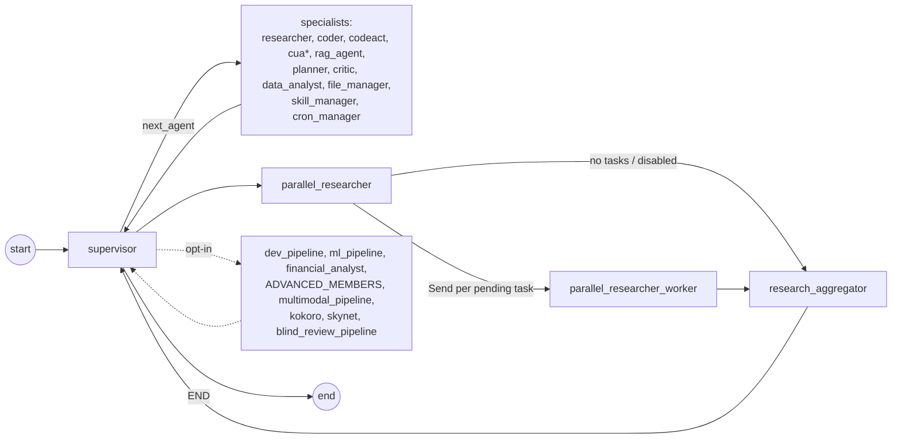
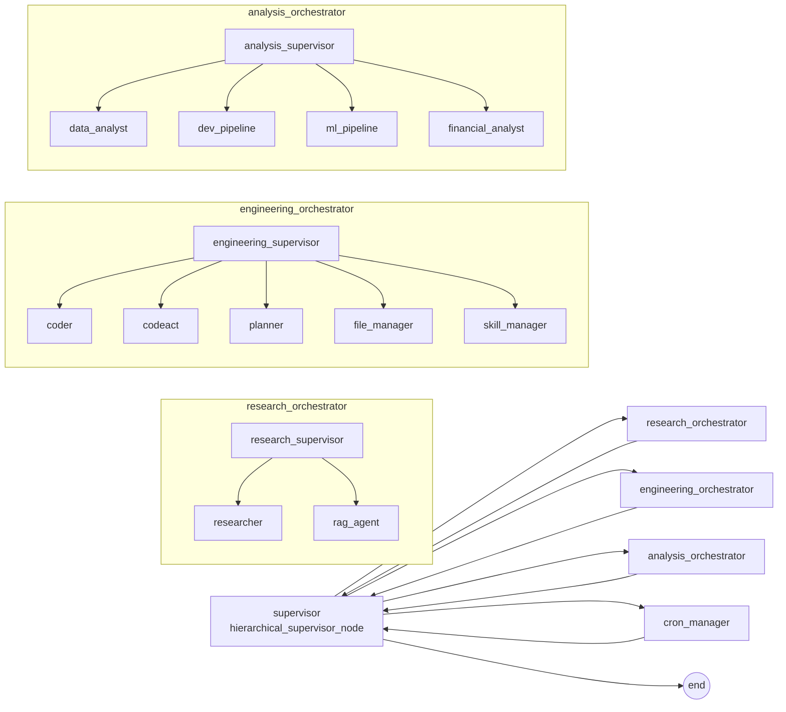

# Agents and the supervisor graph

The core of prismal is a LangGraph `StateGraph[AgentState]` built in `prismal/agents/graph.py`.
A central `supervisor` node picks **one** route per hop (a specialist agent, a reasoning-pattern
node or a compiled subgraph). That route runs and hands control back to the supervisor, which
either routes again or ends the turn:

```
supervisor → specialist → supervisor → … → END
```

This page covers the flat graph (default), the routing pipeline in `supervisor.py`, the
deterministic `intent_router.py`, the shared `AgentState`, every module under `prismal/agents/`,
the opt-in hierarchical mode and the parallel research fan-out.

## Overview

| Topic | Module | Summary |
|---|---|---|
| Graph assembly | `prismal/agents/graph.py` | `build_supervisor_graph()`, `get_compiled_graph()`, `get_async_compiled_graph()`, `build_checkpointer()` |
| Routing | `prismal/agents/supervisor.py` | `supervisor_node`, `supervisor_router`, route lists (`MEMBERS`, `ADVANCED_MEMBERS`, …), `effective_valid_routes()` |
| Intent short-circuit | `prismal/agents/intent_router.py` | `match_intent(text)`, stdlib-only regex matcher |
| State | `prismal/agents/state.py` | `AgentState` (`TypedDict`, 23 fields), `create_initial_state()` |
| Hierarchical mode | `graph.py::_build_hierarchical_graph`, `domain_supervisor.py`, `subgraphs/*_orchestrator/` | Root supervisor → 3 domain orchestrators + `cron_manager` |
| Parallel research | `prismal/agents/parallel_research.py` | `parallel_researcher` → `Send` fan-out → `research_aggregator` |

### Route count

The supervisor can select **30 routes** (plus `END`):

* **15 core routes** — `MEMBERS` (`supervisor.py:56-76`): `researcher`, `coder`, `codeact`, `cua`,
  `rag_agent`, `planner`, `critic`, `data_analyst`, `file_manager`, `skill_manager`,
  `cron_manager`, `dev_pipeline`, `ml_pipeline`, `financial_analyst`, `parallel_researcher`.
* **15 opt-in routes**:
  * `ADVANCED_MEMBERS` (`supervisor.py:85-100`) — 11 routes: 6 reasoning patterns (`tot_agent`,
    `debate_agent`, `constitutional_filter`, `lats_agent`, `llm_compiler`, `mixture_agent`) and
    5 domain subgraphs (`customer_service`, `document_generation`, `data_etl`, `code_review`,
    `debate_consensus`). Gate: `enable_subgraphs`.
  * `MULTIMODAL_MEMBERS` (`supervisor.py:106`) — `multimodal_pipeline`. Gate: `multimodal_enabled`.
  * `KOKORO_MEMBERS` (`supervisor.py:115`) — `kokoro`. Gate: `kokoro_enabled`.
  * `SKYNET_MEMBERS` (`supervisor.py:124`) — `skynet`. Gate: `skynet_enabled`.
  * `BLIND_REVIEW_MEMBERS` (`supervisor.py:134`) — `blind_review_pipeline`. Gate:
    `blind_review_pipeline_enabled`.

`MEMBERS` is the **routable** set, not the set of nodes that are always present. Four of its
entries become graph nodes only under a flag:

* `cua` is registered only when `cua_enabled` (`graph.py:335-337`).
* `dev_pipeline`, `ml_pipeline` and `financial_analyst` are registered only when
  `enable_subgraphs` is on **and** the graph is built through `get_async_compiled_graph()`, which
  compiles them (`graph.py:695-711`).

With every flag at its default the flat graph has 14 nodes: `supervisor`, 10 specialists
(`researcher`, `coder`, `codeact`, `rag_agent`, `planner`, `critic`, `data_analyst`,
`file_manager`, `skill_manager`, `cron_manager`) and the 3 parallel-research nodes
(`parallel_researcher`, `parallel_researcher_worker`, `research_aggregator`).

## How it works

### Flat graph (default)



`build_supervisor_graph()` sets `supervisor` as the entry point, adds a conditional edge from it
via `_supervisor_router` (a thin wrapper around `supervisor_router` that exists so LangGraph's
`get_type_hints()` can resolve `AgentState`), and adds a return edge from every specialist and
every optional node back to `supervisor`.

Optional nodes are collected by `_collect_optional_nodes()` (`graph.py:201-255`), which applies
all gating in one place:

| Optional nodes | Builder | Gate |
|---|---|---|
| `dev_pipeline`, `ml_pipeline`, `financial_analyst` | `get_compiled_dev_pipeline()`, `get_compiled_ml_pipeline()`, `get_compiled_financial_analyst()` | `enable_subgraphs` |
| 6 pattern nodes + 5 domain subgraphs | `_build_advanced_nodes()` | `enable_subgraphs` |
| `multimodal_pipeline` | `_build_multimodal_nodes()` | `multimodal_enabled` |
| `kokoro` | `_build_kokoro_nodes()` | `kokoro_enabled` |
| `skynet` | `_build_skynet_nodes()` | `skynet_enabled` |
| `blind_review_pipeline` | `_build_blind_review_nodes()` | `blind_review_pipeline_enabled` |

The `_build_*_nodes()` coroutines are awaited only by `get_async_compiled_graph()`. The
synchronous `get_compiled_graph()` calls `build_supervisor_graph()` with no optional graphs, so it
never contains optional nodes, whatever the flags say.

### One supervisor hop

`supervisor_node(state)` (`supervisor.py:831`) runs these steps in order:

1. Per-run seeding (each a no-op unless its flag is on): `maybe_seed_budget_run`,
   `maybe_seed_hardening_run`, `maybe_seed_context_compaction_run` + `maybe_compact_context`.
2. Trim history to the last `_HISTORY_WINDOW = 6` messages (`supervisor.py:172`).
3. **Loop breaker** — `_loop_break_decision()`: if the last message is an `AIMessage` and
   `current_agent` is not `supervisor`, route to `END` without an LLM call. One specialist answer
   per user turn.
4. **Intent short-circuit** — `_intent_short_circuit()` calls `match_intent()` on the last human
   message; a match that is in `effective_valid_routes(...)` is returned directly.
5. **Typed decision** — `maybe_decide_route()` (`prismal.decisions.integrations.route`; no-op
   unless `decisions_enabled` + `decision_routing_enabled`). An accepted route skips the routing
   LLM call.
6. **LLM routing** — system prompt from `build_system_prompt(...)` (the base prompt plus one
   section per enabled layer) plus recalled memory context; the reply is normalised by
   `_match_route()`. Unknown replies become `END` with a `supervisor_invalid_routing` warning.
7. **Routing overrides** — `_apply_routing_overrides()` (`supervisor.py:724-755`):
   * `codeact` → `coder` when `codeact_enabled` is off;
   * `cua` → `researcher` when `cua_enabled` is off;
   * `researcher` → `parallel_researcher` when `len(pending_tasks) > 1` and `parallel_enabled`.
8. On `END` with a human last message, `_build_direct_answer()` answers directly (system prompt
   from `ProfileManager().load_system_prompt()`, tools `SUPERVISOR_DIRECT_TOOLS`) and
   `_spawn_memory_extraction()` fires when `memory_extraction_enabled`.

The node returns `{"current_agent": "supervisor", "next_agent": <route or None>, "messages": [...]}`;
`supervisor_router()` maps `None`/`"END"` to `"__end__"`.

> **Caveat.** `dev_pipeline`, `ml_pipeline` and `financial_analyst` are always in `MEMBERS` and
> always described in the base routing prompt, and `_apply_routing_overrides()` has no downgrade
> for them. If they are not registered as nodes (`enable_subgraphs` off, or the sync
> `get_compiled_graph()`), the conditional-edge map built in `graph.py:379-395` has no entry for
> them.

### Intent router

`match_intent(text: str | None) -> str | None` (`intent_router.py`) normalises the text (NFKD,
strip combining marks, lowercase) and checks rules in this order. The first match wins:

| Rule | Returns |
|---|---|
| Educational guard (`explain`, `what is`, `how does`, `write a script`, ES equivalents) | `None` (LLM decides) |
| Cron verb + noun, or verb + recurrence (EN/ES) | `cron_manager` |
| "tree of thought(s)" | `tot_agent` |
| `etl` / "extract, transform and load" | `data_etl` |
| "consensus" | `debate_consensus` |
| "debate" | `debate_agent` |
| "code review" | `code_review` |
| Video / audio / image phrasing | `multimodal_pipeline` |
| "kokoro", "deliberate", "weigh … perspectives", "three voices", … | `kokoro` |
| "skynet", "swarm", "fan … out", "in parallel", … | `skynet` |
| "blind review", "dual review", "revisión ciega", … | `blind_review_pipeline` |

The supervisor accepts a match only when the route is in the current `effective_valid_routes(...)`.
For example, `"code review this PR"` falls through to LLM routing when `enable_subgraphs` is off.

### Shared state

`AgentState` (`prismal/agents/state.py`) is a `TypedDict` with 23 fields. Four use reducers; the
rest are replaced on update:

| Field | Type | Reducer |
|---|---|---|
| `messages` | `list[BaseMessage]` | `add_messages` |
| `retrieved_docs` | `list[dict]` | `operator.add` |
| `tool_results` | `list[dict]` | `operator.add` |
| `parallel_results` | `list[dict]` | `operator.add` |
| `current_agent`, `next_agent` | `str`, `str \| None` | — |
| `task_plan`, `completed_tasks`, `pending_tasks` | `list[str]` | — |
| `doc_grades` | `list[float]` | — |
| `tool_errors` | `list[dict]` | — |
| `dev_pipeline_modules`, `skynet_orders` | `list[dict]` | — (fan-out staging) |
| `risk_score`, `permissions_granted`, `security_flags` | `float`, `list[str]`, `list[str]` | — |
| `session_id`, `created_at` | `str` | — |
| `token_count`, `estimated_cost_usd`, `iteration_count` | `int`, `float`, `int` | — |
| `metadata` | `dict[str, Any]` | — |
| `channel_context` | `dict[str, str] \| None` | — |

`create_initial_state(session_id)` returns a fresh state with `current_agent="supervisor"`. Opt-in
layers keep their own data under `metadata` (`metadata["mm"]`, `["kokoro"]`, `["skynet"]`,
`["budget"]`, `["routing"]`, …).

### Hierarchical mode

With `hierarchical_mode=True`, `get_async_compiled_graph()` returns `_build_hierarchical_graph()`
instead of the flat graph (`graph.py:679-681`). The root supervisor only sees
`HIERARCHICAL_MEMBERS` (`supervisor.py:1015-1020`):



* `hierarchical_supervisor_node` reuses the flat supervisor's loop breaker, `match_intent()`
  (accepted only when it returns one of the 4 targets, in practice `cron_manager`), memory recall
  and direct answer on `END`. It does not run the budget/hardening/compaction seeding or the
  typed-decision step.
* Each orchestrator is a compiled subgraph whose entry node comes from
  `make_domain_supervisor(domain_name, agents, domain_description)` (`domain_supervisor.py`). A
  domain supervisor has its own loop breaker, keeps its iteration counter in
  `metadata["domain_<name>"]`, and forces `END` after `_MAX_DOMAIN_ITERATIONS = 8`.
* Leaf sets: `RESEARCH_AGENTS = ("researcher", "rag_agent")`,
  `ENGINEERING_AGENTS = ("coder", "codeact", "planner", "file_manager", "skill_manager")`,
  `ANALYSIS_AGENTS = ("data_analyst", "dev_pipeline", "ml_pipeline", "financial_analyst")`.
* `critic`, `cua`, `parallel_researcher` and all opt-in routes (advanced, multimodal, kokoro,
  skynet, blind review) are not reachable in hierarchical mode.
* The analysis orchestrator compiles `dev_pipeline`, `ml_pipeline` and `financial_analyst` itself,
  whatever `enable_subgraphs` says.

See [subgraphs.md](subgraphs.md#hierarchical-orchestrators) for the orchestrator builders.

### Parallel research fan-out

`prismal/agents/parallel_research.py` adds three nodes to the flat graph:

1. `parallel_researcher_node` — passthrough anchoring the dispatcher edge.
2. `research_dispatcher` — `make_parallel_dispatcher(tasks_field="pending_tasks",
   worker_node="parallel_researcher_worker", max_workers=10, on_empty="research_aggregator")`.
   It emits one `Send` per pending task, capped at `min(10, parallel_max_workers)`. It routes
   straight to `research_aggregator` when `parallel_enabled` is off or the list is empty.
3. `parallel_researcher_worker` — runs a bounded ReAct loop with the researcher's tools and
   appends a partial result to `parallel_results` (an `operator.add` reducer).
4. `research_aggregator_node` — merges `parallel_results` into one `AIMessage` and returns to the
   supervisor.

The supervisor reaches this path either by picking `parallel_researcher` directly or through the
`researcher` → `parallel_researcher` upgrade in `_apply_routing_overrides()`.

## Agent module inventory

`prismal/agents/` holds 33 top-level modules (excluding `__init__.py`). In the flat graph,
**13 modules provide nodes**: `supervisor` plus 12 specialist modules. The other **20 are helpers
or standalone components**. `domain_supervisor` is used only in hierarchical mode.

| Module | Main symbol(s) | Role in the main graph |
|---|---|---|
| `supervisor.py` | `supervisor_node`, `hierarchical_supervisor_node`, `supervisor_router` | Node `supervisor` (entry point) |
| `researcher.py` | `researcher_node` | Node `researcher` |
| `coder.py` | `coder_node` | Node `coder` |
| `codeact_agent.py` | `codeact_node` | Node `codeact` (always registered; routed to `coder` unless `codeact_enabled`; the node also checks the flag) |
| `cua_agent.py` | `cua_node` | Node `cua`, registered only when `cua_enabled` (otherwise the route becomes `researcher`) |
| `rag_agent.py` | `rag_agent_node` | Node `rag_agent` |
| `planner.py` | `planner_node` | Node `planner` |
| `critic.py` | `critic_node` | Node `critic` (flat mode only) |
| `data_analyst.py` | `data_analyst_node` | Node `data_analyst` |
| `file_manager.py` | `file_manager_node` | Node `file_manager` |
| `skill_manager.py` | `skill_manager_node` | Node `skill_manager` |
| `cron_manager.py` | `cron_manager_node` | Node `cron_manager` (flat and hierarchical) |
| `parallel_research.py` | `parallel_researcher_node`, `parallel_researcher_worker`, `research_aggregator_node`, `research_dispatcher` | Nodes `parallel_researcher`, `parallel_researcher_worker`, `research_aggregator` |
| `domain_supervisor.py` | `make_domain_supervisor()` | Hierarchical mode only: entry node of the 3 orchestrator subgraphs |
| `skill_creator.py` | `create_skill()`, `skill_creator_node` | Helper. `skill_manager` calls `create_skill()`. `skill_creator_node` is defined but not registered in any graph |
| `meta_learner.py` | `MetaLearner` (`fetch_traces`, `score_traces`, `generate_proposals`, `review`) | Standalone: nothing in `prismal/` wires it into a graph |
| `network_supervisor.py` | `NetworkSupervisorAgent.delegate()` | Standalone: remote delegation by capability; `rag/federated.py` reuses its node registry |
| `spawner.py` | `SubAgentSpawner` | Standalone async task launcher (exported from `prismal.agents`) |
| `factory.py` | `AgentFactory.build(AgentPattern)` | Builds alternative topologies (`SUPERVISOR`, `REACT`, `PLAN_EXECUTE`, `SWARM`, `REFLEXION`, `CODEACT`, `CRAG`, `DEBATE`, `DEV_PIPELINE`); not the main graph |
| `graph.py` | `build_supervisor_graph`, `get_compiled_graph`, `get_async_compiled_graph` | Assembly |
| `intent_router.py` | `match_intent` | Routing helper |
| `state.py` | `AgentState`, `create_initial_state` | State schema |
| `handoff.py` | `HandoffEnvelope`, `build_envelope`, `maybe_run_envelope` | Handoff envelopes (TKE) |
| `artifacts.py` | `ArtifactStorePort`, `read_artifact` | Tenant/run-scoped artifact store (TKE) |
| `context.py` | ambient invocation context | Used by `tools.py` |
| `context_compaction.py` | `maybe_compact_context`, `maybe_seed_context_compaction_run` | Context compaction (Phase LH) |
| `loop_phase.py` | task-phase resolution | Tool gating helper (Phase LH) |
| `tool_registry.py` | `get_tools_for_agent`, `get_tools_for_agent_ctx`, `react_loop`, `set_tool_provider` | Tool resolution + ReAct loop |
| `tool_gate.py` | mask-mode tool gating | TKE |
| `tool_output_budget.py` | per-tool output budgets | TKE |
| `tool_search.py` | `DeferredToolSet`, `plan_deferred_tools` | Deferred tools + BM25 tool search (TKE) |
| `tools.py` | stub LangChain tools, `SUPERVISOR_DIRECT_TOOLS` | Tool stubs |
| `visualization.py` | `to_mermaid`, `visualize`, `save_graph_image` | Graph rendering |

Subpackages: `patterns/` ([patterns.md](patterns.md)), `subgraphs/` ([subgraphs.md](subgraphs.md)),
`multimodal/` (modal agents used inside `multimodal_pipeline`), `kokoro/` ([kokoro.md](kokoro.md)),
`skynet/` ([skynet.md](skynet.md)) and `extension/` ([extension.md](extension.md)).

## Public API

| Symbol | Module | Notes |
|---|---|---|
| `get_compiled_graph()` | `prismal.agents.graph` | `lru_cache` singleton, sync `SqliteSaver` at `data/db/checkpoints.db`, no optional nodes |
| `get_async_compiled_graph(*, tool_provider=None)` | `prismal.agents.graph` | Module-level singleton. Checkpointer from `build_checkpointer(settings.db_url)`; builds the optional nodes; returns the hierarchical graph when `hierarchical_mode`. `tool_provider` is bound via `with_config` only when `tool_provider_mode == "context"` |
| `build_supervisor_graph(checkpoint_path=None, checkpointer=None, dev_pipeline_graph=None, ml_pipeline_graph=None, financial_analyst_graph=None, advanced_nodes=None, multimodal_nodes=None, kokoro_nodes=None, skynet_nodes=None, blind_review_nodes=None)` | `prismal.agents.graph` | Low-level, uncached builder |
| `build_checkpointer(db_url=None)` | `prismal.agents.graph` | `AsyncPostgresSaver` for `postgresql://`/`postgres://` URLs (needs `langgraph-checkpoint-postgres`), else `AsyncSqliteSaver` |
| `list_session_ids()` | `prismal.agents.graph` | Thread ids from the default SQLite checkpoint DB |
| `visualize_supervisor_graph(graph=None)` | `prismal.agents.graph` | PNG in notebooks, Mermaid otherwise |
| `supervisor_node`, `supervisor_router` | `prismal.agents.supervisor` | Flat routing |
| `hierarchical_supervisor_node` | `prismal.agents.supervisor` | Root of hierarchical mode |
| `MEMBERS`, `ADVANCED_MEMBERS`, `HIERARCHICAL_MEMBERS` | `prismal.agents.supervisor` | In `__all__` |
| `MULTIMODAL_MEMBERS`, `KOKORO_MEMBERS`, `SKYNET_MEMBERS`, `BLIND_REVIEW_MEMBERS` | `prismal.agents.supervisor` | Module constants (not in `__all__`) |
| `effective_valid_routes(enable_advanced, enable_multimodal=False, enable_kokoro=False, enable_skynet=False, enable_blind_review=False)` | `prismal.agents.supervisor` | Routable set + `END` |
| `build_system_prompt(...)` | `prismal.agents.supervisor` | Same five flags |
| `match_intent(text)` | `prismal.agents.intent_router` | Deterministic short-circuit |
| `AgentState`, `create_initial_state(session_id)` | `prismal.agents.state` | |
| `make_domain_supervisor(domain_name, agents, domain_description)` | `prismal.agents.domain_supervisor` | |
| `AgentFactory`, `AgentPattern`, `SubAgentSpawner` | `prismal.agents` | Package re-exports |

## Configuration

All fields live in `prismal/core/config.py` `Settings` (env prefix `PRISMAL_`).

| Setting | Default | Effect |
|---|---|---|
| `hierarchical_mode` | `False` | `get_async_compiled_graph()` builds the 3-level hierarchical graph |
| `enable_subgraphs` | `False` | Registers `dev_pipeline`, `ml_pipeline`, `financial_analyst` and the 11 `ADVANCED_MEMBERS` (async graph only) |
| `multimodal_enabled` | `False` | Adds `multimodal_pipeline` |
| `kokoro_enabled` | `False` | Adds `kokoro` |
| `skynet_enabled` | `False` | Adds `skynet` |
| `blind_review_pipeline_enabled` | `False` | Adds `blind_review_pipeline` |
| `codeact_enabled` | `False` | Off ⇒ `codeact` is routed to `coder` |
| `cua_enabled` | `False` | On ⇒ registers the `cua` node; off ⇒ `cua` is routed to `researcher` |
| `parallel_enabled` | `True` | `researcher` → `parallel_researcher` upgrade; dispatcher fan-out |
| `parallel_max_workers` | `10` (1–100) | Hard cap on `Send` per fan-out |
| `memory_extraction_enabled` | `True` | Background memory extraction when a turn ends on `END` |
| `db_url` | `sqlite+aiosqlite:///data/db/prismal.db` | Checkpointer backend for the async graph |
| `tool_provider_mode` | `"global"` | `"context"` enables per-session `tool_provider` binding |

## Usage

```python
import asyncio

from langchain_core.messages import HumanMessage

from prismal.agents.graph import get_async_compiled_graph
from prismal.agents.intent_router import match_intent
from prismal.agents.state import create_initial_state
from prismal.agents.supervisor import effective_valid_routes


async def main() -> None:
    print(match_intent("list my cron jobs"))  # "cron_manager"
    print(len(effective_valid_routes(True, True, True, True, True)))  # 31 = 30 routes + END

    graph = await get_async_compiled_graph()  # always the async variant in async code
    state = create_initial_state(session_id="demo")
    state["messages"] = [HumanMessage(content="Summarise docs/agents.md")]
    result = await graph.ainvoke(state, config={"configurable": {"thread_id": "demo"}})
    print(result["messages"][-1].content)


asyncio.run(main())
```

Invoking the graph needs a configured LLM provider. Offline examples:

* `examples/supervisor_quickstart.py` — `match_intent` on sample utterances, graph build with an
  in-memory checkpointer and a `FakeToolProvider`, topology inspection.
* `examples/hierarchical_supervisor.py` — `make_domain_supervisor` routing outcomes and
  `NetworkSupervisorAgent` with a fake transport.
* `examples/parallel_research_fanout.py` — the fan-out / fan-in path.
* `examples/meta_learner.py`, `examples/skill_creator_agent.py`, `examples/subagent_spawner.py` —
  the standalone modules.
* `examples/visualize_graphs.py` — Mermaid rendering of the supervisor graph.

## Testing

* Graph assembly and gating: `tests/unit/agents/test_graph.py`, `test_graph_advanced_nodes.py`,
  `test_graph_multimodal.py`, `test_graph_kokoro.py`, `test_graph_skynet.py`,
  `test_graph_blind_review.py`, plus the `test_graph_snapshot_*.py` family (flags off ⇒
  unchanged topology).
* Supervisor routing: `tests/unit/agents/test_supervisor_routing.py`,
  `test_supervisor_advanced_routing.py`, `test_supervisor_cron_routing.py`,
  `test_supervisor_decisions.py`, `test_supervisor_multimodal.py`, `test_supervisor_kokoro.py`,
  `test_supervisor_skynet.py`, `test_supervisor_context_compaction.py`,
  `test_supervisor_cache_stable_prompt.py`.
* Intent router: `tests/unit/agents/test_intent_router.py`, `test_intent_router_advanced.py`.
* State: `tests/unit/agents/test_state.py`, `test_state_management.py`.
* Hierarchical mode: `tests/unit/agents/test_hierarchical_graph.py`.
* Specialists and helpers: `test_sub_agents.py`, `test_codeact_agent.py`, `test_cua_agent.py`,
  `test_cron_manager_node.py`, `test_meta_learner.py`, `test_network_supervisor.py`,
  `test_skill_creator.py`, `test_spawner.py`, `test_factory.py`, `test_checkpointer_factory.py`.
* End to end: `tests/e2e/test_supervisor_graph_e2e.py`.

## Related

* [patterns.md](patterns.md) — the 6 pattern nodes in `ADVANCED_MEMBERS`.
* [subgraphs.md](subgraphs.md) — pipeline subgraphs and orchestrators.
* [rag.md](rag.md) — the engines behind `rag_agent`.
* [routing.md](routing.md) — adaptive model routing (which model a node calls).
* [decisions.md](decisions.md) — the typed `DEC-ROUTE` integration in `supervisor_node`.
* [budget.md](budget.md), [loop-hardening.md](loop-hardening.md), [token-efficiency.md](token-efficiency.md) — per-run seeding done by the supervisor.
* [tool-providers.md](tool-providers.md) — how specialists get tools.
* [kokoro.md](kokoro.md), [skynet.md](skynet.md), [blind-review-pipeline.md](blind-review-pipeline.md) — opt-in routes.
* [extension.md](extension.md) — building your own nodes and subgraphs.
* [configuration.md](configuration.md) — all settings.
