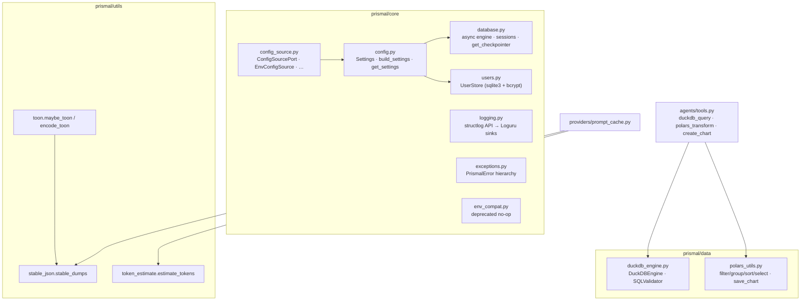

# Data layer, utilities & core infrastructure

This page covers the three small packages the rest of Prismal builds on:

- **`prismal/data/`**: an in-process analytics layer, with DuckDB for SQL and
  Polars for DataFrame transforms and charts. It backs the data-analyst tools.
- **`prismal/utils/`**: three dependency-free helpers used by the
  token-efficiency layer.
- **`prismal/core/`**: settings, configuration sources, database and
  checkpointer factories, the exception hierarchy, logging and the user store.

How settings *values* are sourced (the `ConfigSourcePort`) is covered in
[configuration.md](configuration.md). This page only places those pieces in
context.

> Related: [Configuration](configuration.md) · [Composition root](composition-root.md) ·
> [Token efficiency](token-efficiency.md)

## Overview



## `prismal/data/`: DuckDB + Polars

### `DuckDBEngine`

`DuckDBEngine(db_path=":memory:")` wraps a `duckdb.DuckDBPyConnection` and
validates every query with `SQLValidator` before running it:

| Method | Behaviour |
|---|---|
| `query(sql) -> list[dict[str, Any]]` | Validates, executes and returns rows as dicts |
| `query_csv(path, sql=None)` | Creates or replaces a view named after the file stem over `read_csv_auto(path)`, then runs `sql` (default `SELECT * FROM <stem>`). Raises `FileNotFoundError` for a missing file |
| `register_polars(name, df)` | Exposes a Polars DataFrame as a virtual table |
| `list_tables()` | Table and view names in schema `main` |
| `close()` / context manager | Closes the connection |

`SQLValidator.validate(sql)` raises `PrismalError` when the SQL contains any
of `DROP`, `DELETE`, `INSERT`, `UPDATE`, `CREATE`, `ALTER`, `TRUNCATE`,
`REPLACE` or `MERGE` as a whole word, case-insensitive.

### Polars helpers (`polars_utils.py`)

All helpers are pure: they return new DataFrames and raise `PrismalError` on
bad columns or operators.

| Function | Signature |
|---|---|
| `filter_rows` | `(df, column, op: "=="\|"!="\|">"\|">="\|"<"\|"<=", value)` |
| `group_by_aggregate` | `(df, group_col, agg_col, agg_fn="sum")` with `agg_fn` one of `sum`, `mean`, `min`, `max`, `count`, `median` |
| `sort_by` | `(df, column, ascending=True)` |
| `select_columns` | `(df, columns)` |
| `to_records` | `(df) -> list[dict[str, object]]` |
| `save_chart` | `(df, x_col, y_col, output_path, kind="bar", title="", *, dpi=150) -> Path` with `kind` one of `bar`, `line`, `scatter`, `hist`. Creates the parent directory |

Consumers are the `duckdb_query`, `polars_transform` and `create_chart`
tools in `prismal/agents/tools.py`, which import these modules lazily.

## `prismal/utils/`

| Symbol | Module | Purpose |
|---|---|---|
| `stable_dumps(obj) -> str` | `utils/stable_json.py` | Byte-stable JSON (sorted keys, compact separators, unicode kept, `default=str`). This is the precondition for prompt-cache hits |
| `estimate_tokens(text) -> int` | `utils/token_estimate.py` | `ceil(len(text) / 4)`, about ±15 % on English and JSON. Used for budgets and thresholds, never for billing |
| `is_uniform_tabular(obj)`, `encode_toon(rows, *, name="items")`, `maybe_toon(obj)` | `utils/toon.py` | TOON encoding for uniform lists of flat dicts. `maybe_toon` falls back to `stable_dumps` for other data |

## `prismal/core/`: infrastructure

| Module | Key symbols | Notes |
|---|---|---|
| `config.py` | `Settings`, `build_settings(source=None)`, `get_settings()` (`lru_cache`), `reload_settings()`, `MaintenanceSettings`, `get_maintenance_settings()`, `is_loopback_url()` | `Settings` uses the `PRISMAL_` prefix, `case_sensitive=False`, `extra="ignore"`, `populate_by_name=True`. Each phase adds one settings block plus a `_validate_<phase>` validator |
| `config_source.py` | `ConfigSourcePort`, `EnvConfigSource`, `MappingConfigSource`, `ChainedConfigSource`, `FakeConfigSource`, `set_config_source()`, `get_config_source()` | See [configuration.md](configuration.md) |
| `database.py` | `Base`, `create_async_engine_from_url(db_url)`, `get_session_factory(engine)`, `get_db_session(engine=None)`, `init_db(engine=None)`, `get_backend_type()`, `get_checkpointer()` | SQLAlchemy 2.x async engine. `get_db_session` commits on success and rolls back on error. `get_checkpointer()` returns `AsyncSqliteSaver` or `AsyncPostgresSaver` (the `[postgres]` extra) based on `db_url` |
| `exceptions.py` | `PrismalError` and one subtree per subsystem, for example `SecurityError`, `ProviderError`, `SkillError`, `MCPError`, `RAGError`, `SchedulerError`, `ConfigSourceError`, `RuntimeCompositionError`, `GatewayError`, `DecisionError`, `RoutingError`, `ProtocolUpgradeError`, `AgenticMemoryError`, `MissingDependencyError` | One `except PrismalError` catches everything. Note that the module defines its own `MemoryError(PrismalError)`, which shadows the builtin when imported by name |
| `logging.py` | `setup_logging(log_level="INFO", log_format="pretty", log_file="data/logs/prismal.log", rotation="500 MB", retention="30 days", compression="gz")`, `setup_chat_logging(log_file=…)`, `get_logger(name="prismal")` | structlog API with Loguru sinks (stderr plus a rotating file). `get_logger()` bootstraps `setup_logging()` with its defaults when structlog is unconfigured |
| `users.py` | `UserRole` (`admin`, `operator`, `viewer`), `User`, `UserStore(db_path=None)` | Plain `sqlite3` (not SQLAlchemy). bcrypt through `passlib`. If `passlib` is missing, `verify_password` returns `False` |
| `env_compat.py` | `apply_legacy_env_aliases()` | Deprecated no-op that emits a `DeprecationWarning`. The `LIGHTAGENT_*` mirror now lives in `EnvConfigSource.load()` |

`prismal.core` re-exports `Settings`, `build_settings`, `get_settings`,
`reload_settings`, all the config sources, `Base`, `get_db_session`,
`init_db`, `get_logger`, `setup_logging` and the base exception classes.
Importing it does not mutate `os.environ`.

## Public API

| Symbol | Module |
|---|---|
| `DuckDBEngine`, `SQLValidator` | `prismal.data.duckdb_engine` (re-exported from `prismal.data`) |
| `filter_rows`, `group_by_aggregate`, `sort_by`, `select_columns`, `to_records`, `save_chart` | `prismal.data.polars_utils` (re-exported) |
| `stable_dumps` | `prismal.utils.stable_json` |
| `estimate_tokens` | `prismal.utils.token_estimate` |
| `encode_toon`, `is_uniform_tabular`, `maybe_toon` | `prismal.utils.toon` |
| `Settings`, `build_settings`, `get_settings`, `reload_settings` | `prismal.core.config` (re-exported from `prismal.core`) |
| `ConfigSourcePort`, `EnvConfigSource`, `MappingConfigSource`, `ChainedConfigSource`, `FakeConfigSource`, `set_config_source`, `get_config_source` | `prismal.core.config_source` (re-exported) |
| `Base`, `get_db_session`, `init_db`, `get_checkpointer`, `get_backend_type`, `create_async_engine_from_url`, `get_session_factory` | `prismal.core.database` |
| `get_logger`, `setup_logging`, `setup_chat_logging` | `prismal.core.logging` |
| `PrismalError` and subclasses | `prismal.core.exceptions` |
| `UserStore`, `User`, `UserRole` | `prismal.core.users` |

## Configuration

Only the settings these modules read directly are listed here. For sourcing,
strict mode and per-tenant settings, see [configuration.md](configuration.md).

| Env var | Default | Read by |
|---|---|---|
| `PRISMAL_DB_URL` | `sqlite+aiosqlite:///data/db/prismal.db` | `database._get_engine()`, `get_checkpointer()`, `get_backend_type()` |
| `PRISMAL_USERS_DB_PATH` | `data/db/users.db` | `UserStore()` |
| `PRISMAL_LOG_LEVEL` / `PRISMAL_LOG_FORMAT` | `INFO` / `pretty` | the host, when it passes them to `setup_logging()` |
| `PRISMAL_LOG_FILE_PATH` / `_ROTATION` / `_RETENTION` | `data/logs/prismal.log` / `500 MB` / `30 days` | the host, likewise |
| `PRISMAL_CONFIG_SOURCE_STRICT` | `false` | `build_settings()` (raises `ConfigSourceError` when no source is injected) |
| `PRISMAL_MAINTENANCE_*` | see `MaintenanceSettings` | `get_maintenance_settings()` |

`setup_logging()` does not read `Settings`. A host that wants the `log_*`
settings applied calls `setup_logging(s.log_level, s.log_format, s.log_file_path, s.log_file_rotation, s.log_file_retention)`
once at startup. Otherwise, the first `get_logger()` call configures the
defaults, including a file sink at `data/logs/prismal.log` relative to the
working directory.

## Usage

```python
import polars as pl

from prismal.core import get_logger, get_settings
from prismal.core.database import get_checkpointer
from prismal.data import DuckDBEngine, group_by_aggregate, save_chart

log = get_logger(__name__)
settings = get_settings()

with DuckDBEngine() as engine:
    rows = engine.query_csv("data/sales.csv",
                            "SELECT region, SUM(amount) AS total FROM sales GROUP BY region")

df = group_by_aggregate(pl.DataFrame(rows), "region", "total", "sum")
chart = save_chart(df, "region", "total", "data/workspace/sales.png", kind="bar")
log.info("chart_saved", path=str(chart), backend=settings.db_url.split(":", 1)[0])

async with get_checkpointer() as saver:      # AsyncSqliteSaver / AsyncPostgresSaver
    ...
```

Config-source examples:
[`examples/config_source_env.py`](../examples/config_source_env.py),
[`examples/config_source_custom.py`](../examples/config_source_custom.py).

## Security notes

- **`SQLValidator` is a keyword denylist, not a SELECT-only parser.** It
  blocks the nine DML/DDL keywords above wherever they appear as whole words,
  including inside a legitimate `SELECT` such as `replace(col, …)` or a column
  named `update`. It does **not** block other DuckDB statements such as
  `COPY … TO`, `ATTACH`, `INSTALL`/`LOAD`, `PRAGMA`, `SET` or
  `EXPORT DATABASE`, or file-reading table functions. Do not treat it as an
  isolation boundary for LLM-written SQL: give `DuckDBEngine` an in-memory or
  read-only database and gate the calling tool with `ActionInterceptor`
  (Rule #5).
- `query_csv` interpolates the file path and stem into SQL text. Pass only
  trusted, confined paths (for example, resolved through
  `filesystem_guard`).
- `save_chart` writes to any `output_path` and creates directories. Confine
  the path and check `ActionInterceptor` before writing files.
- **Configuration reads.** The core reads `os.environ` and `.env` only through
  `EnvConfigSource`. `tests/unit/core/test_no_env_reads.py` enforces this. The
  exceptions are `MaintenanceSettings`, which still sets `env_file=".env"`,
  and the LiteLLM credential bridge in `providers/registry.py`.
- `UserStore` stores only bcrypt hashes, and `verify_password` fails closed
  when `passlib` is missing.

## Testing

- `tests/unit/data/`: `test_duckdb_engine.py`, `test_polars_utils.py`
- `tests/unit/utils/`: `test_stable_json_token_estimate.py`, `test_toon.py`
- `tests/unit/core/`: `test_config*.py` (one per phase), `config_source/`,
  `test_database.py`, `test_exceptions*.py`, `test_logging.py`,
  `test_users.py`, `test_no_env_reads.py`
- `tests/conftest.py` holds an autouse fixture that injects
  `EnvConfigSource(dotenv_path=None)` and clears provider keys, so tests never
  read your `.env`.

```bash
uv run pytest tests/unit/data tests/unit/utils tests/unit/core
```

## Related

- [configuration.md](configuration.md): `ConfigSourcePort`, sources, strict mode, per-tenant settings
- [composition-root.md](composition-root.md): `build_runtime()` builds the checkpointer and the other ports
- [token-efficiency.md](token-efficiency.md): where `stable_dumps`, `estimate_tokens` and TOON are used
- [providers.md](providers.md): the LiteLLM environment bridge
