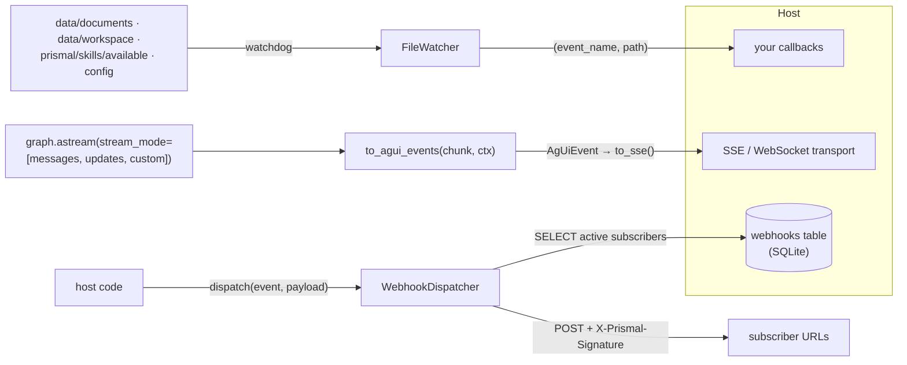

# Events

`prismal/events/` is a set of three **independent event adapters** that sit
at the edge of the engine. It is **not** an in-process publish/subscribe bus:
there is no central dispatcher, topic registry or subscription API, and none
of the three components below is wired into the graph by the engine itself.
The host (prismal-server or your application) instantiates whichever adapters
it needs and connects them to its own handlers.

| Component | Module | Direction | What it does |
|---|---|---|---|
| `FileWatcher` | `events/file_watcher.py` | filesystem → callbacks | Watchdog observer that calls `callback(event_name, path)` on file create/modify |
| `WebhookDispatcher` | `events/webhook_dispatcher.py` | engine → HTTP subscribers | HMAC-SHA256-signed POSTs with retry, driven by a SQLite `webhooks` table |
| AG-UI translator | `events/agui.py` | `graph.astream` → AG-UI 1.0 events | Pure, I/O-free translation for streaming front-ends |

> Related: [Protocol upgrades 2026](protocols-2026.md) (full AG-UI mapping) ·
> [Scheduler](scheduler.md) · example: [`examples/agui_translate.py`](../examples/agui_translate.py)

## How it works



### File watcher

`FileWatcher(observer=None)` holds a list of `(path, event_name, callback)`
registrations:

- `register(path, event_name, callback)` adds one. `callback` is an
  `EventCallback`, a sync `Callable[[str, str], None]` that receives
  `(event_name, file_path)`.
- `start()` schedules a recursive watchdog handler for each path that exists.
  Missing paths are skipped with a `file_watcher_path_missing` warning. Then
  it starts the observer thread.
- `stop()` stops and joins the observer. `is_running()` reports its state.
- Only file `created` and `modified` events fire. Directory events, deletes
  and moves are ignored.

`create_default_watcher(callbacks=None)` pre-registers four paths, resolved
relative to the parent of the `prismal/` package directory:

| Path | Event name | Intended handler |
|---|---|---|
| `data/documents` | `index_document_event` | `document_index_flow` (RAG indexing) |
| `data/workspace` | `workspace_update_event` | (none) |
| `prismal/skills/available` | `skill_discovery_event` | `skill_discovery_flow` / `SkillsManager.reload_all()` |
| `config` | `config_reload_event` | `config_reload_flow` |

Events without a callback use a no-op that only logs `file_watcher_event`.
The Prefect flows named above live in `prismal/scheduler/prefect_flows.py`
(see [scheduler.md](scheduler.md)). Connecting a watcher event to a flow is up
to the host.

### Webhook dispatcher

`WebhookDispatcher(db_path="data/db/prismal.db")`:

- `await dispatch(event, payload)` accepts only names in `WEBHOOK_EVENTS`:
  `chat.completed`, `skill.executed`, `cron.triggered` and `security.blocked`.
  Unknown names are logged and dropped.
- Subscribers come from `SELECT id, url, secret, events FROM webhooks WHERE active = 1`,
  where `events` is a JSON list. The engine never creates this table. The host
  owns its schema and the registration of subscribers. If `aiosqlite` is
  missing or the query fails, the subscriber list is empty.
- Each matching subscriber is delivered on its own `asyncio.create_task`. The
  body is `{"event", "payload", "timestamp"}`, with the headers
  `X-Prismal-Signature: hex(HMAC-SHA256(secret, body))` and
  `X-Prismal-Event: <event>`.
- Up to 3 attempts are made with `RETRY_DELAYS = (1.0, 4.0, 16.0)` and a 10 s
  HTTP timeout. When all attempts fail, the subscriber is marked
  `active = 0`.
- A subscriber with an **empty secret is skipped** (never sent unsigned), and
  `_sign()` raises on an empty secret.

### AG-UI translator

`events/agui.py` translates each item from
`graph.astream(..., stream_mode=["messages", "updates", "custom"])`
(optionally with `subgraphs=True`) into AG-UI 1.0 events. The translator is
pure: sync, no I/O, and it never raises. The host owns the transport. Its
entry points are:

- `start_run(ctx, *, initial_state=None, input=None)`
- `to_agui_events(chunk, ctx)`
- `finish_run(ctx, *, summary=None, result=None)`
- `error_run(ctx, *, code, message, summary=None)`
- `to_sse(event)`, which encodes one `data: <json>\n\n` frame

`AgUiContext(run_id, thread_id, include_state_deltas=True, include_usage=True, include_metadata=True, …)`
holds the per-run state. The host creates it and it is never checkpointed.
The event mapping, the state/metadata allowlists (`DEFAULT_STATE_KEYS`,
`ALLOWED_METADATA_KEYS`) and the usage wire are documented in
[protocols-2026.md](protocols-2026.md).

## Public API

| Symbol | Module |
|---|---|
| `FileWatcher`, `EventCallback`, `create_default_watcher` | `prismal.events.file_watcher` (re-exported from `prismal.events`) |
| `WebhookDispatcher`, `WEBHOOK_EVENTS` | `prismal.events.webhook_dispatcher` |
| `AgUiContext`, `start_run`, `to_agui_events`, `finish_run`, `error_run`, `to_sse` | `prismal.events.agui` |
| `AgUiEvent`, `AgUiEventType`, event models (`RunStarted`, `RunFinished`, `RunError`, `TextMessage*`, `ToolCall*`, `StateSnapshot`, `StateDelta`, `Subagent*`, `RawEvent`, `CustomEvent`, …), `TokenUsage` | `prismal.events.agui` |
| `AGUI_PROTOCOL_VERSION`, `DEFAULT_STATE_KEYS`, `ALLOWED_METADATA_KEYS`, `USAGE_EVENT_NAME`, `state_view`, `sanitize_metadata`, `json_patch_diff`, `json_safe` | `prismal.events.agui` |

## Configuration

| Env var | Default | Meaning |
|---|---|---|
| `PRISMAL_AGUI_EVENTS_ENABLED` | `false` | Host-facing switch for exposing the AG-UI translator |
| `PRISMAL_AGUI_INCLUDE_STATE_DELTAS` | `true` | Map to `AgUiContext.include_state_deltas` |
| `PRISMAL_AGUI_INCLUDE_USAGE` | `true` | Map to `AgUiContext.include_usage` |
| `PRISMAL_AGUI_INCLUDE_METADATA` | `true` | Map to `AgUiContext.include_metadata` |
| `PRISMAL_WEBHOOKS_ENABLED` | `true` | Host-level switch (not read by `WebhookDispatcher` itself) |
| `PRISMAL_WEBHOOKS_SIGNING_KEY` | `change-me-in-production` | Host-level default key (not read by `WebhookDispatcher`, which signs with each subscriber's own `secret`) |

`AgUiContext` does not read settings. The host copies the `agui_include_*`
values into it. `FileWatcher` has no settings.

## Usage

```python
from prismal.events import create_default_watcher
from prismal.events.webhook_dispatcher import WebhookDispatcher
from prismal.scheduler.prefect_flows import document_index_flow

watcher = create_default_watcher(
    callbacks={"index_document_event": lambda _evt, path: document_index_flow(path)},
)
watcher.start()          # observer thread; callbacks run on it
...
watcher.stop()

dispatcher = WebhookDispatcher("data/db/prismal.db")
await dispatcher.dispatch("chat.completed", {"thread_id": "t-1", "tokens": 812})
```

The AG-UI streaming loop is shown in
[`examples/agui_translate.py`](../examples/agui_translate.py) and in
[protocols-2026.md](protocols-2026.md).

## Security notes

- **AG-UI leaks nothing internal by construction.** Only allowlisted
  top-level state keys and scalar metadata leaves reach clients. `security`,
  `hardening`, `identity`, `mm`, `skynet`, `kokoro` and `_`-prefixed metadata
  never leave the process. `tests/unit/events/test_agui_leakage.py` covers
  this.
- **No transport in `events/`.** `tests/unit/events/test_no_http_imports.py`
  forbids `httpx`, `aiohttp`, `requests`, `urllib`, `http`, `http.client` and
  `websockets` under `prismal/events/**`. `webhook_dispatcher.py` is the one
  documented exemption.
- **Webhooks are signed, never unsigned.** Use a strong per-subscriber secret
  (the dispatcher's own warning suggests ≥ 32 chars). Subscribers should verify
  `X-Prismal-Signature`. Payloads go out as given, so do not dispatch raw user
  content or secrets. `dispatch` schedules fire-and-forget tasks; keep the
  event loop alive until they finish.
- **File-watcher callbacks run on the watchdog thread.** Bridge to your event
  loop with `asyncio.run_coroutine_threadsafe` (as `CronExecutor.schedule_coroutine`
  does). Never feed a watched file's content into a prompt without
  `SecurePromptBuilder`.

## Testing

- `tests/unit/events/test_file_watcher.py`
- `tests/unit/events/test_agui_translator.py`, `test_agui_models.py`,
  `test_agui_leakage.py`; golden transcripts in
  `tests/fixtures/protocols/agui/` (regenerate with
  `uv run python -m tests.unit.events._transcripts --write`)
- `tests/unit/events/test_no_http_imports.py`: the transport guard

```bash
uv run pytest tests/unit/events
```

## Related

- [protocols-2026.md](protocols-2026.md): AG-UI 1.0 mapping and usage wire
- [scheduler.md](scheduler.md): the Prefect flows the default watcher events target
- [skills.md](skills.md): `SkillsManager.reload_all()`
- [observability-integration.md](observability-integration.md): `RunSummary` / `get_run_summary`, the source of `finish_run(summary=…)`
