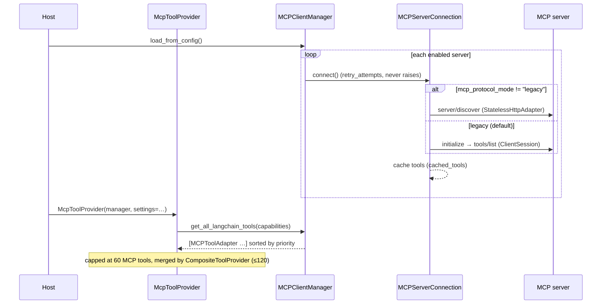

# MCP client

`prismal/mcp/` is Prismal's [Model Context Protocol](https://modelcontextprotocol.io)
**client**. It reads a catalogue of MCP servers from `config/mcp_servers.yaml`,
keeps one connection per enabled server alive, and exposes each server tool as a
LangChain `BaseTool` (`MCPToolAdapter`). Agents never import this package. The
host wraps an `MCPClientManager` in an `McpToolProvider` and injects it through
the `ToolProviderPort` (see [tool-providers.md](tool-providers.md)).

> Related: [Tool providers](tool-providers.md) ·
> [Protocol upgrades 2026](protocols-2026.md) (stateless wire + tasks) ·
> [ADR-PRT-001](adr/ADR-PRT-001-protocol-pins.md) (pinned wire names)

## Overview

| Layer | Module | Responsibility |
|---|---|---|
| Config models | `mcp/connection.py` | `MCPServerConfig`, `MCPAuthConfig`, `MCPServerStatus` (YAML schema) |
| One server | `mcp/connection.py` | `MCPServerConnection`: transport, session, tool cache, `call_tool` |
| All servers | `mcp/client.py` | `MCPClientManager`: load/reload config, priority + capability filtering |
| Tool wrapper | `mcp/adapter.py` | `MCPToolAdapter(BaseTool)`: JSON Schema → Pydantic `args_schema`, async-only calls |
| 2026-07-28 wire (opt-in) | `mcp/protocol.py`, `mcp/constants.py` | `LegacySessionAdapter`, `StatelessHttpAdapter`, `select_adapter`, `negotiate_stateless` |
| Tool-list cache (opt-in) | `mcp/tool_cache.py` | `McpToolListCache` (TTL, scope, identity-preserving refresh) |
| Tasks extension (opt-in) | `mcp/tasks.py` | `McpTaskPoller` |
| Input requests (stateless) | `mcp/input_requests.py` | `InputRequestHandler`, `DeclineAllInputHandler` |
| Bundled server | `mcp/servers/datetime_server.py` | Standalone FastMCP server (`python -m prismal.mcp.servers.datetime_server`) |

The `mcp` SDK is pinned at 1.28.1 and serves the legacy session path. The
2026-07-28 stateless wire is implemented in-house on `httpx`.

## How it works



### Server catalogue

`MCPClientManager.load_from_config(config_path=None)` reads the YAML `servers:`
list with `yaml.safe_load`. Each entry is validated as an `MCPServerConfig`:

| Field | Default | Notes |
|---|---|---|
| `name` | required | Unique id; also the key in `get_server_status()` |
| `type` | required | `stdio`, `sse` or `streamable-http` |
| `enabled` | `true` | Disabled entries are never connected |
| `command` / `env` | `None` | stdio only (`command` is required). `$VAR`s in `env` values are expanded with `os.path.expandvars` |
| `url` / `auth` | `None` | `sse` and `streamable-http` (`url` is required). `auth: {type: bearer, token_env: NAME}` |
| `timeout_seconds` | `30` | Applied to `initialize` and to every `call_tool` |
| `retry_attempts` | `3` | Connect retries |
| `priority` | `0` | Higher values are listed first. Descriptions get a `[Preferred]` / `[Fallback …]` prefix |
| `capabilities` | `["general"]` | Tags used for capability routing |

A missing file, invalid YAML or an invalid entry is logged, and the manager
stays usable. `reload()` re-reads the file. Connections that are still valid
are kept, removed or disabled servers are disconnected, and new ones are
connected. `close()` disconnects everything. `MCPServerConnection` records the
PIDs of the stdio subprocesses it spawns, so that it can force-kill the
process tree on disconnect.

### Capability routing

`get_all_langchain_tools(capabilities=None)` filters at server level:

- `capabilities=None` returns every connected server (the legacy behaviour).
- Otherwise a server is included when its `capabilities` intersect the request.
- Servers tagged `general` are **always** included.

The capability vocabulary is documented in the header of
`config/mcp_servers.yaml`: `general`, `research`, `file_management`,
`code_execution`, `code_review`, `customer_service`, `data_etl`,
`document_generation`, `rag`, `vision`, `audio`, `video`. Agents ask through
the tool registry with `get_tools_for_agent(agent_name, required_capabilities=…)`.
The registry passes the request to the injected provider, and
`McpToolProvider` forwards it to the manager.

### Tool calls

`MCPToolAdapter._arun(**kwargs)` drops `None` arguments, so that optional
fields are omitted instead of being sent as `null`. It then calls
`MCPServerConnection.call_tool(name, arguments)` under
`asyncio.wait_for(timeout_seconds)` and joins the `TextContent` blocks of the
result. A result with `isError=True`, a timeout or a transport error raises
`MCPToolError`. Synchronous `_run` raises `NotImplementedError`, so MCP tools
must be awaited (`ainvoke` / `arun`). When the adapter is constructed with an
`ActionInterceptor`, `on_tool_start` runs before the call, and a
`PermissionDeniedError` blocks it.

### 2026-07-28 stateless mode, tool-list cache, tasks

These are opt-in Phase PRT features. With the defaults, `mcp_protocol_mode="legacy"`
and every other flag off, the request sequence equals 3.16.0:

- `MCPServerConnection._do_connect()` calls `negotiate_stateless()` when
  `mcp_protocol_mode` is `stateless` or `auto`. stdio is always legacy. `auto`
  probes `server/discover` once per server and memoizes the result in
  `ProtocolModeMemo` (`clear_protocol_memo()` resets it).
- `McpToolProvider` puts each server's list through `McpToolListCache` when
  `mcp_tool_cache_enabled` is on. Unchanged content returns the *same*
  `BaseTool` objects, so the prompt-cache prefix stays stable.
- With `mcp_tasks_enabled`, a task-augmented `tools/call` is polled by
  `McpTaskPoller.wait()`. With the flag off, task-only tools are filtered out
  and task results are refused (fail closed).
- `input_required` rounds go to the `InputRequestHandler` passed as
  `MCPClientManager(input_handler=…)`. The default is `DeclineAllInputHandler`.

The full wire behaviour, metrics and rollout notes are in
[protocols-2026.md](protocols-2026.md).

### Plugging into `ToolProviderPort`

`build_default_tool_provider(settings, *, mcp_config_path=None)` in
`prismal/agents/extension/providers.py` is the standard host wiring. When the
config file exists, it builds an `MCPClientManager` and awaits
`load_from_config()`. It forwards `settings` to the manager only when
`mcp_protocol_mode != "legacy"` or `mcp_tasks_enabled` is on. It then appends
`McpToolProvider(manager, settings=settings)` before the skills and stub
providers. If MCP fails to start, a warning is logged and the MCP provider is
left out. Startup never aborts. `build_runtime(..., mcp_config_path=…)` in the
composition root reuses the same builder.

## Public API

| Symbol | Module |
|---|---|
| `MCPClientManager` | `prismal.mcp.client` (re-exported from `prismal.mcp`) |
| `MCPServerConnection`, `MCPServerConfig`, `MCPAuthConfig`, `MCPServerStatus` | `prismal.mcp.connection` (re-exported) |
| `resolve_secret` | `prismal.mcp.connection` |
| `MCPToolAdapter` | `prismal.mcp.adapter` (re-exported) |
| `McpProtocolAdapter`, `LegacySessionAdapter`, `StatelessHttpAdapter`, `select_adapter`, `negotiate_stateless`, `ProtocolModeMemo`, `clear_protocol_memo`, `ToolListPage`, `ServerDiscovery`, `McpTaskHandle`, `McpTaskStatus`, `ToolCallOutcome` | `prismal.mcp.protocol` |
| `McpToolListCache`, `CachedToolList`, `canonical_tools_hash`, `principal_scope_key` | `prismal.mcp.tool_cache` |
| `McpTaskPoller` | `prismal.mcp.tasks` |
| `InputRequestHandler`, `DeclineAllInputHandler`, `McpInputRequest`, `McpInputResponse`, `answer_input_requests` | `prismal.mcp.input_requests` |
| `STATELESS_PROTOCOL_VERSION`, `LEGACY_PROTOCOL_VERSIONS`, method / header / `_meta` names | `prismal.mcp.constants` |
| `McpToolProvider`, `build_default_tool_provider` | `prismal.agents.extension` (host side) |

Exceptions (`prismal.core.exceptions`): `MCPError` → `MCPConnectionError`,
`MCPToolError`. The PRT subtree adds `McpProtocolError`, `McpDiscoveryError`,
`McpTaskError` and `McpTaskTimeout`.

## Configuration

Per-server options live in `config/mcp_servers.yaml` (table above). The global
switches are on `Settings` (`PRISMAL_` prefix):

| Env var | Default | Meaning |
|---|---|---|
| `PRISMAL_MCP_PROTOCOL_MODE` | `legacy` | `legacy`, `stateless` or `auto` |
| `PRISMAL_MCP_STATELESS_PROTOCOL_VERSION` | `2026-07-28` | Version sent by the stateless adapter |
| `PRISMAL_MCP_TOOL_CACHE_ENABLED` | `false` | TTL tool-list cache |
| `PRISMAL_MCP_TOOL_CACHE_DEFAULT_TTL_S` | `300` | TTL when the server sends no `ttlMs` (also the `auto` memo TTL) |
| `PRISMAL_MCP_TOOL_CACHE_MAX_TTL_S` | `86400` | TTL ceiling |
| `PRISMAL_MCP_TOOL_CACHE_MAX_ENTRIES` | `256` | LRU bound |
| `PRISMAL_MCP_TASKS_ENABLED` | `false` | Declare and accept the tasks extension |
| `PRISMAL_MCP_TASK_POLL_INTERVAL_S` | `1.0` | First poll delay |
| `PRISMAL_MCP_TASK_POLL_MAX_INTERVAL_S` | `15.0` | Poll delay ceiling |
| `PRISMAL_MCP_TASK_TIMEOUT_S` | `900.0` | Task wall-clock limit (then `tasks/cancel` and `McpTaskTimeout`) |

## Usage

```yaml
# config/mcp_servers.yaml
servers:
  - name: datetime
    type: stdio
    command: ["python", "-m", "prismal.mcp.servers.datetime_server"]
    capabilities: ["general"]
  - name: search
    type: streamable-http
    url: https://mcp.example.com/mcp
    auth: {type: bearer, token_env: SEARCH_MCP_TOKEN}
    capabilities: ["research"]
    priority: 2
```

```python
from pathlib import Path

from prismal.agents.extension import McpToolProvider
from prismal.agents.tool_registry import set_tool_provider
from prismal.core.config import get_settings
from prismal.mcp import MCPClientManager

manager = MCPClientManager(Path("config/mcp_servers.yaml"))
await manager.load_from_config()
print([s.model_dump() for s in manager.get_server_status()])

research_tools = manager.get_all_langchain_tools(capabilities=["research"])
result = await research_tools[0].ainvoke({"query": "MCP 2026-07-28"})

# Usually you compose it instead (see docs/tool-providers.md):
set_tool_provider(McpToolProvider(manager, settings=get_settings()))
...
await manager.close()
```

Host wiring examples:
[`examples/tool_provider_host.py`](../examples/tool_provider_host.py) and
[`examples/composition_root.py`](../examples/composition_root.py).

## Security notes

- **Agents never import MCP** (Critical Rule #9). Only
  `agents/extension/providers.py` imports `prismal.mcp`, and it does so lazily.
  `tests/unit/agents/extension/test_no_mcp_skills_imports.py` enforces this.
- **Secrets stay out of YAML.** `auth.token_env` names a secret. `resolve_secret()`
  looks it up in the injected `ConfigSourcePort` first and then in
  `os.environ`. URLs and stdio `env` values are expanded with
  `os.path.expandvars`.
- **The ActionInterceptor is optional on the adapter.**
  `MCPClientManager.get_all_langchain_tools()` builds `MCPToolAdapter(conn, mcp_tool)`
  with no interceptor (`prismal/mcp/client.py`). On that path the adapter
  itself runs no `ActionInterceptor` hooks. If MCP servers can write files or
  execute code, construct the adapters with an interceptor yourself, or
  enable/disable those servers deliberately (Critical Rules #2 and #5).
- **Untrusted server data.** Server-supplied millisecond hints are clamped to
  `MAX_HINT_MS`. Stateless elicitation text is L1-sanitized
  (`InputSanitizer`), URL-mode elicitation is never opened, and
  `DeclineAllInputHandler` audits only a SHA-256 of the prompt. A tool list
  with no `cacheScope` is cached per principal (fail closed).
- The bundled `datetime_server` imports no `prismal` internals. It runs as a
  separate subprocess and reads `PRISMAL_TIMEZONE` / `PRISMAL_CRON_TIMEZONE`
  from its own environment.

## Testing

- `tests/unit/mcp/`: `test_client.py`, `test_connection.py`, `test_adapter.py`,
  `test_capability_routing.py`, `test_mcp_tracing.py`, `test_datetime_server.py`,
  plus PRT: `test_connection_protocol.py`, `test_protocol_adapters.py`,
  `test_protocol_malformed_fields.py`, `test_stateless_and_legacy_servers.py`,
  `test_tool_cache.py`, `test_tasks_poller.py`, `test_input_requests.py`
  (`fake_mcp_servers.py` holds the fakes).
- `tests/unit/agents/extension/test_no_mcp_skills_imports.py`: the inversion
  guard.
- In agent tests, inject `FakeToolProvider` instead of a live manager.

```bash
uv run pytest tests/unit/mcp
```

## Related

- [tool-providers.md](tool-providers.md): `ToolProviderPort`, `McpToolProvider`, `CompositeToolProvider`
- [protocols-2026.md](protocols-2026.md): stateless wire, tool-list cache, tasks, input requests
- [composition-root.md](composition-root.md): `build_runtime(mcp_config_path=…)`
- [skills.md](skills.md): the other live tool source
- [configuration.md](configuration.md): `ConfigSourcePort`, which `resolve_secret` consults
