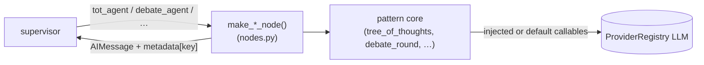

# Reasoning patterns

`prismal/agents/patterns/` holds reusable reasoning primitives: loops, searches, debates and
fan-outs that agents and subgraphs compose. Six of them also become supervisor routes through the
node adapters in `patterns/nodes.py`.

## Overview

There are **9 pattern modules** plus `nodes.py` (adapters) and `__init__.py` (the `AgentPattern`
enum used by `AgentFactory`):

| Pattern | Module | Entry point | Graph route (`ADVANCED_MEMBERS`) | Used in-package by |
|---|---|---|---|---|
| Reflection | `reflection.py` | `reflection_loop()`, `@with_reflection` | — | `planner`, `rag_agent`, `dev_pipeline/po_agent` |
| Parallel fan-out | `parallel.py` | `make_parallel_dispatcher()` | — | `parallel_research`, `dev_pipeline`, `skynet` subgraph |
| Tree of Thoughts | `tree_of_thoughts.py` | `tree_of_thoughts()`, `make_tot_node()` | `tot_agent` | node adapter |
| Debate | `debate.py` | `debate_round()`, `pairwise_jaccard()` | `debate_agent` | node adapter, Kokoro (`pairwise_jaccard`) |
| Constitutional AI | `constitutional.py` | `ConstitutionalFilter.apply()` | `constitutional_filter` | node adapter |
| LATS (MCTS) | `lats.py` | `LATSAgent.search()` | `lats_agent` | node adapter |
| LLM-Compiler | `llm_compiler.py` | `LLMCompiler.compile_and_run()` | `llm_compiler` | node adapter |
| Mixture of Agents | `mixture_of_agents.py` | `MixtureOfAgents.generate()` | `mixture_agent` | node adapter, `multimodal_fusion` (`moa` strategy) |
| Swarm handoff | `swarm.py` | `swarm_handoff()` | — | not wired into any graph |

So **6 patterns are graph nodes** (gate `enable_subgraphs`) and **3 are library primitives**
(reflection, parallel, swarm).

## How it works

### Callable injection

The algorithmic core of most patterns takes its LLM-dependent steps as async callables. Tests can
then run the algorithm with deterministic fakes:

| Pattern | Injected callables |
|---|---|
| `reflection_loop` | `generate_fn(state, previous_draft=None, critique=None) -> str`, `critique_fn(draft, state) -> (feedback, score)` |
| `tree_of_thoughts` | `generate_fn(problem, state, path) -> list[str]`, `evaluate_fn(thought, state) -> float` |
| `LATSAgent` | `reward_fn(state) -> float`, `action_generator(state, tools) -> actions`, `transition_fn(state, action) -> state` |
| `LLMCompiler` | `plan_fn(goal, state, previous_results)`, `tool_executor(task, prior_outputs)`, `joiner(goal, completed)` |
| `make_parallel_dispatcher` | `worker_node` name + `tasks_field` (no LLM) |

`debate_round`, `MixtureOfAgents` and `ConstitutionalFilter` resolve their LLM internally through
`ProviderRegistry` and build prompts with `SecurePromptBuilder`. Their node factories still let
you replace the whole unit: `make_debate_node(debate_fn=...)`, `make_mixture_node(moa=...)`
or `moa_factory=...`, `make_constitutional_node(filter_factory=...)`.

### From pattern to graph node

`patterns/nodes.py` exposes 6 factories. Each returns an `async (state) -> state_update` node
that:

1. reads the query from `state["messages"][-1]` (an empty history means a no-op that returns `{}`);
2. runs the pattern. Missing callables get LLM-backed defaults that resolve the provider **at call
   time** (`_resolve_llm`), so building the graph needs no credentials;
3. returns `{"messages": [AIMessage(...)], "metadata": {<key>: {...}}}`.

| Route | Factory | Defaults | `metadata` key → fields |
|---|---|---|---|
| `tot_agent` | `make_tot_agent_node(*, generate_fn=None, score_fn=None, llm=None, breadth=3, depth=2, beam_size=2, threshold=0.9, search_strategy="beam")` | LLM thought generator + scorer | `tot` → `best_score`, `total_thoughts`, `strategy` |
| `debate_agent` | `make_debate_node(*, debate_fn=debate_round, n_agents=3, n_rounds=2, synthesis_strategy="moderator")` | — | `debate` → `agreement_score`, `rounds_completed` |
| `constitutional_filter` | `make_constitutional_node(*, filter_factory=ConstitutionalFilter)` | `DEFAULT_PRINCIPLES` | `constitutional` → `revisions`, `all_principles_satisfied`, `max_revisions_reached` |
| `lats_agent` | `make_lats_node(*, reward_fn=None, action_generator=None, transition_fn=None, llm=None, max_simulations=16, max_depth=3, n_actions=3, exploration_constant=1.41)` | LLM actions + reward. On `LATSError` it falls back to one direct LLM answer | `lats` → `best_reward`, `total_simulations`, `search_tree_depth` |
| `llm_compiler` | `make_llm_compiler_node(*, plan_fn=None, tool_executor=None, joiner=None, llm=None, max_subtasks=3, max_replanning=0)` | LLM planner/executor/joiner, `tools=[]`. AMR plan cache via `plan_cache_for()` | `llm_compiler` → `tasks_succeeded`, `tasks_failed`, `replanning_count` |
| `mixture_agent` | `make_mixture_node(*, moa=None, moa_factory=MixtureOfAgents, proposer_models=None)` | proposers = `[default_model, fallback_model]` (deduplicated). `batch_policy` from `build_batch_policy(settings)` when `routing_policy="batch"` | `mixture` → `providers_used` |

`graph.py::_build_advanced_nodes()` calls each factory with no arguments and registers the results
under these route names when `enable_subgraphs` is on (see [agents.md](agents.md#route-count)).
`intent_router.match_intent()` short-circuits two of them: "tree of thoughts" → `tot_agent`,
"debate" → `debate_agent`.



### Pattern details

* **Reflection** — `reflection_loop(generate_fn, critique_fn, state, threshold=0.85, max_iterations=3, budget_guard_fn=None) -> (best_draft, best_score)`.
  The loop generates, critiques and refines until `score >= threshold`. Iterations are capped at
  `min(max_iterations, settings.reflection_max_iterations)`. With `reflection_enabled=False` it
  returns the first draft with score `1.0`. `with_reflection(threshold=0.85, max_iterations=2, critique_fn=...)`
  decorates a node that returns a string draft (`critique_fn` is required). `planner` and
  `rag_agent` use `settings.reflection_default_threshold` (`rag_agent` takes
  `max(0.8, reflection_default_threshold)`).
* **Parallel** — `make_parallel_dispatcher(tasks_field, worker_node, max_workers=10, on_empty="__end__", task_key="_task")`
  returns a conditional-edge function. It emits one `Send(worker_node, {**state, task_key: task})`
  per item in `state[tasks_field]`, capped at `min(max_workers, parallel_max_workers)`.
  Overflow is truncated with a warning. It returns `on_empty` when the list is empty, is not a list,
  or `parallel_enabled` is off.
* **Tree of Thoughts** — `tree_of_thoughts(problem, generate_fn, evaluate_fn, state, breadth=3, depth=3, beam_size=2, threshold=0.9, search_strategy="beam", budget_guard_fn=None) -> ToTResult`.
  Strategies are `beam`, `bfs` and `dfs`, with an early stop once a thought scores `>= threshold`.
* **Debate** — `debate_round(query, state, n_agents=3, n_rounds=2, roles=None, synthesis_strategy="moderator", settings=None, budget_guard_fn=None) -> DebateResult`.
  Default roles are `proponent`, `opponent` and `neutral`. Synthesis is `moderator`,
  `majority_vote` or `weighted` (weighted is a moderator variant). `agreement_score` is
  `pairwise_jaccard()` over the final-round token sets.
* **Constitutional** — `ConstitutionalFilter(principles=None, max_revisions=3, settings=None).apply(output, context=None) -> ConstitutionalResult`.
  It checks each principle in order and revises on a violation, up to `max_revisions` per
  principle. `DEFAULT_PRINCIPLES` has 3 entries: `P001 no_harmful_content`, `P002 factual_accuracy`,
  `P003 no_pii_exposure`.
* **LATS** — `LATSAgent(tools, reward_fn, action_generator, transition_fn, max_simulations=50, exploration_constant=1.41, max_depth=10, timeout_seconds=None, terminal_reward=0.99, settings=None).search(initial_state, goal, budget_guard_fn=None) -> LATSResult`.
  This is MCTS with UCB1 (`LATSNode.ucb1`: `reward/visits + C·sqrt(ln(parent_visits)/visits)`;
  unvisited nodes score `inf`).
* **LLM-Compiler** — `LLMCompiler(tools, plan_fn, tool_executor, joiner, max_replanning=2, settings=None, plan_cache=None)`.
  `plan()` produces a `CompilerPlan`. `validate_dag()` uses Kahn's algorithm and raises
  `CompilerError` on duplicate ids, unknown dependencies or cycles. `compute_execution_waves()`
  groups tasks into topological waves that run concurrently. `compile_and_run(goal, state, ...)`
  returns `CompilerResult`.
* **Mixture of Agents** — `MixtureOfAgents(proposer_models, aggregator_model=None, n_aggregator_layers=1, settings=None, batch_policy=None).generate(query, state, budget_guard_fn=None) -> MoAResult`.
  Proposers run in parallel and the aggregator synthesises their answers. Partial proposer
  failures are tolerated; `MoAError` is raised only if all of them fail.
* **Swarm** — `await swarm_handoff(current_agent, target_agent, state, reason, valid_targets=None)`
  returns a new state with `next_agent=target_agent` and appends a `HandoffRecord` to
  `metadata["handoff_history"]`. It is copy-on-write. Self-handoff and targets outside
  `valid_targets` (default `VALID_HANDOFF_TARGETS`: `coder`, `researcher`, `data_analyst`,
  `planner`, `file_manager`, `rag_agent`, `critic`) raise `ValueError`. The module also re-exports
  `SwarmError`.

### Budget integration

Five pattern entry points accept `budget_guard_fn: Callable[[dict], Awaitable[bool]] | None`. They
call it before each expansion unit and stop early (best effort) when it returns `False`. A
hard-capped guard raises `BudgetExceeded`:

| Entry point | Checked before | Context dict |
|---|---|---|
| `reflection_loop` | each refinement (iteration ≥ 2) | `{"pattern": "reflection", "iteration": n}` |
| `tree_of_thoughts` | each depth level after the root | `{"pattern": "tot", "strategy": s, "level": d}` |
| `LATSAgent.search` | each MCTS simulation after the first | `{"pattern": "lats", "simulations": n}` |
| `debate_round` | each additional round | `{"pattern": "debate", "round": r}` |
| `MixtureOfAgents.generate` | each aggregator layer | `{"pattern": "moa", "layer": n}` |

Build the callable with `prismal.budget.guard.make_budget_guard_fn(guard)`. A `None` guard gives
an always-`True` function. The per-run guard is `prismal.budget.resolve.get_budget_guard(state)`.
`constitutional`, `llm_compiler`, `parallel` and `swarm` take no `budget_guard_fn`.

> **Note.** The `nodes.py` factories (including `make_tot_node`) and the in-package
> `reflection_loop` callers (`planner`, `rag_agent`, `po_agent`) do not pass a `budget_guard_fn`.
> Inside the supervisor graph these patterns are not checked per expansion unit. The ReAct-based
> specialists are budgeted through `react_loop(..., budget_guard=...)` instead
> ([budget.md](budget.md)).

## Public API

| Symbol | Module |
|---|---|
| `reflection_loop`, `with_reflection`, `GenerateFn`, `CritiqueFn` | `prismal.agents.patterns.reflection` |
| `make_parallel_dispatcher`, `DispatcherFn` | `prismal.agents.patterns.parallel` |
| `tree_of_thoughts`, `make_tot_node`, `Thought`, `ToTResult` | `prismal.agents.patterns.tree_of_thoughts` |
| `debate_round`, `pairwise_jaccard`, `DebatePosition`, `DebateResult` | `prismal.agents.patterns.debate` |
| `ConstitutionalFilter`, `ConstitutionalPrinciple`, `ConstitutionalResult`, `DEFAULT_PRINCIPLES` | `prismal.agents.patterns.constitutional` |
| `LATSAgent`, `LATSNode`, `LATSResult` | `prismal.agents.patterns.lats` |
| `LLMCompiler`, `TaskNode`, `CompilerPlan`, `CompilerResult` | `prismal.agents.patterns.llm_compiler` |
| `MixtureOfAgents`, `MoAResult`, `MoAError` | `prismal.agents.patterns.mixture_of_agents` |
| `swarm_handoff`, `HandoffRecord`, `VALID_HANDOFF_TARGETS` | `prismal.agents.patterns.swarm` |
| `make_tot_agent_node`, `make_debate_node`, `make_constitutional_node`, `make_lats_node`, `make_llm_compiler_node`, `make_mixture_node` | `prismal.agents.patterns.nodes` |
| `AgentPattern` | `prismal.agents.patterns` (topologies for `AgentFactory`) |

`prismal.agents.patterns` itself re-exports only `AgentPattern`; import pattern symbols from
their submodules.

## Configuration

`prismal/core/config.py` `Settings`, env prefix `PRISMAL_`.

| Setting | Default | Effect |
|---|---|---|
| `enable_subgraphs` | `False` | Registers the 6 pattern nodes as supervisor routes (async graph) |
| `reflection_enabled` | `True` | Off ⇒ `reflection_loop` returns the first draft |
| `reflection_max_iterations` | `3` (1–10) | Global cap on reflection iterations |
| `reflection_default_threshold` | `0.85` | Threshold used by `planner` / `rag_agent` |
| `parallel_enabled` | `True` | Off ⇒ every dispatcher routes to `on_empty` |
| `parallel_max_workers` | `10` (1–100) | Hard cap on `Send` per fan-out |
| `default_model`, `fallback_model` | `"claude-sonnet-4-5"`, `"gpt-4o-mini"` | Default MoA proposers in `make_mixture_node` |
| `routing_policy` | `"static"` | `"batch"` ⇒ batch-assigned MoA proposers ([routing.md](routing.md)) |
| `budget_enabled` | `False` | Per-run guard available via `get_budget_guard(state)` ([budget.md](budget.md)) |
| `constitutional_enabled`, `constitutional_max_revisions`, `constitutional_principles` | `False`, `3`, `["P001","P002","P003"]` | Declared, but no module under `prismal/` reads them. `ConstitutionalFilter` uses its own constructor arguments |

## Usage

Offline: inject callables instead of an LLM.

```python
import asyncio

from langchain_core.messages import HumanMessage

from prismal.agents.patterns.nodes import make_tot_agent_node
from prismal.agents.patterns.reflection import reflection_loop
from prismal.budget.guard import make_budget_guard_fn


async def generate(problem, state, path):  # -> list[str]
    return [f"step {len(path)}: option {i}" for i in range(3)]


async def score(thought, state):  # -> float in [0, 1]
    return 0.95 if thought.endswith("option 2") else 0.3


async def main() -> None:
    node = make_tot_agent_node(generate_fn=generate, score_fn=score, breadth=3, depth=2)
    update = await node({"messages": [HumanMessage(content="Plan a migration")], "metadata": {}})
    print(update["messages"][-1].content, update["metadata"]["tot"])

    async def draft(state, previous_draft=None, critique=None):
        return (previous_draft or "v0") + "+"

    async def critique(text, state):
        return "add detail", min(1.0, 0.4 * len(text))

    best, s = await reflection_loop(
        draft, critique, state={}, threshold=0.85, max_iterations=3,
        budget_guard_fn=make_budget_guard_fn(None),  # None guard: always proceed
    )
    print(best, s)


asyncio.run(main())
```

Runnable examples in `examples/patterns/`: `01_tree_of_thoughts.py`, `02_debate.py`,
`03_lats.py`, `04_llm_compiler.py`, `05_mixture_of_agents.py`, `06_reflection_loop.py`,
`07_constitutional_ai.py`, `08_swarm.py`, `09_parallel_dispatcher.py`. Budget wiring:
`examples/budget_governance.py`, `examples/budget_graph_integration.py`.

## Testing

* Unit: `tests/unit/agents/patterns/` — `test_reflection.py`, `test_parallel.py`,
  `test_tree_of_thoughts.py`, `test_debate.py`, `test_constitutional.py`, `test_lats.py`,
  `test_llm_compiler.py`, `test_llm_compiler_plan_cache.py`, `test_mixture_of_agents.py`,
  `test_moa_routing.py`, `test_swarm.py`, `test_nodes.py`.
* Graph wiring: `tests/unit/agents/test_graph_advanced_nodes.py`,
  `tests/unit/agents/test_supervisor_advanced_routing.py`, `tests/unit/agents/test_patterns.py`.
* Integration: `tests/integration/agents/test_reflexion_loop.py`,
  `tests/integration/test_adaptive_rag_constitutional.py`.

## Related

* [agents.md](agents.md) — supervisor routes and `ADVANCED_MEMBERS`.
* [subgraphs.md](subgraphs.md) — `make_parallel_dispatcher` inside `dev_pipeline` and `skynet`; `debate_consensus` pipeline.
* [budget.md](budget.md) — `BudgetGuard`, `make_budget_guard_fn`.
* [routing.md](routing.md) — batch assignment for MoA, plan cache for LLM-Compiler.
* [kokoro.md](kokoro.md) — reuses `pairwise_jaccard` for soul agreement.
* [configuration.md](configuration.md) — all settings.
* `specs/advanced-architectures/SPEC.md` — SPEC-PAT-001…007.
