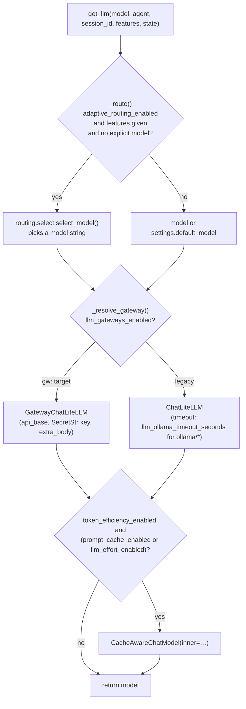

# LLM & media providers

`prismal/providers/` is the **only** package that talks to model vendors. Every
chat model the agents use is built by `ProviderRegistry.get_llm()` on top of
LiteLLM (`langchain_litellm.ChatLiteLLM`), and every speech, vision and
embedding backend is wrapped behind a small Prismal-owned interface. Agents,
RAG, memory and the routing layer only ever see `BaseChatModel`,
`STTClient`, `TTSClient` or `Embeddings`. They never see a vendor SDK.

> Related guides: [LLM gateways](gateways.md) · [Cost & budget](budget.md) ·
> [Token efficiency](token-efficiency.md) · [Adaptive routing](routing.md) ·
> contract: [ADR-WAVE-001](adr/ADR-WAVE-001-llm-construction-contract.md)

## Overview

| Concern | Module | Entry point |
|---|---|---|
| Chat models (all providers) | `providers/registry.py` | `ProviderRegistry.get_llm()` / `get_llm_with_fallback()` |
| Per-call USD pricing | `providers/cost.py` | `compute_cost_usd()` → `CostEstimate` |
| Prompt caching + per-agent effort | `providers/prompt_cache.py` | `CacheAwareChatModel` (outer wrapper) |
| Gateways (OpenRouter, OpenCode, OmniRoute, …) | `providers/gateways/` | `GatewayChatLiteLLM`, `GatewayRouter` (see [gateways.md](gateways.md)) |
| Provider batch APIs | `providers/batch_adapters.py` | `default_adapters()` → `BatchApiPort` |
| Speech-to-text | `providers/stt.py` | `get_stt()` → `STTClient` |
| Text-to-speech | `providers/tts.py` | `get_tts()` → `TTSClient` |
| Vision / native multimodal chat | `providers/vision.py`, `providers/multimodal.py` | `get_vision_llm()`, `get_multimodal_llm()` |
| Cross-modal (CLIP) embeddings | `providers/cross_modal_embeddings.py` | `get_cross_modal_embeddings()` → `CLIPEmbeddings` |
| RAG reranking / compression | `providers/rerank.py`, `providers/compression.py` | `build_reranker()`, `PassageCompressor` |
| LLM injection classifier | `providers/injection_classifier.py` | `build_injection_classifier()` |

There is no module-level `get_llm()` function. The factory is the
`ProviderRegistry.get_llm` method.

## How it works

### The LLM construction pipeline

`ProviderRegistry.get_llm(model=None, streaming=False, temperature=None, *, agent=None, session_id=None, features=None, state=None)`
assembles a chat model in a fixed order, as set out in ADR-WAVE-001:



- **Routing (AMR)** only picks the model *string*. It never wraps the model.
  An explicit `model=` always wins. So does an agent pinned in
  `llm_gateway_agent_map`.
- **Gateways (GW)**: a `gw:<gateway>/<model>` reference with
  `llm_gateways_enabled=False` raises `GatewayConfigError("gateways_disabled…")`.
  It never falls back to the legacy path silently.
- **Langfuse**: when `LangfuseManager().get_callback_handler()` returns a
  handler, it is attached to `llm.callbacks`. Every build opens an OTel span
  `provider.get_llm` and increments the `llm_requests` counter.
- `get_llm_with_fallback()` wraps the primary with `with_fallbacks([fallback])`
  when `settings.fallback_model` is non-empty and differs from the primary. It
  skips the wrapper in three cases: under a routing cascade, when the gateway
  owns model fallback (`ResolvedModel.owns_model_fallback`), and when the
  fallback is empty. When primary and fallback share one gateway, a 402 or a
  policy denial is **not** retried there (`_SameGatewayFallbackEligible`).

### Credentials bridge

LiteLLM reads credentials from `os.environ`. `ProviderRegistry._inject_api_keys()`
mirrors `anthropic_api_key`, `openai_api_key`, `google_api_key` and
`ollama_base_url` (as `OLLAMA_API_BASE`) into the environment with
`os.environ.setdefault`, so values the shell already set win. It also sets
`litellm.modify_params = True`. This is the single sanctioned environment
*write* in the core (exempted in `tests/unit/core/test_no_env_reads.py`).
Gateway keys are **never** written to the environment. They are unwrapped only
at the `GatewayChatLiteLLM` constructor.

### Cost (`providers/cost.py`)

`compute_cost_usd(model, prompt_tokens, completion_tokens, *, settings=None, cache_read_tokens=0, cache_write_tokens=0, reported_cost_usd=None, response=None, cost_mode="metered", batch=False) -> CostEstimate`
never raises. It resolves a price in this order:

0. `cost_mode="subscription"` → `CostEstimate(0.0, "subscription", equivalent_usd=…)`
1. `reported_cost_usd` (gateway-billed) → `source="gateway"`
2. `litellm.completion_cost(response)` or `litellm.cost_per_token(...)` (cache-aware) → `"litellm"`
3. `settings.budget_pricing[model]` (per 1k tokens) → `"table"`
4. `CostEstimate(0.0, "none")`

`batch=True` multiplies only the `litellm`/`table` prices by
`settings.batch_price_ratio`. `CostEstimate.estimated` is `True` unless the
source is `gateway`, `litellm` or `subscription`. The consumer is `CostMeter`;
see [budget.md](budget.md).

### Cache-aware chat model (`providers/prompt_cache.py`)

`CacheAwareChatModel` is a composition wrapper (`inner: BaseChatModel`). It
touches only the request side:

- **Cache policy**: `detect_cache_family(model)` returns a `CacheFamily`
  (`ANTHROPIC_EXPLICIT`, `OPENAI_AUTO`, `GEMINI_IMPLICIT`, `DEEPSEEK_AUTO` or
  `NONE`). `apply_cache_policy()` then adds Anthropic `cache_control`
  breakpoints or an OpenAI `prompt_cache_key`. It is fail-open: on error it
  returns the inputs unchanged. The volatile provider facts live in
  `config/prompt_cache.yaml` and are loaded by `load_cache_policy(settings)`.
- **Per-agent effort**: `reasoning_effort` comes from `llm_effort_by_agent`,
  or from the `recommended` profile (`recommended_effort(agent)`). It is sent
  only when `supports_reasoning(model)` is true. `max_tokens` comes from
  `llm_max_tokens_by_agent`. The agent is the `agent=` argument, or the call's
  `langgraph_node` metadata when `agent=` is not given.
- Tools are bound name-sorted, so the tool block stays byte-stable.

The inner `ChatResult` comes back unchanged, so `response_metadata` (gateway
cost capture, usage) survives. Full guide: [token-efficiency.md](token-efficiency.md).

### Gateways

`providers/gateways/` (`GatewayPort`, `GatewayRouter`, `GatewayChatLiteLLM`,
`QuotaLedger`, `CostReconciler`, `GatewayQuotaPoller`, the
OpenRouter / OpenCode / OmniRoute / generic OpenAI-compatible adapters) is
documented in [gateways.md](gateways.md).

### Batch adapters (`providers/batch_adapters.py`)

`BatchApiPort` (`submit` / `poll` / `results` / `cancel`) is the seam that
`prismal.routing.batch.BatchExecutor` uses. Three adapters exist:

| Adapter | Transport |
|---|---|
| `AnthropicBatchAdapter` | raw `httpx` against Message Batches (LiteLLM cannot create or fetch them) |
| `OpenAIBatchAdapter` | LiteLLM file + batch API (`litellm_module` is injectable for tests) |
| `OpenRouterBatchAdapter` | `httpx` against `POST /api/v1/batches`, with defensive result parsing |

`default_adapters(settings, *, key_resolver=None)` builds one adapter for each
family that has a key (`anthropic_api_key`, `openai_api_key`,
`openrouter_api_key`). `key_resolver` lets a multi-tenant host supply tenant
keys. Every failure raises `BatchExecutorError`, and keys never appear in
`repr`. The executor side is described in [routing.md](routing.md#batchexecutor).

### Media wrappers

| Function | Resolution | Backends |
|---|---|---|
| `get_stt(provider=None, model=None, *, settings=None)` | `provider` or `settings.stt_provider` | `openai` → `litellm.atranscription` (default model `whisper-1`); `local` → `faster_whisper.WhisperModel` (default `base`, `[multimodal-local]`) |
| `get_tts(provider=None, *, settings=None)` | preferred, then cascades `elevenlabs → openai → pyttsx3` | `elevenlabs` (`[multimodal-premium]`), `openai` (`litellm.aspeech`, `gpt-4o-mini-tts`), `pyttsx3` (offline) |
| `get_vision_llm(model=None, *, settings=None)` | `model` → `vision_model` → `cua_vision_model` → `default_model` | any vision model via `ProviderRegistry` |
| `get_multimodal_llm(model=None, *, settings=None)` | `model` → `multimodal_model` → `default_model` | any native multimodal model via `ProviderRegistry` |
| `get_cross_modal_embeddings(model=None, *, settings=None)` | `"backend:model"` spec, default `cross_modal_embedding_model` | only `open_clip` (`[multimodal-embed]`); other prefixes raise `ValueError` |

`STTClient.transcribe(audio, *, language=None, prompt=None) -> STTResult` and
`TTSClient.synthesize(text, *, voice=None, format="wav") -> TTSResult` are
`runtime_checkable` Protocols. `CLIPEmbeddings` adds `embed_image(image)` to
the LangChain `Embeddings` interface. A missing optional extra raises
`MissingDependencyError`, and a backend failure raises `STTError` / `TTSError`.

## Public API

| Symbol | Module |
|---|---|
| `ProviderRegistry`, `ModelInfo`, `TokenUsage` | `prismal.providers.registry` (re-exported from `prismal.providers`) |
| `CostEstimate`, `compute_cost_usd` | `prismal.providers.cost` |
| `CacheAwareChatModel`, `CachePolicy`, `CacheFamily`, `detect_cache_family`, `apply_cache_policy`, `load_cache_policy`, `recommended_effort`, `supports_reasoning` | `prismal.providers.prompt_cache` |
| `BatchApiPort`, `BatchRequest`, `BatchResult`, `BatchStatus`, `AnthropicBatchAdapter`, `OpenAIBatchAdapter`, `OpenRouterBatchAdapter`, `default_adapters`, `family_of`, `provider_model` | `prismal.providers.batch_adapters` |
| `get_stt`, `STTClient`, `STTProvider`, `STTResult`, `STTSegment` | `prismal.providers.stt` (re-exported) |
| `get_tts`, `TTSClient`, `TTSProvider`, `TTSResult` | `prismal.providers.tts` (re-exported) |
| `get_vision_llm` | `prismal.providers.vision` (re-exported) |
| `get_multimodal_llm` | `prismal.providers.multimodal` (re-exported) |
| `get_cross_modal_embeddings`, `CLIPEmbeddings` | `prismal.providers.cross_modal_embeddings` (re-exported) |
| `CrossEncoderReranker`, `build_reranker` | `prismal.providers.rerank` |
| `PassageCompressor` | `prismal.providers.compression` |
| `build_injection_classifier` | `prismal.providers.injection_classifier` |
| `GatewayChatLiteLLM`, `GatewayRouter`, … | `prismal.providers.gateways.*` (see [gateways.md](gateways.md)) |

## Configuration

All fields live on `prismal.core.config.Settings` (env prefix `PRISMAL_`). See
[configuration.md](configuration.md) for how values are sourced.

| Env var | Default | Meaning |
|---|---|---|
| `PRISMAL_DEFAULT_MODEL` | `claude-sonnet-4-5` | LiteLLM model string used when `model=None` (may be a `gw:` ref) |
| `PRISMAL_FALLBACK_MODEL` | `gpt-4o-mini` | `get_llm_with_fallback` secondary; empty disables the wrapper |
| `PRISMAL_TEMPERATURE` | `0.7` | Default sampling temperature |
| `PRISMAL_MAX_TOKENS` | `4096` | `max_tokens` passed to the chat model |
| `PRISMAL_TIMEOUT_SECONDS` | `60` | Per-call timeout (cloud models, gateways) |
| `PRISMAL_LLM_OLLAMA_TIMEOUT_SECONDS` | `300` | Timeout for `ollama/*` and `ollama_chat/*` |
| `PRISMAL_RETRY_ATTEMPTS` | `1` | `max_retries` (forced to `0` when a gateway owns fallback) |
| `PRISMAL_OLLAMA_BASE_URL` | `http://localhost:11434` | Exported as `OLLAMA_API_BASE` |
| `PRISMAL_ANTHROPIC_API_KEY` / `PRISMAL_OPENAI_API_KEY` / `PRISMAL_GOOGLE_API_KEY` | `""` | Provider keys (the unprefixed names are accepted too) |
| `PRISMAL_BUDGET_PRICING` | `{}` | Fallback pricing table for `compute_cost_usd` |
| `PRISMAL_BATCH_PRICE_RATIO` | `0.5` | Batch / on-demand price ratio |
| `PRISMAL_TOKEN_EFFICIENCY_ENABLED` | `false` | Master flag for `CacheAwareChatModel` |
| `PRISMAL_PROMPT_CACHE_ENABLED` | `false` | Apply the cache policy (needs the master flag) |
| `PRISMAL_PROMPT_CACHE_POLICY_PATH` | `config/prompt_cache.yaml` | Volatile cache facts |
| `PRISMAL_LLM_EFFORT_ENABLED` / `PRISMAL_LLM_EFFORT_PROFILE` | `false` / `none` | Per-agent effort |
| `PRISMAL_STT_PROVIDER` | `openai` | `openai` or `local` |
| `PRISMAL_TTS_PROVIDER` | `pyttsx3` | `pyttsx3`, `openai` or `elevenlabs` |
| `PRISMAL_TTS_MAX_CHARS` | `2000` | Per-call synthesis cap |
| `PRISMAL_ELEVENLABS_API_KEY` | `""` | ElevenLabs TTS |
| `PRISMAL_VISION_MODEL` | `""` | Vision model (falls back to `cua_vision_model`) |
| `PRISMAL_MULTIMODAL_MODEL` | `gemini/gemini-2.0-flash` | Native multimodal model |
| `PRISMAL_CROSS_MODAL_EMBEDDING_MODEL` | `open_clip:ViT-B-32` | CLIP spec |

Gateway settings (`llm_gateways_enabled`, `openrouter_*`, …) are listed in
[gateways.md](gateways.md). Routing settings are in [routing.md](routing.md).

## Usage

```python
from prismal.providers import ProviderRegistry, get_stt, get_tts
from prismal.providers.cost import compute_cost_usd

registry = ProviderRegistry()                      # settings from get_settings()
llm = registry.get_llm()                           # settings.default_model
coder = registry.get_llm("gpt-4o", agent="coder", session_id="s-1")
safe = registry.get_llm_with_fallback(agent="researcher")

est = compute_cost_usd("gpt-4o", prompt_tokens=1200, completion_tokens=300)
print(est.cost_usd, est.source, est.estimated)

stt = get_stt()                                    # settings.stt_provider
result = await stt.transcribe(audio_bytes, language="es")
speech = await get_tts().synthesize(result.text, format="wav")
```

Runnable examples:
[`examples/multimodal/02_audio_agent.py`](../examples/multimodal/02_audio_agent.py),
[`examples/multimodal/01_vision_agent.py`](../examples/multimodal/01_vision_agent.py),
[`examples/gateways_openrouter.py`](../examples/gateways_openrouter.py),
[`examples/token_efficiency.py`](../examples/token_efficiency.py),
[`examples/adaptive_routing.py`](../examples/adaptive_routing.py).

## Security notes

- **Provider isolation (Critical Rule #4).** `litellm`, `langchain_litellm`,
  `faster_whisper`, `elevenlabs`, `pyttsx3` and `open_clip` are imported only
  under `prismal/providers/`. The modules that import `litellm` are
  `registry.py`, `cost.py`, `stt.py`, `tts.py`, `prompt_cache.py`,
  `batch_adapters.py` and `gateways/chat_model.py`. Subsystem AST guards
  enforce the rule elsewhere, for example
  `tests/unit/routing/test_no_provider_imports.py`,
  `tests/unit/security/test_no_provider_imports.py`,
  `tests/unit/identity/test_no_provider_imports.py` and
  `tests/unit/decisions/test_no_sdk_imports.py`.
- **Secrets.** Provider keys are `SecretStr`. Gateway and batch keys are
  unwrapped only at the point of use and never appear in `repr`, logs or URLs.
- **Untrusted text.** `build_injection_classifier()` builds its prompt with
  `SecurePromptBuilder` (Rule #1). It fails open to `0.0` so that it can never
  block a legitimate flow.
- **Media.** The wrappers here do not validate media. Run
  `MediaValidator.validate()` before any audio or image reaches an
  `STTClient` or a vision model (Rule #6).

## Testing

- `tests/unit/providers/`: `test_registry.py`, `test_registry_contract.py`
  (the shared ADR-WAVE-001 contract test; extend it, never replace it),
  `test_registry_gateways.py`, `test_registry_monitoring.py`, `test_cost*.py`,
  `test_prompt_cache_policy.py`, `test_cache_aware_chat_model.py`,
  `test_batch_adapters.py`, `test_stt.py`, `test_tts.py`,
  `test_vision_multimodal.py`, `test_cross_modal_embeddings.py`,
  `test_rerank_compression.py`, `test_injection_classifier.py`,
  `test_tke_disabled_contract.py`.
- `tests/unit/providers/gateways/`: gateway adapters and `GatewayChatLiteLLM`.
- `tests/integration/providers/test_provider_switching.py`.

```bash
uv run pytest tests/unit/providers -m "not live_api"
```

## Related

- [gateways.md](gateways.md): gateway adapters, `gw:` references, quotas
- [budget.md](budget.md): `CostMeter` / `BudgetGuard`, which consume `compute_cost_usd`
- [token-efficiency.md](token-efficiency.md): prompt caching, effort, rerank and compression
- [routing.md](routing.md): adaptive routing and `BatchExecutor`
- [configuration.md](configuration.md): how `Settings` values are sourced
- [ADR-WAVE-001](adr/ADR-WAVE-001-llm-construction-contract.md): the fixed construction order
