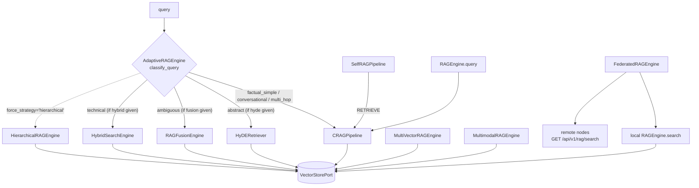

# RAG engines

`prismal/rag/` provides retrieval-augmented generation on top of one storage port,
`VectorStorePort`. Every engine takes a store (or builds one through `VectorStoreFactory`) and
never builds a backend itself. Stores are documented separately in
[vector-stores.md](vector-stores.md).

## Overview

There are **11 retrieval engines/pipelines**, plus 2 support modules and a loaders package:

| # | Engine | Module | Class / entry point | Sync/async |
|---|---|---|---|---|
| 1 | Standard (facade) | `rag/engine.py` | `RAGEngine` | `search` sync, `query` async (runs CRAG) |
| 2 | Corrective RAG | `rag/crag.py` | `CRAGPipeline.run()` | async |
| 3 | HyDE | `rag/hyde.py` | `HyDERetriever.search()` | async |
| 4 | RAG-Fusion | `rag/fusion.py` | `RAGFusionEngine.search()`, `reciprocal_rank_fusion()` | async |
| 5 | Hybrid (BM25 + semantic) | `rag/hybrid.py` | `HybridSearchEngine.search()` | sync |
| 6 | Self-RAG | `rag/self_rag.py` | `SelfRAGPipeline.run()` | async |
| 7 | Hierarchical (parent/child) | `rag/hierarchical.py` | `HierarchicalRAGEngine.search()` | sync |
| 8 | Multi-vector | `rag/multi_vector.py` | `MultiVectorRAGEngine.search()` | async |
| 9 | Adaptive (router facade) | `rag/adaptive.py` | `AdaptiveRAGEngine.search()` | async |
| 10 | Multimodal | `rag/multimodal.py` | `MultimodalRAGEngine.search()` | async (`index` sync) |
| 11 | Federated | `rag/federated.py` | `FederatedRAGEngine.search()` | async |

Support modules:

* `rag/context_budget.py` — rerank, compress and fit retrieved chunks to a token budget (Phase TKE).
* `rag/embeddings.py` — `EmbeddingsFactory` (`openai` | `huggingface` | `ollama`).

Loaders (`rag/loaders/`): `DocumentProcessorFactory` (text documents) plus the multimodal
`ImageLoader`, `AudioLoader` and `VideoLoader`.

All engines except `HybridSearchEngine`, `HierarchicalRAGEngine` and `FederatedRAGEngine` call an
LLM. They resolve it through `ProviderRegistry(settings=...).get_llm()` in their constructor,
except `MultimodalRAGEngine`, which uses its loaders' agents. Engines that put the user query into
a prompt (`crag`, `hyde`, `fusion`, `self_rag`, `multi_vector`, `adaptive`) build that prompt with
`SecurePromptBuilder`.

Every engine returns `RetrievedChunk` (`rag/crag.py`: `source`, `chunk_id`, `relevance_score`,
`content`) or a result object that wraps a list of them. The only exception is
`MultimodalRetrievedChunk`. Scores follow the port contract: `[0, 1]`, higher is more relevant.

## How it works



### 1. `RAGEngine` (standard)

`RAGEngine(collection_name="default", settings=None)` builds its store with
`VectorStoreFactory.create(settings, collection_name)`.

* `index_file(path)` calls `delete_by_source(str(path))` first (no duplicates on re-index), then
  `DocumentProcessorFactory().load(path)` and `add_documents`. `index_directory(path)` does the same
  for every supported file.
* `search(query, k=5)` runs a similarity search with `effective_k(k, settings)`, maps hits to
  `RetrievedChunk`s and passes them through `apply_context_budget()`.
* `query(query)` builds a `CRAGPipeline` on the same store and returns a `CRAGResult`.
* `create_collection(name)` returns a new engine bound to another collection;
  `delete_collection()` drops the current one.

The `rag_search` and `doc_index` stub tools in `prismal/agents/tools.py` wrap `RAGEngine`, and
the `rag_agent` node uses these tools.

### 2. `CRAGPipeline` (Corrective RAG)

`run(query)` has five steps:

1. **Retrieve** — `similarity_search(query, k=effective_k(5, settings))`.
2. **Grade** — the LLM scores each chunk 0.0–1.0. When `decisions_enabled` and
   `decision_rag_relevance_enabled` are on, `maybe_grade_candidates()`
   (`prismal.decisions.integrations.rag`) can supply accepted per-chunk scores first.
3. **Filter** — keep chunks with `relevance_score >= 0.5` (`_RELEVANCE_THRESHOLD`).
4. **Decide** — if nothing passes, inject the `_web_search_fallback()` chunk
   (`source="web_fallback"`). This is a stub; no web search is performed.
5. **Generate** — the LLM answers with the surviving chunks as cited context.

Returns `CRAGResult(answer, sources, used_web_fallback)`.

### 3. `HyDERetriever`

`HyDERetriever(vector_store, settings=None, hypothesis_prompt=None)`. `search(query, k=5)` asks
the LLM for a hypothetical answer document, then searches the store with that text. It also embeds
the hypothesis with `EmbeddingsFactory.create(settings)` and returns the vector for inspection.
Chunks are budgeted against the **original** query. Returns
`HyDEResult(chunks, hypothesis, hypothesis_embedding)`; failures raise `HyDEError`.

### 4. `RAGFusionEngine`

`RAGFusionEngine(vector_store, n_queries=4, rrf_k=60, settings=None)`. `search(query, k=5)`
generates reformulations, keeps `[query, *variants][:n_queries]`, runs one search per variant in
parallel, and merges the rankings with
`reciprocal_rank_fusion(ranked_lists, k=60)`: `score(d) = Σ 1 / (k + rank(d, q))`.
Returns `FusionResult` (includes the `queries` used).

### 5. `HybridSearchEngine`

`HybridSearchEngine(vector_store, alpha=0.5, settings=None)`. Call
`build_index(corpus, doc_ids)` first to build the in-memory `BM25Okapi` index (`rank-bm25`).
`search(query, k=5, alpha=None)` fuses scores linearly:
`alpha * semantic + (1 - alpha) * bm25_norm`. BM25 scores are normalised by the per-query
maximum. Results are the union of both candidate sets, keyed by `doc_id = "<source>:<chunk_id>"`,
so `doc_ids` must follow the store's `source` / `chunk_id` metadata. Without an index it falls
back to semantic-only.
`alpha` outside `[0, 1]` raises `ValueError`. No LLM is involved.

### 6. `SelfRAGPipeline`

`SelfRAGPipeline(vector_store, crag_pipeline=None, settings=None)`. `run(query)` works like this:

1. The LLM decides `RetrievalDecision.RETRIEVE` or `NO_RETRIEVE`. An unparseable reply means
   retrieve.
2. On `RETRIEVE` it delegates to `CRAGPipeline.run()`; otherwise it answers directly.
3. The LLM assesses its own answer: `SupportedDecision` (`SUPPORTED` / `PARTIALLY_SUPPORTED` /
   `UNSUPPORTED`) plus a utility score 1–5. An unparseable assessment means `UNSUPPORTED` with
   utility 1.

Returns `SelfRAGResult`.

### 7. `HierarchicalRAGEngine`

`HierarchicalRAGEngine(vector_store, parent_chunk_size=500, child_chunk_size=100, child_overlap=20, settings=None)`.
`index_document(path)` splits each document into parent blocks and each parent into overlapping
children. Only the children are embedded; their metadata carries `parent_id` and
`parent_content`. `search(query, k=5)` matches children and expands each hit to its parent.
Returns `HierarchicalSearchResult` with `parent_chunks: list[ParentChunk]`. The constructor
rejects `child_chunk_size >= parent_chunk_size` and `child_overlap >= child_chunk_size`.

### 8. `MultiVectorRAGEngine`

`MultiVectorRAGEngine(vector_store, n_questions=3, settings=None)`. `index_document(path)` stores
three representations per chunk under one `doc_id`: the chunk text, an LLM summary, and
`n_questions` LLM-generated questions. `search(query, k=5)` deduplicates hits by `doc_id`, keeps
the best-scoring representation and returns `MultiVectorResult` (with `matched_representations`).

### 9. `AdaptiveRAGEngine`

`AdaptiveRAGEngine(crag_engine, hyde_retriever=None, fusion_engine=None, hybrid_engine=None, hierarchical_engine=None, use_llm_classifier=False, settings=None)`.

`classify_query(query)` is a deterministic regex classifier returning `(QueryType, confidence)`.
It checks multi-hop, conversational, technical, abstract, ambiguous (vague words or ≤ 2 words) and
factual, in that order. `use_llm_classifier=True` asks the LLM first and falls back to regex.

| `QueryType` | Engine (if supplied) | Fallback |
|---|---|---|
| `ABSTRACT` | HyDE | CRAG |
| `AMBIGUOUS` | RAG-Fusion | CRAG |
| `TECHNICAL` | Hybrid (`asyncio.to_thread`) | CRAG |
| `FACTUAL_SIMPLE`, `CONVERSATIONAL`, `MULTI_HOP` | CRAG | — |

The classifier never selects `hierarchical`. Use
`search(query, k=5, force_strategy="hierarchical")` (valid values: `crag`, `hyde`, `fusion`,
`hybrid`, `hierarchical`). Returns `AdaptiveResult(chunks, strategy_used, query_type, confidence)`.

### 10. `MultimodalRAGEngine`

`MultimodalRAGEngine(vector_store, *, cross_modal_embedder=None, image_loader=None, audio_loader=None, video_loader=None, settings=None)`.
`index(path)` detects each file's kind with `MediaValidator.sniff()` and dispatches it to the
matching loader. It indexes image captions, audio transcripts and video frame descriptions +
transcripts with `modality` and `source_uri` metadata. It returns
counts per `Modality`. `search(query, *, k=5, modalities=None)` filters by modality and returns
`MultimodalRetrievedChunk`s. Without a cross-modal embedder (CLIP, `[multimodal-embed]` extra)
the engine embeds the textual captions/transcripts. Part of the opt-in multimodal layer
(`multimodal_enabled`).

### 11. `FederatedRAGEngine`

`FederatedRAGEngine(local_engine=None, remote_nodes=None, timeout_seconds=15)`. `search(query, k=5)`
queries the local `RAGEngine` and every remote node in parallel (`asyncio.gather`,
`GET /api/v1/rag/search` with a JWT bearer). Nodes that fail are skipped. `_merge_and_rerank()`
deduplicates and sorts by `relevance_score`. When `remote_nodes` is `None`, nodes with a `rag`
capability are read from `config/network_nodes.yaml` via
`prismal.agents.network_supervisor._load_nodes`. Needs `httpx`.

### Context budget (support)

Active only when **both** `token_efficiency_enabled` and `rag_context_budget_enabled` are `True`
(`context_budget_active(settings)`). When active:

* `effective_k(k, settings)` returns `rag_retrieve_k` (over-fetch) instead of `k`.
* `apply_context_budget(query, chunks, settings)` reranks the chunks. It uses
  `prismal.providers.rerank.build_reranker` (a cross-encoder when `rag_rerank_enabled`, otherwise
  `ScoreReranker`). When `rag_passage_compression_enabled`, it also compresses prose passages with
  `prismal.providers.compression.PassageCompressor`. Last, `fit_to_budget()` trims the chunks to
  `rag_context_budget_tokens`. It never raises: failures degrade to score reranking or no
  compression.

`RAGEngine.search`, `CRAGPipeline`, `HyDERetriever` and `HybridSearchEngine` call these seams.
`budget_context(query, chunks, *, settings=None, reranker=None, compressor=None)` is the
injectable form. `RerankerPort` and `PassageCompressorPort` are the ports.

### Embeddings (support)

`EmbeddingsFactory.create(settings=None)` maps `settings.embeddings_model` to:

| Value | Class | Model |
|---|---|---|
| `openai` | `OpenAIEmbeddings` | `text-embedding-3-small` |
| `huggingface` (default) | `HuggingFaceEmbeddings` | `all-MiniLM-L6-v2` |
| `ollama` | `OllamaEmbeddings` | `nomic-embed-text` |

### Loaders

| Loader | Module | Notes |
|---|---|---|
| `DocumentProcessorFactory().load(path)` | `loaders/document_loader.py` | `SUPPORTED_EXTENSIONS = {.pdf, .docx, .txt, .md, .csv, .json}`. Sets `metadata["source"]`. Unsupported suffix raises `UnsupportedDocumentTypeError` |
| `ImageLoader(*, vision_agent=None).load(path)` | `loaders/image_loader.py` | Caption via `VisionAgent.analyze` |
| `AudioLoader(*, stt_client=None, segment_chunk_chars=1000).load(path)` | `loaders/audio_loader.py` | STT transcript, chunked |
| `VideoLoader(*, audio_loader=None, image_loader=None, video_agent=None, fps=1.0, max_frames=60).load(path)` | `loaders/video_loader.py` | `VideoAgent.summarize()` frame descriptions (FFmpeg inside `SandboxExecutor`) + audio via `AudioLoader` |

The multimodal loaders' `load` methods are `async`.

## Public API

Everything below is re-exported from `prismal.rag` except where noted.

| Symbol | Module |
|---|---|
| `RAGEngine` | `prismal.rag.engine` |
| `CRAGPipeline`, `CRAGResult`, `RetrievedChunk` | `prismal.rag.crag` |
| `HyDERetriever`, `HyDEResult` | `prismal.rag.hyde` |
| `RAGFusionEngine`, `FusionResult`, `reciprocal_rank_fusion` | `prismal.rag.fusion` |
| `HybridSearchEngine` | `prismal.rag.hybrid` |
| `SelfRAGPipeline`, `SelfRAGResult`, `RetrievalDecision`, `SupportedDecision` | `prismal.rag.self_rag` |
| `HierarchicalRAGEngine`, `HierarchicalSearchResult`, `ParentChunk` | `prismal.rag.hierarchical` |
| `MultiVectorRAGEngine`, `MultiVectorResult` | `prismal.rag.multi_vector` |
| `AdaptiveRAGEngine`, `AdaptiveResult`, `QueryType` | `prismal.rag.adaptive` |
| `MultimodalRAGEngine`, `MultimodalRetrievedChunk` | `prismal.rag.multimodal` |
| `FederatedRAGEngine` (not re-exported) | `prismal.rag.federated` |
| `budget_context`, `apply_context_budget`, `effective_k`, `fit_to_budget`, `RerankerPort`, `PassageCompressorPort`, `ScoreReranker` (not re-exported) | `prismal.rag.context_budget` |
| `EmbeddingsFactory` | `prismal.rag.embeddings` |
| `DocumentProcessorFactory`, `SUPPORTED_EXTENSIONS`, `UnsupportedDocumentTypeError` | `prismal.rag.loaders` |
| `ImageLoader`, `AudioLoader`, `VideoLoader` (from `prismal.rag.loaders`) | `prismal.rag.loaders` |
| `ChromaVectorStore`, `ChromaStoreError` (re-export shim) | `prismal.rag.vector_store` |
| `VectorStoreFactory`, `FakeVectorStore` (not re-exported) | `prismal.rag.vector_store_factory` |

Errors are subclasses in `prismal/core/exceptions.py`: `RAGError`, `HyDEError`, `FusionError`,
`SelfRAGError`, `AdaptiveRAGError`, `MultimodalRAGError`.

## Configuration

`prismal/core/config.py` `Settings`, env prefix `PRISMAL_`.

| Setting | Default | Used by |
|---|---|---|
| `vector_store_backend` | `"chroma"` | `VectorStoreFactory` (see [vector-stores.md](vector-stores.md)) |
| `chroma_path` | `"data/db/chroma"` | Chroma adapter (alias of `vector_store_path`) |
| `embeddings_model` | `"huggingface"` | `EmbeddingsFactory` |
| `token_efficiency_enabled` | `False` | Master switch for the context budget |
| `rag_context_budget_enabled` | `False` | Context budget sub-flag |
| `rag_context_budget_tokens` | `3000` | Budget in estimated tokens |
| `rag_retrieve_k` | `20` | Over-fetch size when the budget is active |
| `rag_rerank_enabled` | `False` | Cross-encoder reranker (`[rerank]` extra) |
| `rag_passage_compression_enabled` | `False` | Prose compression (`[compression]` extra) |
| `decisions_enabled` + `decision_rag_relevance_enabled` | `False` | Typed relevance decisions in CRAG grading ([decisions.md](decisions.md)) |
| `multimodal_enabled` | `False` | Multimodal layer (agents + `multimodal_pipeline`) |

Engine-specific knobs (`n_queries`, `alpha`, chunk sizes, `n_questions`, `rrf_k`,
`timeout_seconds`) are constructor arguments, not settings.

## Usage

Offline hybrid search with the deterministic `FakeVectorStore` (no LLM, no backend):

```python
from langchain_core.documents import Document

from prismal.rag.hybrid import HybridSearchEngine
from prismal.rag.vector_store_factory import FakeVectorStore

corpus = {
    "a.md:0": "LangGraph StateGraph supervisor",
    "b.md:0": "BM25 lexical scoring",
    "c.md:0": "Chroma vector store adapter",
}


def doc(doc_id: str) -> Document:
    source, chunk_id = doc_id.rsplit(":", 1)
    return Document(page_content=corpus[doc_id], metadata={"source": source, "chunk_id": chunk_id})


# FakeVectorStore returns pre-scored (Document, score) hits per query string.
store = FakeVectorStore(docs={"bm25 scoring": [(doc("b.md:0"), 0.9), (doc("a.md:0"), 0.2)]})
engine = HybridSearchEngine(vector_store=store, alpha=0.5)
engine.build_index(corpus=list(corpus.values()), doc_ids=list(corpus))  # ids are "source:chunk_id"
for chunk in engine.search("bm25 scoring", k=2):
    print(chunk.source, chunk.chunk_id, round(chunk.relevance_score, 3))
# b.md 0 0.95
# a.md 0 0.1
```

With a configured provider and the default store:

```python
import asyncio
from pathlib import Path

from prismal.rag import AdaptiveRAGEngine, CRAGPipeline, HyDERetriever, RAGEngine
from prismal.rag.vector_store_factory import VectorStoreFactory


async def main() -> None:
    engine = RAGEngine(collection_name="docs")
    engine.index_directory(Path("data/documents/"))
    result = await engine.query("What is Prismal?")  # CRAG
    print(result.answer, result.used_web_fallback)

    store = VectorStoreFactory.create(collection_name="docs")
    adaptive = AdaptiveRAGEngine(
        crag_engine=CRAGPipeline(vector_store=store),
        hyde_retriever=HyDERetriever(vector_store=store),
    )
    res = await adaptive.search("Why does LangGraph use a StateGraph?", k=5)
    print(res.strategy_used, res.query_type)  # "hyde", QueryType.ABSTRACT


asyncio.run(main())
```

One runnable example per engine in `examples/rag/`: `01_crag.py`, `02_adaptive_rag.py`,
`03_self_rag.py`, `04_hyde.py`, `05_hybrid_search.py`, `06_hierarchical_rag.py`,
`07_rag_fusion.py`, `08_multi_vector_rag.py`, `09_multimodal_rag.py`, `10_federated_rag.py`.
See also `examples/vector_store_lancedb.py` and `examples/multimodal_ingestion.py`.

## Testing

* Unit tests: `tests/unit/rag/` — one file per engine (`test_engine.py`, `test_crag.py`,
  `test_hyde.py`, `test_fusion.py`, `test_hybrid.py`, `test_self_rag.py`, `test_hierarchical.py`,
  `test_multi_vector.py`, `test_adaptive.py`, `test_multimodal_engine.py`, `test_federated.py`),
  plus `test_embeddings.py`, `test_loaders.py`, `test_multimodal_loaders.py`,
  `test_rag_context_budget.py`, `test_rag_budget_wiring.py`, `test_crag_decisions.py`,
  `test_rag_tracing.py`, `test_vector_store.py` and the adapter tests under
  `tests/unit/rag/stores/`.
* Integration: `tests/integration/agents/test_crag_pipeline.py`,
  `tests/integration/test_adaptive_rag_constitutional.py`.
* Use `FakeVectorStore` and an injected/mocked LLM; no test needs a running vector backend.

## Related

* [vector-stores.md](vector-stores.md) — `VectorStorePort`, adapters, score contract.
* [agents.md](agents.md) — `rag_agent` and the supervisor graph.
* [token-efficiency.md](token-efficiency.md) — the TKE master switch behind the context budget.
* [decisions.md](decisions.md) — typed relevance grading in CRAG.
* [composition-root.md](composition-root.md) — per-tenant stores via `RuntimeContext.vector_store_provider`.
* [configuration.md](configuration.md) — all settings.
* `specs/advanced-architectures/SPEC.md` — SPEC-RAG-001…006.
* `specs/multimodal-agents/SPEC.md` — multimodal RAG.
