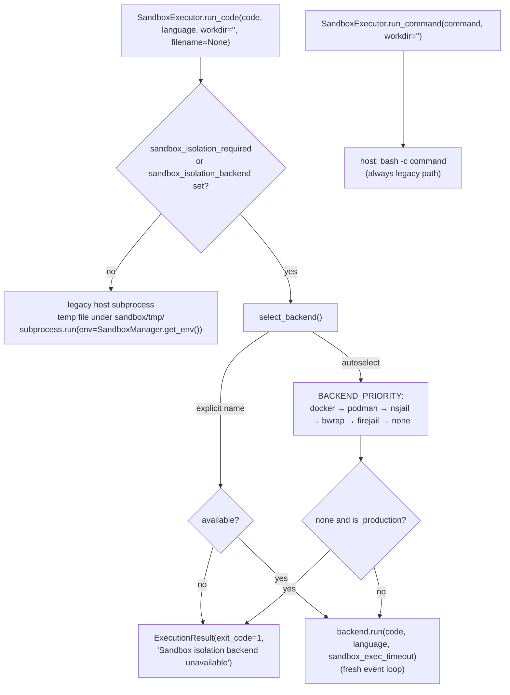

# Sandbox & process isolation

`prismal/sandbox/` runs agent-generated code and external commands away from
the Prismal process. It has two layers:

1. **`SandboxExecutor`** (`sandbox/executor.py`) is the stable, synchronous
   entry point. It runs Python, JavaScript, TypeScript, Go and Bash snippets,
   plus `ruff-check` and `tsc`, under a dedicated sandbox root with its own
   `PATH`, `HOME`, `GOPATH` and npm prefix (`SandboxManager`).
2. **Isolation backends** (`sandbox/isolation.py`, Phase 43 / SPEC-045):
   `docker`, `podman`, `nsjail`, `bwrap`, `firejail`, plus the dev-only `none`.
   When an operator turns isolation on, `SandboxExecutor.run_code()` hands the
   snippet to one of these backends.

> Related: [Skills](skills.md) · [Configuration](configuration.md) ·
> example: [`examples/multimodal/03_video_agent.py`](../examples/multimodal/03_video_agent.py)

## How it works



### `SandboxExecutor`

- `run_code(code, language, workdir="", filename=None) -> ExecutionResult`
  accepts `SUPPORTED_LANGUAGES`: `python`/`python3`, `javascript`/`js`/`node`,
  `typescript`/`ts`, `go`/`golang`, `bash`/`sh`, `ruff-check`, `tsc`. An
  unknown language returns `exit_code=1` and does not raise.
- `run_command(command, workdir="") -> ExecutionResult` runs
  `["bash", "-c", command]` through the legacy host path. **It never goes
  through an isolation backend.**
- `ExecutionResult` holds `stdout`, `stderr`, `exit_code`, `language`,
  `duration_ms`, `workdir` and `truncated`. `combined_output(max_chars=8000)`
  formats both streams. The legacy path maps a timeout to `exit_code=124` and
  a missing runtime to `127`.
- `workdir` resolves inside `sandbox/workspace/` through
  `SandboxManager.resolve_workspace()`, which rejects path traversal. An empty
  value uses `sandbox/tmp/`.

`run_code` is synchronous. Async callers wrap it in `asyncio.to_thread`. The
isolated branch runs the backend coroutine with `asyncio.run`, or on a worker
thread with its own loop when a loop is already running.

### Isolation backends

Every backend implements `IsolationBackend.run(code, language, timeout)`
(async) and `is_available()`, which is a `shutil.which` probe of its binary.
**The real backends accept only `python` / `python3`.** Any other language
raises `SandboxIsolationError`. The code is fed on stdin as `python -`, so
nothing is written to the host filesystem.

| Backend | Enforced by argv |
|---|---|
| `DockerBackend` / `PodmanBackend` | `--rm`, `--user 65534:65534`, `--read-only`, `--network=none`, `--cap-drop=ALL`, `no-new-privileges`, `--memory`, `--pids-limit`, `--cpus`, `--tmpfs /sandbox:rw,noexec,nosuid,size=…`, `--workdir /sandbox`, env allowlist; image `sandbox_container_image`; on timeout `<binary> kill <name>` |
| `NsjailBackend` | uid/gid 65534, `--rlimit_as` (`sandbox_memory_mb`), `--max_cpus`, `--time_limit`, tmpfs `/sandbox` |
| `BwrapBackend` | read-only binds of `/usr`, `/lib`, `/lib64`, `/bin`, `/sbin`, `/etc`; `--unshare-all --unshare-net`, `--cap-drop ALL`, `--die-with-parent`, tmpfs `/sandbox`. **No memory or PID cap**; the timeout comes only from `asyncio.wait_for` |
| `FirejailBackend` | `--net=none`, `--noroot`, `--seccomp`, `--private`, `--rlimit-as`, `--rlimit-nproc`, read-only system dirs, tmpfs `/sandbox` |
| `NoneBackend` | No isolation (`isolated=False`). Runs the legacy host path and logs `sandbox_isolation_degraded` |

All backends except `none` call `ActionInterceptor.check_shell(argv)` before
they spawn, and refuse when `shell_enabled` is false. Every run, including
`none`, writes one audit record through `_audit_sandbox_run` →
`AuditLogger.log_tool_call`. The record holds the SHA-256 of the code (never
the code itself), stdout/stderr truncated to 256 chars, the exit code, the
duration, and the image reference for container backends.

Seccomp: the container and nsjail backends add a custom profile only when
`config/sandbox_seccomp.json` exists. That file is **not** in the repository
today, so they log `sandbox_seccomp_profile_missing` and run with the
runtime's default profile.

### Who uses it

| Consumer | Call | Path taken |
|---|---|---|
| `codeact_agent` (`prismal/agents/codeact_agent.py`) | `SandboxExecutor().run_code(code, language="python")` via `asyncio.to_thread`. It runs only after the AST import allowlist (`codeact_import_allowlist`) and `ActionInterceptor.check_shell()` | isolated when isolation is configured, otherwise host |
| `VideoAgent` (`prismal/agents/multimodal/video_agent.py`) | `SandboxExecutor().run_command("ffmpeg …")` with `shlex.quote`d paths, for frame extraction and audio-track extraction | **always** the legacy host path (`run_command`) |
| Sandbox tools (`prismal/sandbox/tools.py`) | `sandbox_exec`, `sandbox_shell`, `sandbox_install`, `sandbox_write_file`, `sandbox_read_file`, `sandbox_ls`, `sandbox_status` (`SANDBOX_TOOLS`) | `sandbox_exec` → `run_code`; `sandbox_shell` → `run_command`. Execution tools require `shell_enabled`; file tools do not |
| `SandboxInstaller` (`sandbox/installer.py`) | `install(package, manager="pip", workdir=None)` for `pip`, `npm`, `go`, `ruff`, `typescript`; `bootstrap_node()`, `bootstrap_go()`, `setup_python_venv()` | host subprocess under the sandbox root |

## Public API

| Symbol | Module |
|---|---|
| `SandboxManager` | `prismal.sandbox.manager` (re-exported from `prismal.sandbox`) |
| `SandboxExecutor`, `ExecutionResult` | `prismal.sandbox.executor` |
| `SandboxInstaller` | `prismal.sandbox.installer` |
| `IsolationBackend`, `DockerBackend`, `PodmanBackend`, `NsjailBackend`, `BwrapBackend`, `FirejailBackend`, `NoneBackend`, `select_backend`, `BACKEND_PRIORITY`, `BACKENDS_BY_NAME`, `SandboxIsolationError` | `prismal.sandbox.isolation` |
| `SANDBOX_TOOLS`, `sandbox_exec`, `sandbox_shell`, `sandbox_install`, `sandbox_write_file`, `sandbox_read_file`, `sandbox_ls`, `sandbox_status` | `prismal.sandbox.tools` |

`SandboxManager(sandbox_root=None)` exposes `root`, `workspace`, `tmp`,
`setup()`, `get_env()`, `is_safe_path(path)`, `resolve_workspace(rel)`,
`resolve_tmp()`, `get_runtime_status()` and `disk_usage_mb()`.

## Configuration

| Env var | Default | Meaning |
|---|---|---|
| `PRISMAL_SANDBOX_PATH` | `sandbox` | Sandbox root (`workspace/`, `tmp/`, `.python/`, `.node/`, `.go/`) |
| `PRISMAL_SANDBOX_EXEC_TIMEOUT` | `60` | Seconds per execution (both paths) |
| `PRISMAL_SANDBOX_MAX_OUTPUT_CHARS` | `8000` | Output truncation (legacy path) |
| `PRISMAL_SANDBOX_NODE_VERSION` / `PRISMAL_SANDBOX_GO_VERSION` | `20.11.0` / `1.22.0` | Runtimes fetched by `SandboxInstaller` |
| `PRISMAL_SANDBOX_ISOLATION_REQUIRED` | `false` | Route `run_code` through `select_backend()` |
| `PRISMAL_SANDBOX_ISOLATION_BACKEND` | `""` | Explicit backend (`docker`, `podman`, `nsjail`, `bwrap`, `firejail`, `none`); setting it also turns isolation on |
| `PRISMAL_IS_PRODUCTION` | `false` | Makes `select_backend()` refuse `none` |
| `PRISMAL_SANDBOX_CONTAINER_IMAGE` | `python:3.13-slim` | Image for docker/podman |
| `PRISMAL_SANDBOX_MEMORY_MB` | `256` | docker `--memory`, nsjail `--rlimit_as`, firejail `--rlimit-as` |
| `PRISMAL_SANDBOX_PIDS_LIMIT` | `32` | docker `--pids-limit`, firejail `--rlimit-nproc` |
| `PRISMAL_SANDBOX_CPUS` | `1.0` | docker `--cpus`, nsjail `--max_cpus` |
| `PRISMAL_SANDBOX_TMPFS_SIZE_MB` | `128` | Size of the `/sandbox` tmpfs (containers) |
| `PRISMAL_SANDBOX_ENV_ALLOWLIST` | `""` | Comma-separated env names forwarded into containers. Names matching `API_KEY`, `SECRET`, `TOKEN`, `PASSWORD`, `PASSWD` or `CREDENTIAL` are always dropped |
| `PRISMAL_SHELL_ENABLED` | `false` | `ActionInterceptor.check_shell()` gate |
| `PRISMAL_CODEACT_ENABLED` | `false` | Enables the CodeAct node |
| `PRISMAL_CODEACT_IMPORT_ALLOWLIST` | see `Settings` | Imports CodeAct code may use |

A recommended production posture:

```bash
export PRISMAL_IS_PRODUCTION=true
export PRISMAL_SANDBOX_ISOLATION_REQUIRED=true
export PRISMAL_SANDBOX_ISOLATION_BACKEND=docker   # fail loudly if docker is missing
export PRISMAL_SHELL_ENABLED=true                 # only if you run CodeAct / sandbox tools
```

## Usage

```python
import asyncio

from prismal.sandbox.executor import SandboxExecutor
from prismal.sandbox.isolation import select_backend

executor = SandboxExecutor()
result = await asyncio.to_thread(executor.run_code, "print(sum(range(10)))", "python")
print(result.exit_code, result.stdout, result.truncated)

backend = select_backend()           # what run_code would pick right now
print(backend.name, backend.isolated)
```

## Security notes

- **Critical Rule #7 (FFmpeg via `SandboxExecutor`)** is met in name only.
  `VideoAgent` uses `run_command`, which is always a host `bash -c`
  subprocess. It gets the sandbox `PATH`/`HOME` and the timeout, but no
  container, namespace or seccomp boundary, even with
  `sandbox_isolation_required=true`. The isolation backends support only
  Python.
- **The legacy path inherits the full process environment.**
  `SandboxManager.get_env()` starts from `os.environ.copy()`, so provider API
  keys are visible to host-path code. Only the container backends apply the
  empty-by-default env allowlist.
- **Fail-closed rules.** An explicit backend that is unavailable, or `none`
  under `is_production`, returns an error `ExecutionResult`. It never falls
  back to an unisolated run. Autoselect without `is_production` can still pick
  `none` on hosts that have no backend installed. Watch for the
  `sandbox_isolation_degraded` warning.
- **Rule #5.** Call `ActionInterceptor.check_shell()` / `check()` before
  executing code. CodeAct and the isolated backends do. Direct callers of
  `run_command` (and skill script tools, see [skills.md](skills.md)) must add
  the check themselves.
- `bwrap` applies no memory or PID limits. Layer cgroup or systemd limits on
  top if you choose it.

## Testing

- `tests/unit/sandbox/test_isolation.py`: backend argv, availability probes,
  `select_backend` rules.
- `tests/unit/sandbox/test_isolation_audit.py`: audit records (hash-only).
- `tests/integration/test_sandbox_isolation.py` (`@pytest.mark.integration`):
  needs a real backend on the host.

```bash
uv run pytest tests/unit/sandbox
uv run pytest tests/integration/test_sandbox_isolation.py -m integration
```

## Related

- [skills.md](skills.md): script tools that run outside the sandbox
- [providers.md](providers.md): STT used by `VideoAgent` after FFmpeg extraction
- [configuration.md](configuration.md): how `Settings` values are sourced
- [scheduler.md](scheduler.md): scheduled agent runs that may reach CodeAct
