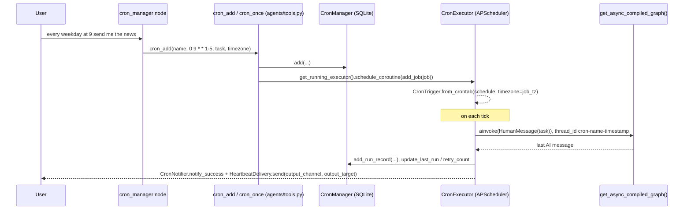

# Scheduler (cron, time, flows)

`prismal/scheduler/` runs agent tasks on a schedule. Job definitions are kept
in SQLite (`CronManager`). An APScheduler `AsyncIOScheduler` fires them
(`CronExecutor`), and each firing invokes the compiled supervisor graph with
the job's task as the user message. All time arithmetic goes through one
timezone-aware service (`DateTimeService`). Results can be pushed to Telegram,
Slack, Discord or email. Prefect flows are provided as optional orchestration
entry points.

> Related: [Skills](skills.md) · [Events](events.md) · [Configuration](configuration.md)

## Overview

| Piece | Module | Role |
|---|---|---|
| `CronManager`, `CronJob`, `CronRunRecord`, `CronStatus` | `scheduler/cron_manager.py` | SQLite job store and run history |
| `CronExecutor`, `get_running_executor()` | `scheduler/executor.py` | APScheduler engine, retry/backoff, soft-failure detection |
| `DateTimeService` | `scheduler/datetime_service.py` | Process-wide time source (timezone chain, cron next-run, optional NTP drift check) |
| `CronNotifier` | `scheduler/notifier.py` | Success/failure alerts (Telegram, Slack, console fallback) |
| `HeartbeatDelivery` | `scheduler/heartbeat_delivery.py` | Per-job output delivery (Telegram, Slack, Discord webhook, SMTP) |
| Prefect flows | `scheduler/prefect_flows.py` | `agent_run_flow`, `document_index_flow`, `skill_discovery_flow`, `config_reload_flow` |
| `cron_manager` agent | `prismal/agents/cron_manager.py` | Turns natural-language scheduling requests into cron tool calls |

`prismal.scheduler` imports `CronExecutor` and the Prefect flows lazily, on
first attribute access, so `DateTimeService` and `CronManager` stay light.

## How it works



### Jobs and triggers

`CronManager(db_path=None)` creates the `cron_jobs` and `cron_run_history`
tables. With no `db_path`, the file is `data/db/cron_jobs.db`, resolved
relative to the parent of the `prismal/` package directory (not to the current
working directory).

- `add(name, schedule, task, max_retries=0, retry_delay_seconds=60, output_channel=None, output_target=None, timezone="") -> CronJob`
  creates a recurring 5-field cron job.
- `add_once(name, run_at, task, timezone="", output_channel=None, output_target=None) -> CronJob`
  stores `schedule="once:<ISO datetime>"`.
- `pause`, `resume`, `remove`, `list_jobs`, `get_job`, `update_timezone`,
  `update_last_run`, `set_retry_count`, `add_run_record`,
  `get_run_history(job_name, limit=20)` and `get_last_run` manage jobs and
  their history.

`CronExecutor(manager=None, notifier=None)`:

- `await start()` registers every `active` job and starts the scheduler in
  `DateTimeService.get().get_scheduler_tz()`. It also records itself as the
  running executor, so that tools on worker threads can reach it through
  `get_running_executor()` and `schedule_coroutine(coro)`.
- Recurring jobs use `CronTrigger.from_crontab(schedule, timezone=job_tz)`.
  `once:` jobs use a `DateTrigger`, are skipped and deleted if already past,
  and are removed after a successful run.
- `add_job`, `remove_job`, `pause_job` and `resume_job` update the live
  scheduler. `await stop()` calls `shutdown(wait=False)`.

### Run outcome and retries

`_run_job(name, task)` never re-raises, so APScheduler keeps scheduling
future runs.

- **Soft failure.** When the final agent message matches a transient-error
  signature ("rate limit", "quota exceeded", "temporarily unavailable", …),
  the run raises `SoftFailureError` and goes through the retry path. A polite
  apology is not recorded as a success.
- **Permanent errors** (billing, auth, invalid request; see
  `_is_permanent_error`) skip retries and notify immediately.
- **Retries.** While `retry_count < max_retries`, a one-shot retry is
  scheduled after `retry_delay_seconds * 2^(n-1)` seconds. Once the retries
  are exhausted, `retry_count` is reset and `CronNotifier.notify_failure()`
  fires.
- **Delivery.** On success, `notify_success()` posts to Telegram and/or Slack
  when they are configured, and prints to the console otherwise. When the job
  has `output_channel` and `output_target`, `HeartbeatDelivery().send(channel, target, content)`
  delivers the output (`telegram` chat id, `slack` channel, `discord` webhook
  URL, `email` address).

### Time: `DateTimeService`

`DateTimeService.get()` is a thread-safe singleton. Its timezone resolution
chain is: explicit argument → `cron_timezone` → `timezone` → `tzlocal` → UTC.
An invalid IANA name logs a warning and falls back to UTC. It never raises.

The methods are `resolve_timezone(tz_str=None)`, `get_scheduler_tz()`,
`now(tz=None)`, `now_utc_naive()`, `next_run(cron_expr, tz=None)`,
`to_utc_naive(aware_dt)`, `parse_local(dt_str, tz=None)` and `ntp_offset()`.
With `ntp_enabled`, it syncs against `ntp_server` every
`ntp_sync_interval_seconds` and warns above `ntp_warn_threshold_seconds`.

The bundled MCP server `prismal.mcp.servers.datetime_server` provides the
same operations to agents as tools (see [mcp.md](mcp.md)).

### The `cron_manager` agent

`cron_manager_node(state)` is a `@prismal_node(name="cron_manager", security="off", audit=False, …)`
ReAct node. Its tools are `get_current_time`, `cron_once`, `cron_add`,
`cron_list`, `cron_pause`, `cron_resume` and `cron_remove`, all defined in
`prismal/agents/tools.py`. It is a fixed-tool agent: `CompositeToolProvider`
gives it only the stubs, never MCP or skill tools. When a request arrives from
a messaging channel and no channel is given, `cron_add` and `cron_once` route
the output back to the originating chat (`output_channel="none"` opts out).

### Prefect flows

`prefect_flows.py` defines four `@flow`s backed by `@task`s with fixed retry
policies:

| Flow | Task | Status |
|---|---|---|
| `agent_run_flow(task_description)` | runs `get_async_compiled_graph().ainvoke(...)` | functional |
| `skill_discovery_flow()` | `_discover_skills_task` (retries=2): `SkillsManager().reload_all()` + `list_skills()` | functional |
| `document_index_flow(document_path)` | `_index_document_task` (retries=3) | **placeholder**: logs and returns `"indexed:<name>"` without calling the RAG engine |
| `config_reload_flow()` | `_reload_config_task` (retries=1) | **placeholder**: returns `True` without reloading settings |

`CronManager.add()` does **not** create a Prefect deployment.
`_try_create_prefect_deployment()` only logs `cron_prefect_deployment_skipped`.
Jobs run through APScheduler only.

## Public API

| Symbol | Module |
|---|---|
| `CronManager`, `CronJob`, `CronStatus` | `prismal.scheduler.cron_manager` (re-exported from `prismal.scheduler`) |
| `CronRunRecord` | `prismal.scheduler.cron_manager` |
| `CronExecutor` | `prismal.scheduler.executor` (lazily re-exported) |
| `get_running_executor`, `SoftFailureError` | `prismal.scheduler.executor` |
| `DateTimeService` | `prismal.scheduler.datetime_service` (re-exported) |
| `CronNotifier` | `prismal.scheduler.notifier` |
| `HeartbeatDelivery` | `prismal.scheduler.heartbeat_delivery` |
| `agent_run_flow`, `document_index_flow`, `skill_discovery_flow`, `config_reload_flow` | `prismal.scheduler.prefect_flows` (lazily re-exported) |
| `cron_manager_node` | `prismal.agents.cron_manager` |
| `cron_add`, `cron_once`, `cron_list`, `cron_pause`, `cron_resume`, `cron_remove`, `get_current_time` | `prismal.agents.tools` |

Exceptions: `SchedulerError` subtree in `prismal.core.exceptions`.

## Configuration

| Env var | Default | Meaning |
|---|---|---|
| `PRISMAL_TIMEZONE` | `""` | Process timezone (empty: `tzlocal`) |
| `PRISMAL_CRON_TIMEZONE` | `""` | Default job timezone (empty: inherits `timezone`) |
| `PRISMAL_NTP_ENABLED` | `false` | NTP drift check |
| `PRISMAL_NTP_SERVER` | `pool.ntp.org` | NTP host |
| `PRISMAL_NTP_SYNC_INTERVAL_SECONDS` | `3600` | Re-sync interval (≥ 60) |
| `PRISMAL_NTP_WARN_THRESHOLD_SECONDS` | `5` | Warning threshold |
| `PRISMAL_CRON_NOTIFY_TELEGRAM_CHAT_ID` | `""` | Chat for cron alerts (uses `telegram_bot_token`) |
| `PRISMAL_CRON_NOTIFY_SLACK_CHANNEL` | `""` | Channel for cron alerts (uses `slack_bot_token`) |
| `PRISMAL_TELEGRAM_BOT_TOKEN` / `PRISMAL_SLACK_BOT_TOKEN` | `""` | Channel credentials (`SecretStr`) |
| `PRISMAL_HEARTBEAT_SMTP_HOST` / `_PORT` / `_USER` / `_PASSWORD` / `_FROM` | `""` / `587` / `""` / `""` / `""` | SMTP delivery for `output_channel="email"` |

Per-job options (`max_retries`, `retry_delay_seconds`, `output_channel`,
`output_target`, `timezone`) are stored on each `CronJob`.

## Usage

```python
from prismal.scheduler import CronExecutor, CronManager, DateTimeService

manager = CronManager()
job = manager.add(
    "morning-brief",
    "0 9 * * 1-5",
    "Summarise today's calendar and unread email",
    max_retries=2,
    output_channel="telegram",
    output_target="123456789",
    timezone="America/Caracas",
)

executor = CronExecutor(manager)
await executor.start()                  # in your app lifespan
print(DateTimeService.get().next_run(job.schedule))
...
await executor.stop()
```

Agent-driven scheduling needs no code. Route a request such as "remind me
every Monday at 8" to the supervisor, and `cron_manager` handles it.

## Security notes

- A scheduled job's `task` is fed to the supervisor graph as a plain
  `HumanMessage`, exactly like live user input, under the thread id
  `cron-<name>-<timestamp>`. Treat stored tasks as user input. Anyone who can
  write `cron_jobs.db` can make the agent act on a schedule.
- `cron_manager_node` is declared with `security="off"` and `audit=False` in
  `@prismal_node`. The decorator's security and audit middleware therefore
  skip it, and its only tools are the fixed cron stubs.
- Credentials (`telegram_bot_token`, `slack_bot_token`, `heartbeat_smtp_password`)
  are `SecretStr` and are unwrapped only when the notifier or delivery object
  is constructed. Delivery errors are caught and logged, never re-raised.
- `prismal.scheduler` must not import `prismal.decisions`. The DEC import
  guard covers `scheduler/**`.

## Testing

- `tests/unit/scheduler/`: `test_cron_manager.py`, `test_executor.py`,
  `test_datetime_service.py`, `test_notifier.py`, `test_heartbeat_delivery.py`,
  `test_prefect_flows.py`, `test_cron_pipeline.py`, `test_cron_ml_retrain.py`.
- `tests/integration/test_cron_tz_e2e.py`: timezone end-to-end.
- Gotcha: `tests/unit/agents/conftest.py` and `tests/integration/conftest.py`
  replace `apscheduler` with `MagicMock` in `sys.modules`. Patch module seams
  instead of `apscheduler`, and do not run `tests/integration` in the same
  session as `tests/unit`.

```bash
uv run pytest tests/unit/scheduler
```

## Related

- [events.md](events.md): file-watcher events that map onto the Prefect flows
- [skills.md](skills.md): what `skill_discovery_flow` reloads
- [mcp.md](mcp.md): the `datetime_server` MCP tools
- [memory.md](memory.md): memory consolidation jobs (`register_consolidation_job`)
- [configuration.md](configuration.md): how `Settings` values are sourced
