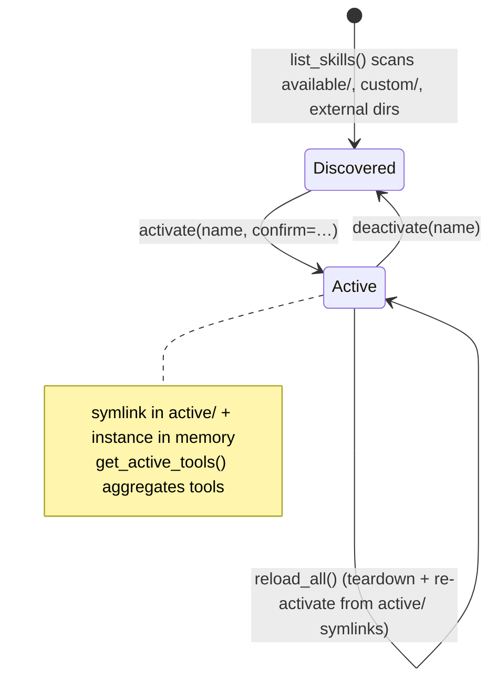
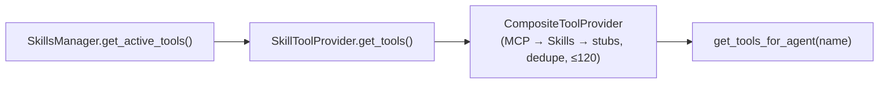

# Skills (and souls)

A **skill** is a directory that contributes LangChain tools to the agents.
`prismal/skills/` holds the skill tiers and the machinery that discovers,
activates and turns skills into tools. The agent core never imports this
package. Active skills reach agents through `SkillToolProvider`, which is part
of the injected `ToolProviderPort` (see [tool-providers.md](tool-providers.md)).

`prismal/souls/` mirrors the same tier layout for **souls**, the Markdown
personas used by Kokoro deliberation. Souls are not tools. They are covered
briefly at the end of this page and in full in [kokoro.md](kokoro.md).

> Related: [Tool providers](tool-providers.md) · [MCP client](mcp.md) ·
> [Kokoro](kokoro.md) · example: [`examples/skill_creator_agent.py`](../examples/skill_creator_agent.py)

## Overview

```
prismal/skills/
├── available/        committed source skills (calendar, code_executor, database_query,
│                     email_reader, spec_driven_design, weather, web_search)
├── active/           relative symlinks to enabled skills (gitignored; restored on start)
├── custom/           AI-generated skills awaiting human review (gitignored)
├── base.py           BaseSkill, SkillMetadata, MarkdownSkill, generate_skill_py, parse_skill_md
├── manager.py        SkillsManager, SkillInfo, SkillStatus
└── remote_installer.py  RemoteSkillInstaller (GitHub download)
```

Two packaging formats are supported:

| Format | Layout | How tools are produced |
|---|---|---|
| **Python skill** | `skill.py` with one `BaseSkill` subclass | `get_tools()` returns the tools explicitly |
| **Markdown skill** | `SKILL.md` (any case) with YAML frontmatter, optional `scripts/` and `references/` | `generate_skill_py()` writes a `MarkdownSkill` wrapper. Tools are discovered automatically |

There is also a fourth, external tier: directories listed in
`settings.external_skills_dirs`. They are scanned like `available/` and reported
with status `external`.

## How it works

### Lifecycle



`SkillsManager(skills_root=None, external_dirs=None)`:

- **Discovery.** `list_skills(status=None) -> list[SkillInfo]` covers four
  groups: the active skills in memory, then `available/`, `custom/` and each
  external dir. A directory that has `SKILL.md` but no `skill.py` gets a
  generated `skill.py` first. Each `skill.py` is imported to read its
  `metadata`. A skill that fails to load shows up with status `error`.
- **Activation.** `await activate(name, *, confirm=False)` finds the directory
  (search order `available/` → `custom/` → external dirs). It then enforces
  these gates:
  1. **Custom review gate.** A skill under `custom/` needs a
     `validated_by_human.txt` file, or activation raises `SkillValidationError`.
  2. **Confirmation gate.** `confirm=True` is required when
     `safe_to_auto_activate=False` (the default) or `requires_permissions` is
     non-empty.
  3. `skill.validate()` must return `True`.

  After the gates, `await skill.initialize()` runs and a relative symlink is
  created in `active/`.
- **Restore.** On construction, `_restore_active_skills()` reloads every
  symlink in `active/` into memory. It does not call `initialize()`.
- **Tools.** `get_active_tools() -> list[BaseTool]` concatenates the
  `get_tools()` output of every active skill, deduplicated by tool name. A
  skill that raises is logged and skipped.
- **Install.** `install_from_zip(zip_path)` unpacks a `SKILL.md` package (at the
  root or under one top-level folder) into `available/` and generates the
  wrapper.

### How a Markdown skill becomes tools

`MarkdownSkill.get_tools()` combines three sources:

1. Every `@tool`-decorated object found in `scripts/*.py`. Files starting with
   `_` are skipped.
2. Any script with **no** `@tool` objects is wrapped as a CLI tool named
   `<skill_dir>__<script_stem>` (`_make_subprocess_tool`). The tool runs
   `python <script> <args>` with a 60 s timeout, and only when
   `settings.shell_enabled` is true.
3. `<name>__guide()` returns the `SKILL.md` body, and
   `<name>__read_reference(filename)` reads a file from `references/`. Each is
   added only when the source exists.

### From active skill to agent



`SkillToolProvider(manager=None)` builds a fresh `SkillsManager()` on every
call when none is injected, and returns `[]` on any error. Skills are not
filtered by agent or capability. `build_default_tool_provider()` always
includes this provider.

### Agents that manage skills

| Node | Module | What it does |
|---|---|---|
| `skill_manager` | `prismal/agents/skill_manager.py` | `skill_manager_node(state)` parses the user's request (list, activate, deactivate, install from a path, install from GitHub, create) and calls `SkillsManager` / `RemoteSkillInstaller` / `create_skill`. It is one of the two `agents/**` modules allowed to import `prismal.skills` |
| `skill_creator` | `prismal/agents/skill_creator.py` | `create_skill(spec, skills_root=None, allow_shell=False)` asks the LLM (prompt built with `SecurePromptBuilder`) to write a `skill.py`. It rejects shell/subprocess patterns unless `allow_shell`, then runs `ruff`, `mypy` and `bandit` with up to `MAX_FIX_ITERATIONS = 3` fix rounds. Results go to `custom/<slug>/` (`skill.py`, `human_review_required.txt`, `generation_prompt.txt`, `quality_report.json`). `skill_creator_node(state)` is the graph entry |

`RemoteSkillInstaller(manager=None).install(repo, skill_name, dest_name=None, enable=False)`
downloads a skill directory through the GitHub API. Claude Code style
YAML/Markdown skills get a generated `BaseSkill` wrapper. Python skills are
copied as-is.

## Public API

| Symbol | Module |
|---|---|
| `SkillsManager`, `SkillInfo`, `SkillStatus` | `prismal.skills.manager` (re-exported from `prismal.skills`) |
| `BaseSkill`, `SkillMetadata` | `prismal.skills.base` (re-exported) |
| `MarkdownSkill`, `generate_skill_py`, `parse_skill_md` | `prismal.skills.base` |
| `RemoteSkillInstaller`, `RECOMMENDED_SKILLS` | `prismal.skills.remote_installer` |
| `SkillToolProvider` | `prismal.agents.extension` |
| `create_skill`, `skill_creator_node`, `MAX_FIX_ITERATIONS` | `prismal.agents.skill_creator` |
| `skill_manager_node` | `prismal.agents.skill_manager` |
| `SoulsManager`, `Soul`, `SoulMetadata`, `load_soul`, `parse_soul_md` | `prismal.souls` |

Exceptions (`prismal.core.exceptions`): `SkillError` → `SkillLoadError`,
`SkillValidationError`. For souls: `SoulNotFoundError`, `SoulValidationError`,
`KokoroConfigError`.

`SkillMetadata` fields: `name`, `description`, `version`, `author`,
`requires_permissions: list[str] = []`, `safe_to_auto_activate: bool = False`,
`tags: list[str] = []`, `min_python: str = "3.13"`.

## Configuration

| Env var | Default | Meaning |
|---|---|---|
| `PRISMAL_EXTERNAL_SKILLS_DIRS` | `[]` | Extra directories of skill subfolders. Read only when `SkillsManager()` uses the default root |
| `PRISMAL_SHELL_ENABLED` | `false` | Required for auto-wrapped script tools (and for the sandbox tools) |
| `PRISMAL_SOULS_DIR` | `""` | Souls root (empty uses the packaged `prismal/souls`) |
| `PRISMAL_KOKORO_SOULS` | `["spirit","mind","heart"]` | The triad that `SoulsManager.load_triad()` loads |
| `PRISMAL_SOUL_MAX_BODY_CHARS` | `20000` | Cap on the size of a `SOUL.md` body |

## Usage

```python
from prismal.skills import SkillsManager

manager = SkillsManager()                      # package root + external_skills_dirs
for info in manager.list_skills():
    print(info.name, info.status, info.safe_to_auto_activate)

await manager.activate("weather", confirm=True)
tools = manager.get_active_tools()             # what SkillToolProvider returns
await manager.deactivate("weather")

name, error = manager.install_from_zip("my_skill.zip")
```

A minimal Markdown skill:

```markdown
---
name: unit-converter
description: Convert between metric and imperial units
version: 1.0.0
author: me
safe_to_auto_activate: false
---
# How to use
Call `unit_converter__convert` with ...
```

Generating a skill offline is shown in
[`examples/skill_creator_agent.py`](../examples/skill_creator_agent.py).

## Security notes

- **Skill code runs in-process.** Activation, and discovery too, executes
  `skill.py` through `importlib`. `list_skills()` imports the `skill.py` of
  every discovered skill, including unreviewed ones in `custom/`, in order to
  read its metadata. The `validated_by_human.txt` gate applies only to
  `activate()`, and `_restore_active_skills()` re-imports whatever `active/`
  points to without repeating the gates. Treat `custom/`, `active/` and the
  external dirs as trusted-code locations.
- **`confirm=True` from a conversation.** `skill_manager_node` calls
  `activate(..., confirm=True)` both for an explicit activation request and
  right after installing from a local path or zip. The user's chat request
  counts as the confirmation.
- **Script tools bypass the sandbox.** Auto-wrapped script tools call
  `subprocess.run` on the host. The only gate is `shell_enabled`; there is no
  `SandboxExecutor` and no `ActionInterceptor.check()`. Rule #5 requires
  interceptor checks before tools that write files or execute code, so keep
  `shell_enabled=false` unless every skill script is trusted.
- **Reference reads are not path-confined.** `<name>__read_reference(filename)`
  reads `references/<filename>` without a `resolve().is_relative_to()` check.
- **Generated skills** are written to `custom/` with a human-review sentinel.
  Their generation prompt goes through `SecurePromptBuilder` (Rule #1), and
  shell patterns are refused unless `allow_shell=True`.
- **Soul bodies are user content.** They must reach a model only through
  `SecurePromptBuilder` (Rule #1). `load_soul()` confines every soul to the
  souls root and caps the body at `soul_max_body_chars`.

## Souls (brief)

`SoulsManager(*, souls_root=None, settings=None)` resolves
`available/`, `active/` and `custom/` under `default_souls_root(settings)`.
Tier priority is `active > available > custom`. A non-empty `active/` acts as
an **allow-list**. The methods are `list_souls()`, `load(soul_id) -> Soul` and
`load_triad(ids=None)`. `load_triad` needs exactly three distinct ids and
otherwise raises `KokoroConfigError`. The committed personas are
`available/{spirit,mind,heart}/SOUL.md`. A `Soul` is a frozen dataclass with
`metadata: SoulMetadata`, `body: str` and `source_dir: Path`. The authoring
format, deliberation and judge are covered in [kokoro.md](kokoro.md).

## Testing

- `tests/unit/skills/`: `test_base.py`, `test_base_markdown.py`,
  `test_builtin_skills.py`, `test_manager.py`, `test_manager_zip.py`,
  `test_skills_manager.py`.
- `tests/unit/souls/`: `test_base.py`, `test_manager.py`.
- `tests/unit/agents/extension/test_no_mcp_skills_imports.py`: the
  `agents/**` → `prismal.skills` import guard.
- Use an explicit `SkillsManager(skills_root=tmp_path)` in tests. With an
  explicit root, `external_skills_dirs` is not read.

```bash
uv run pytest tests/unit/skills tests/unit/souls
```

## Related

- [tool-providers.md](tool-providers.md): `SkillToolProvider` and the composite merge order
- [mcp.md](mcp.md): the other live tool source
- [kokoro.md](kokoro.md): souls, deliberation and the judge
- [sandbox.md](sandbox.md): where code execution should happen
- [scheduler.md](scheduler.md): `skill_discovery_flow` (Prefect)
