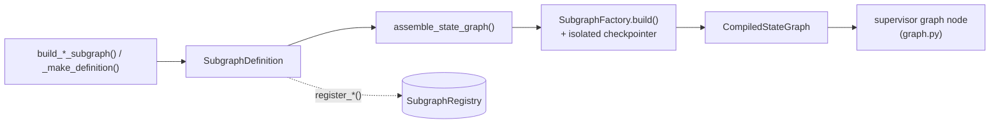
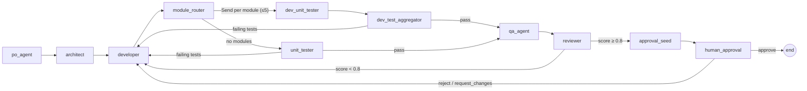
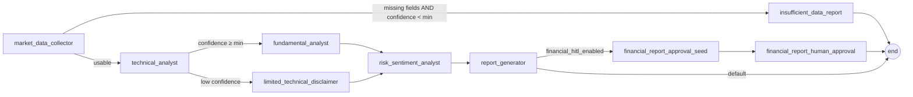
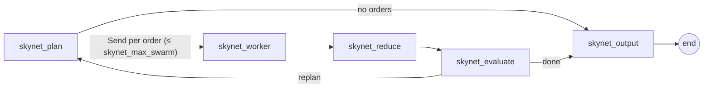

# Subgraphs

`prismal/agents/subgraphs/` holds multi-node pipelines that are compiled into their own
`CompiledStateGraph` and mounted as **one node** of the supervisor graph (or of a domain
orchestrator). Each pipeline is described declaratively by a `SubgraphDefinition`, compiled by
`SubgraphFactory`, and can be installed in the process-wide `SubgraphRegistry`.

## Overview

There are **15 subgraph packages**:

| Package | Route / node name | Kind | Mounted by | Gate |
|---|---|---|---|---|
| `dev_pipeline/` | `dev_pipeline` | software delivery pipeline | flat graph, `analysis_orchestrator` | `enable_subgraphs` (flat) |
| `ml_pipeline/` | `ml_pipeline` | ML training pipeline | flat graph, `analysis_orchestrator` | `enable_subgraphs` (flat) |
| `financial/` | `financial_analyst` | read-only market analysis | flat graph, `analysis_orchestrator` | `enable_subgraphs` (flat) |
| `customer_service/` | `customer_service` | support triage | flat graph (`ADVANCED_MEMBERS`) | `enable_subgraphs` |
| `document_generation/` | `document_generation` | long-form writing | flat graph (`ADVANCED_MEMBERS`) | `enable_subgraphs` |
| `data_etl/` | `data_etl` | ETL with validation branch | flat graph (`ADVANCED_MEMBERS`) | `enable_subgraphs` |
| `code_review/` | `code_review` | static + LLM review | flat graph (`ADVANCED_MEMBERS`) | `enable_subgraphs` |
| `debate_consensus/` | `debate_consensus` | structured debate | flat graph (`ADVANCED_MEMBERS`) | `enable_subgraphs` |
| `multimodal_pipeline/` | `multimodal_pipeline` | modality routing + fusion | flat graph | `multimodal_enabled` |
| `kokoro/` | `kokoro` | soul deliberation + judge | flat graph | `kokoro_enabled` |
| `skynet/` | `skynet` | swarm map-reduce | flat graph | `skynet_enabled` |
| `blind_review_pipeline/` | `blind_review_pipeline` | spec → implement → 2 blind reviews → HITL | flat graph | `blind_review_pipeline_enabled` |
| `research_orchestrator/` | `research_orchestrator` | domain orchestrator | hierarchical graph | `hierarchical_mode` |
| `engineering_orchestrator/` | `engineering_orchestrator` | domain orchestrator | hierarchical graph | `hierarchical_mode` |
| `analysis_orchestrator/` | `analysis_orchestrator` | domain orchestrator | hierarchical graph | `hierarchical_mode` |

Shared modules: `registry.py` (`SubgraphDefinition`, `SubgraphRegistry`), `factory.py`
(`SubgraphFactory`, `assemble_state_graph`), `gates.py` (routing gates + HITL) and `artifacts.py`
(`UserStory`, `TechnicalSpec`, `CodeArtifact`, `TestReport`, `QAReport`, `ReviewResult` for
`dev_pipeline`).

## How it works

### Definition → compiled node



* `SubgraphDefinition` (Pydantic): `name`, `description`, `entry_point`, `nodes` (callable **or**
  pre-compiled `CompiledStateGraph`), `edges: list[tuple[str, str]]`,
  `conditional_edges: dict[str, routing_fn]`, `send_edges: list[tuple[str, dispatcher]]`. It also
  has `to_mermaid()`, `visualize()` and `save_image(path)`.
* `assemble_state_graph(definition)` builds a `StateGraph[AgentState]`: it adds the nodes, the
  entry point, linear edges (`"__end__"` → `END`), conditional edges and `Send` edges, then wires
  every node with no outgoing edge to `END`. It is pure and synchronous.
* `SubgraphFactory().build(definition, checkpointer_path=":memory:")` compiles the graph with its
  **own** `AsyncSqliteSaver` at that path. With `checkpointer_path=None` it uses
  `build_checkpointer()` (driven by `settings.db_url`, SQLite or PostgreSQL), which HITL resumption
  across processes needs.
* `SubgraphRegistry.get_instance()` is an in-memory singleton with async `register` / `unregister`,
  sync `register_sync` (used by plugins and `register_multimodal_pipeline`), `get`, `list` and
  `get_all`. The registry stores **definitions**. `graph.py` does not read it; it compiles the
  pipelines directly (see [agents.md](agents.md#flat-graph-default)).

Subgraphs share `AgentState` with the parent. By convention each pipeline keeps its data under
`state["metadata"][<name>]` and gates read it with dot-paths.

### Gates (`gates.py`)

| Function | Signature | Behaviour |
|---|---|---|
| `score_gate` | `(field, threshold, on_pass, on_fail, max_iterations=3)` | Reads `metadata[field]` (dot-path). `score >= threshold` ⇒ `on_pass`; missing or non-numeric ⇒ `on_fail`; `iteration_count >= max_iterations` ⇒ `on_pass` |
| `failure_gate` | `(field, on_pass, on_fail, max_iterations=3)` | A non-empty list at `field` ⇒ `on_fail`. A missing field counts as passing |
| `seed_hitl_metadata` | `(artifact_field, risk_level="HIGH")` | Node that records the artifact path and risk level for the approval node and clears any stale decision |
| `human_approval_node` | `async (state) -> Command` | Calls LangGraph `interrupt()` with the artifact payload. Accepted actions: `approve`, `reject`, `request_changes` |
| `hitl_gate` | `(artifact_field, on_approve, on_reject="__end__", risk_level="HIGH", bypass_condition=None)` | Routes on the recorded action. `approve` ⇒ `on_approve`; `reject`/`request_changes` ⇒ `on_reject`; no action ⇒ `on_reject`. Bypassed to `on_approve` when `hitl_enabled` is `False` or `bypass_condition(state)` is true |

The HITL trio is always wired as
`seed_hitl_metadata → human_approval_node → hitl_gate`. `human_approval_node` always interrupts,
so pipelines that must skip HITL when `hitl_enabled` is off check the flag **before** entering the
seed node (`blind_review_pipeline` does this in `synthesis_gate`).

## Pipelines

### `dev_pipeline`



* Fan-out: `module_dispatcher = make_parallel_dispatcher(tasks_field="dev_pipeline_modules", worker_node="dev_unit_tester", max_workers=5, on_empty="unit_tester")`.
* Gates: `failure_gate("dev_pipeline.test_report.failing_tests", …, max_iterations=3)`,
  `score_gate("dev_pipeline.review_result.score", 0.8, …, max_iterations=3)`,
  `hitl_gate("dev_pipeline.code_artifact", on_approve="__end__", on_reject="developer")`.
* `po_agent` refines stories with `reflection_loop` and an INVEST critique.
* API: `register_dev_pipeline(checkpointer_path="data/db/checkpoints_subgraph_dev_pipeline.db")`,
  `get_compiled_dev_pipeline(checkpointer_path=":memory:")`. There is no public `build_*`; the
  definition comes from `_make_definition()`.

### `ml_pipeline`

`data_ingester → eda_analyst → feature_engineer → model_trainer → model_evaluator`, then
`score_gate("ml_pipeline.evaluation_report.primary_score", 0.7, on_pass="model_exporter", on_fail="model_trainer", max_iterations=3)`.
`model_exporter` ends the run. Tools live in `ml_pipeline/tools_ml.py` (`validate_dataset`,
`automl_train`, `train_dl_model`, `evaluate_model`, `explain_model`, `export_model`, …). API:
`register_ml_pipeline(...)`, `get_compiled_ml_pipeline(...)`.

### `financial` (route `financial_analyst`)



* The data-availability gate fails only when `missing_fields` is non-empty **and**
  `data_confidence < financial_min_confidence`, or when there is no snapshot at all.
* The technical gate compares `data_confidence` with `financial_technical_min_confidence`. The
  low-confidence branch skips `fundamental_analyst`.
* Optional HITL (risk `MEDIUM`) after the report; approve and reject both end the run.
* API: `register_financial_analyst(...)`, `get_compiled_financial_analyst(...)`. Read-only by
  design (`financial_trade_execution_enabled` defaults to `False`).

### `customer_service`

`classifier → faq_retrieval → escalation_gate`, then a conditional edge from
`make_escalation_gate(threshold)`. It goes to `ticket_creator` when category or confidence is
missing, the category is `complaint`, or `confidence < threshold`. Otherwise it goes to
`response_generator`. Both end the run.
API: `build_customer_service_subgraph(rag_engine=None, escalation_threshold=0.6, settings=None, llm=None)`,
`register_customer_service(...)`. Without `rag_engine`, retrieval short-circuits and the flow
escalates. Without `llm`, `ProviderRegistry().get_llm()` is resolved at build time.

### `document_generation`

`planner → researcher → writer → editor → formatter` (linear).
API: `build_document_generation_subgraph(llm=None, rag_engine=None, format="markdown", settings=None)`
(`format` is `markdown` | `plain` | `html`), `register_document_generation(...)`.

### `data_etl`

`extractor → validator`. The validator branches with `make_etl_branching_gate()` to
`transformer → loader → auditor` (validation passed) or straight to `auditor` (failed or missing).
API: `build_data_etl_subgraph(extractor_fn=None, validator_fn=None, transformer_fn=None, loader_fn=None, required_columns=None, settings=None)`,
`register_data_etl(settings=None)`. The extractor reads the source spec from
`metadata["data_etl"]["source"]` (`{"type": "csv"|"parquet"|"json", "path": ...}`) and skips when
it is absent. `extractor_fn(source)` and `loader_fn(df, destination)` receive the spec dicts,
not the state. The default IO uses polars.

> **Caveat.** The extractor stores the polars `DataFrame` in `metadata["data_etl"]["dataframe"]`.
> LangGraph's checkpoint serializer cannot encode it
> (`TypeError: Type is not msgpack serializable: DataFrame`). A run that actually extracts data
> therefore fails when the subgraph is compiled with a checkpointer, as `SubgraphFactory.build()`
> and `_build_advanced_nodes()` do. The usage example below compiles without one.

### `code_review`

`linter → security_scanner → logic_reviewer → suggester → report_generator` (linear).
`report_generator` approves when its score is `>= approval_threshold` (default `0.8`).
API: `build_code_review_subgraph(linter_fn=None, scanner_fn=None, reviewer_fn=None, suggester_fn=None, approval_threshold=0.8, settings=None)`,
`register_code_review(...)`.

### `debate_consensus`

`proponent → opponent → moderator → consensus` (linear, one shared LLM).
API: `build_debate_consensus_subgraph(llm=None, settings=None)`, `register_debate_consensus(...)`.
This is a fixed pipeline, separate from the `debate_agent` pattern node (see
[patterns.md](patterns.md)).

### `multimodal_pipeline`

`router` → (`_route_from_router` reads `metadata["mm"]["router"]["modality"]`) →
`vision_node` | `audio_node` | `video_node` | `text_node` (`text`, `mixed` and `unknown` go to
`text_node`) → `fusion_node` → `output_formatter_node`.
API: `build_multimodal_subgraph(*, vision_agent=None, audio_agent=None, video_agent=None, fusion=None, fusion_strategy="moderator", settings=None)`
(`fusion_strategy` is `moa` | `moderator` | `concat`), and `register_multimodal_pipeline(registry=None, *, settings=None, **build_kwargs)`.
The register function is **sync** and uses `register_sync`. State lives under `metadata["mm"]`.

### `kokoro`

`load_souls → deliberate → judge → act → output` (linear). `act` is a pass-through unless
`kokoro_execute_actions` is on.
API: `build_kokoro_subgraph(settings=None, *, souls_manager=None, soul_ids=None, generate_fn=None, agreement_fn=None, judge_agent=None, judge_fn=None, tool_executor=None)`,
`register_kokoro(registry=None, *, settings=None)`. See [kokoro.md](kokoro.md).

### `skynet`



The dispatcher is `make_parallel_dispatcher(tasks_field="skynet_orders", worker_node="skynet_worker", max_workers=settings.skynet_max_swarm, on_empty="skynet_output", task_key="_order")`.
`route_after_evaluate` loops back while `metadata["skynet"]["replan"]` is set.
API: `build_skynet_subgraph(settings=None, *, supervisor=None, worker=None, plan_fn=None, evaluate_fn=None, worker_fn=None, reduce_fn=None, tool_provider=None, interceptor=None, role_registry=None, send_fn=None, budget_guard_fn=None, meter=None, audit=None)`,
`register_skynet(registry=None, *, settings=None)`. See [skynet.md](skynet.md).

### `blind_review_pipeline`

`spec_agent → implementer → reviewer_a → reviewer_b → synthesis`, then `synthesis_gate`:

* a `score_gate("blind_review.synthesis.report.score", blind_review_approval_threshold, on_pass="approval_seed", on_fail="implementer", max_iterations=blind_review_max_iterations)`;
* on pass with `hitl_enabled` off, it routes to `END`;
* otherwise `approval_seed → human_approval → hitl_gate` (approve ⇒ `END`, reject ⇒ `implementer`).

API: `build_blind_review_pipeline_subgraph(spec_fn=None, implementer_fn=None, reviewer_a_fn=None, reviewer_b_fn=None, synthesize_fn=None, settings=None)`,
`register_blind_review_pipeline(checkpointer_path="data/db/checkpoints_subgraph_blind_review_pipeline.db")`.
See [blind-review-pipeline.md](blind-review-pipeline.md).

### Hierarchical orchestrators

Each orchestrator is `<domain>_supervisor` (from `make_domain_supervisor`) plus leaf nodes, with
every leaf returning to the domain supervisor. A router (`_research_router`, …) maps `next_agent`
to a leaf or `END`; unknown names go to `END`.

| Package | Entry node | Leaves |
|---|---|---|
| `research_orchestrator` | `research_supervisor` | `RESEARCH_AGENTS = ("researcher", "rag_agent")` |
| `engineering_orchestrator` | `engineering_supervisor` | `ENGINEERING_AGENTS = ("coder", "codeact", "planner", "file_manager", "skill_manager")` |
| `analysis_orchestrator` | `analysis_supervisor` | `ANALYSIS_AGENTS = ("data_analyst", "dev_pipeline", "ml_pipeline", "financial_analyst")`; the 3 pipelines are nested compiled subgraphs |

API: `register_<domain>_orchestrator(checkpointer_path=...)` and
`get_compiled_<domain>_orchestrator(checkpointer_path=":memory:")`. The analysis variants also
accept `dev_pipeline_graph=`, `ml_pipeline_graph=` and `financial_analyst_graph=` stubs. Used by
`graph.py::_build_hierarchical_graph()` when `hierarchical_mode` is on. See
[agents.md](agents.md#hierarchical-mode).

## Public API

| Symbol | Module |
|---|---|
| `SubgraphDefinition`, `SubgraphRegistry` | `prismal.agents.subgraphs` (from `.registry`) |
| `SubgraphFactory`, `assemble_state_graph` | `prismal.agents.subgraphs.factory` |
| `score_gate`, `failure_gate`, `hitl_gate`, `human_approval_node`, `seed_hitl_metadata` | `prismal.agents.subgraphs.gates` |
| `UserStory`, `TechnicalSpec`, `CodeArtifact`, `TestReport`, `QAReport`, `ReviewResult` | `prismal.agents.subgraphs` (from `.artifacts`) |
| `build_<name>_subgraph` (9: `customer_service`, `document_generation`, `data_etl`, `code_review`, `debate_consensus`, `multimodal`, `kokoro`, `skynet`, `blind_review_pipeline`) | `prismal.agents.subgraphs.<package>.builder` |
| `register_<name>` (15; all async except `register_multimodal_pipeline`) | `prismal.agents.subgraphs.<package>.builder` |
| `get_compiled_<name>` (6: `dev_pipeline`, `ml_pipeline`, `financial_analyst`, `research_orchestrator`, `engineering_orchestrator`, `analysis_orchestrator`) | `prismal.agents.subgraphs.<package>.builder` |

Every `register_*` is idempotent: it skips when the name is already in the registry.

## Configuration

`prismal/core/config.py` `Settings`, env prefix `PRISMAL_`.

| Setting | Default | Effect |
|---|---|---|
| `enable_subgraphs` | `False` | Mounts `dev_pipeline`, `ml_pipeline`, `financial_analyst` and the 5 advanced pipelines in the flat async graph |
| `hierarchical_mode` | `False` | Uses the 3 orchestrators instead of the flat graph |
| `multimodal_enabled` | `False` | Mounts `multimodal_pipeline` |
| `kokoro_enabled` | `False` | Mounts `kokoro` |
| `skynet_enabled` | `False` | Mounts `skynet` |
| `blind_review_pipeline_enabled` | `False` | Mounts `blind_review_pipeline` |
| `hitl_enabled` | `True` | Off ⇒ every `hitl_gate` routes to `on_approve` |
| `hitl_timeout_seconds` | `86400` | Documented auto-reject horizon for suspended workflows (consumed by host housekeeping) |
| `financial_hitl_enabled` | `False` | Adds the report approval step to `financial` |
| `financial_min_confidence` | `0.4` | Data-availability gate threshold |
| `financial_technical_min_confidence` | `0.6` | Technical confidence gate threshold |
| `financial_trade_execution_enabled` | `False` | Stays off; the pipeline is read-only |
| `skynet_max_swarm`, `skynet_max_rounds` | `8`, `3` | Skynet fan-out cap and re-plan rounds |
| `kokoro_execute_actions` | `False` | Lets the Kokoro `act` node execute one gated action |
| `blind_review_approval_threshold`, `blind_review_max_iterations` | `0.8`, `3` | Blind review score gate |
| `parallel_enabled`, `parallel_max_workers` | `True`, `10` | Apply to every `make_parallel_dispatcher` (dev_pipeline, skynet) |
| `db_url` | `sqlite+aiosqlite:///data/db/prismal.db` | Backend when `SubgraphFactory.build(..., checkpointer_path=None)` |

## Usage

Build and run a pipeline offline with injected callables:

```python
import asyncio

import polars as pl

from prismal.agents.state import create_initial_state
from prismal.agents.subgraphs.data_etl.builder import build_data_etl_subgraph
from prismal.agents.subgraphs.factory import assemble_state_graph


async def extract(source):  # receives metadata["data_etl"]["source"]
    return pl.DataFrame({"id": [1, 2, 3], "amount": [10.0, -5.0, 7.5]})


def load(df, destination):  # receives metadata["data_etl"]["destination"]
    return df.height


async def main() -> None:
    definition = build_data_etl_subgraph(
        extractor_fn=extract, loader_fn=load, required_columns=["id", "amount"]
    )
    graph = assemble_state_graph(definition).compile()  # no checkpointer (see caveat above)
    state = create_initial_state(session_id="etl-demo")
    state["metadata"] = {"data_etl": {"source": {"type": "memory"}, "destination": {"type": "memory"}}}
    result = await graph.ainvoke(state)
    print(result["metadata"]["data_etl"]["audit"])  # {'passed': True, ..., 'loaded_row_count': 3, ...}


asyncio.run(main())
```

To mount a compiled pipeline yourself, pass it to `build_supervisor_graph(...)` (for example
`dev_pipeline_graph=await get_compiled_dev_pipeline()`), or add it under a new name with the
extension builder ([extension.md](extension.md)).

Runnable examples in `examples/subgraphs/`: `01_ml_pipeline.py`, `02_financial_analyst.py`,
`03_dev_pipeline.py`, `04_code_review.py`, `05_data_etl.py`, `06_customer_service.py`,
`07_document_generation.py`, `08_debate_consensus.py`, `09_hitl_approval.py`,
`10_analysis_orchestrator.py`, `11_engineering_orchestrator.py`, `12_research_orchestrator.py`.
Also `examples/multimodal_pipeline.py`, `examples/kokoro_deliberation.py`,
`examples/skynet_swarm.py`, `examples/blind_review_pipeline.py` and
`examples/visualize_graphs.py`.

## Testing

* Shared infrastructure: `tests/unit/agents/subgraphs/test_factory.py`, `test_registry.py`,
  `test_registry_sync.py`, `test_gates.py`, `test_hitl_gate.py`, `test_artifacts.py`,
  `test_definition_visualization.py`.
* One directory per pipeline under `tests/unit/agents/subgraphs/`: `dev_pipeline/`,
  `ml_pipeline/`, `financial/`, `customer_service/`, `document_generation/`, `data_etl/`,
  `code_review/`, `debate_consensus/`, `multimodal_pipeline/`, `kokoro/`, `skynet/`,
  `blind_review_pipeline/`.
* Orchestrators: `tests/unit/agents/test_hierarchical_graph.py`.
* Graph mounting: `tests/unit/agents/test_graph_advanced_nodes.py`, `test_graph_multimodal.py`,
  `test_graph_kokoro.py`, `test_graph_skynet.py`, `test_graph_blind_review.py`.
* Integration: `tests/integration/agents/test_dev_pipeline.py`, `tests/integration/test_ml_pipeline.py`,
  `tests/integration/test_financial_e2e.py`, `tests/integration/test_hitl_workflow.py`.

## Related

* [agents.md](agents.md) — supervisor graph, route gating, hierarchical mode.
* [patterns.md](patterns.md) — `make_parallel_dispatcher`, `reflection_loop`, MoA used inside pipelines.
* [kokoro.md](kokoro.md), [skynet.md](skynet.md), [blind-review-pipeline.md](blind-review-pipeline.md) — layer guides.
* [extension.md](extension.md) — `PrismalStateGraphBuilder` and subgraph plugins (`register_sync`).
* [rag.md](rag.md) — engines usable as `rag_engine=` for `customer_service` / `document_generation`.
* [configuration.md](configuration.md) — all settings.
* `specs/advanced-architectures/SPEC.md` — the 5 advanced pipelines.
